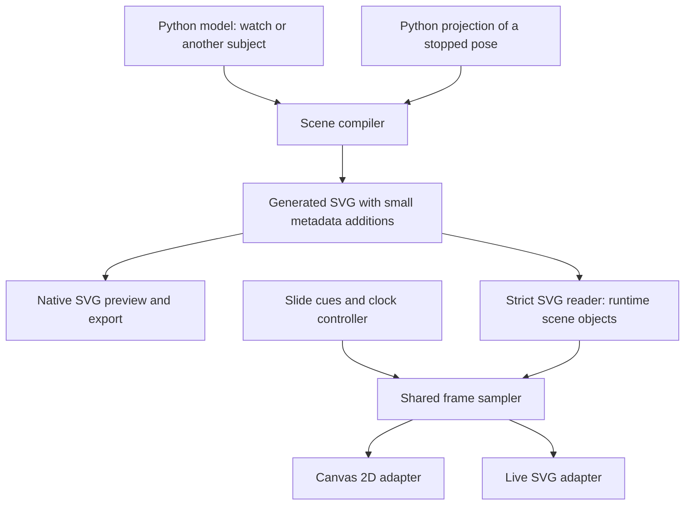
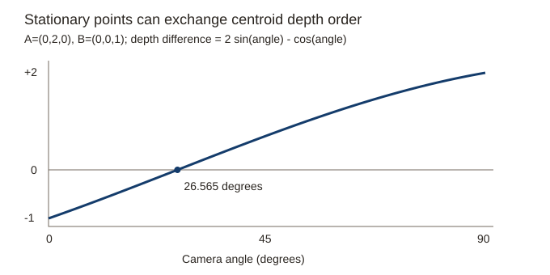

# Canvas 2D refactor: architecture plan

Prepared on 2026-09-27. Status: plan ready for review; implementation has not started.

Scope: [instructions.md](instructions.md). All new files are in this task directory.
Existing code, assets, decks, and project documentation are unchanged.

## 1. Recommended design

Use **one Python scene model and generated SVG as the shared artwork format**.
Parse the supported SVG subset once into runtime scene objects for Canvas.
Use **TypeScript for the shared player**, with small SVG and Canvas 2D adapters.
Keep geometry, animation, scene changes, and presentation timing separate from drawing.
The internal scene contract does not require a separate JSON file.
Use small SVG metadata fields for bindings and cues when needed.
Section 4 compares larger numeric supplements, embedded in SVG or stored in a separate file.

For the first 3D view, **stop the mechanism and prepare the projection in Python**.
Both browser adapters then display the same projected paths.
Do not make the Canvas adapter a general SVG implementation or a general 3D engine.

Use `Path2D` for Canvas paths. Start drawing on the main thread.
Provide a surface factory for temporary composition buffers.
Keep the data suitable for a worker, but defer worker scheduling until measurements justify it.

These choices support both renderers as alternatives. They do not depend on proving SVG too slow.
The request accepts the improvement in Firefox 157. This task does not reopen that performance decision.

| Question from the instructions                                              | Answer                                                                                                      |
| --------------------------------------------------------------------------- | ----------------------------------------------------------------------------------------------------------- |
| Read SVG, generate JavaScript, or export data?                              | Read a controlled SVG subset once. Keep geometry and animation in shared runtime objects.                   |
| Who projects 3D geometry?                                                   | Python prepares a stopped pose, visibility, and projected animation data. Both renderers consume that data. |
| Use OffscreenCanvas?                                                        | Yes, where useful for temporary surfaces. A worker is optional and deferred.                                |
| Canvg, SVG.js, or DOMParser?                                                | DOMParser plus a strict subset reader. Reconsider Canvg if broader SVG support becomes necessary.           |
| JavaScript, TypeScript, or Rust?                                            | TypeScript in the browser; Python for generation.                                                           |
| PixiJS, Paper.js, or Konva?                                                 | None for the present requirements. Their alternatives are ranked in section 10.                             |
| Use Path2D?                                                                 | Yes. Cache static paths; construct changing paths from numeric commands.                                    |
| Can SVG stop at a selected phase?                                           | Yes. This task verifies seeking and handoff in Chromium and Firefox.                                        |
| Can a stationary model keep one centre-based depth order throughout a tilt? | Not in general. The proposed sorting rule needs correction.                                                 |
| Animate the mechanism during a tilt?                                        | Defer it. This is a scope decision, not a demonstrated hardware limit.                                      |

## 2. Evidence and limits

The assessment uses frozen copies under [inputs/](inputs/).
[manifest.json](inputs/manifest.json) records their paths, sizes, hashes, and source commit.
The source commit is `1a96754c84f43d6ca4c4abf5eb4b72ac5b10adc2`.

[assess_design.py](assess_design.py) measures the files and checks the equations below.
Its results are in [assessment.json](evidence/assessment.json).

| Measured property             | Production SVG | Canvas prototype SVG |
| ----------------------------- | -------------: | -------------------: |
| File bytes                    |         46,102 |               46,767 |
| Gzip bytes, using this script |          9,031 |                9,142 |
| Drawn paths                   |             37 |                   37 |
| Drawn circles                 |             18 |                   18 |
| Drawn rectangles              |              1 |                    1 |
| Clip definitions              |              5 |                    5 |
| Rotation animations           |             11 |                   11 |
| Path animations               |              1 |                    1 |
| Part labels                   |           None | `hairspring`, `rest` |

The total is **56 drawn shapes**. The five paths inside clip definitions are additional paths.
The spring has 25 frames. Each frame has one move, 13 cubic curves, and 80 numbers.
That is 2,000 spring coordinates across the loop, or 16,000 bytes as float64 values alone.
This is a data-size calculation, not a measurement of a proposed JSON file.

The prototype player has 433 lines. Its stage has 166 lines.
Those counts exclude Vue integration, measurement tools, and the SVG generator.
These sizes support a small renderer. They do not justify a new general graphics framework.

The prior [comparison](inputs/watches/tasks/2026-09-25-canvas-2d-watch/svg-vs-canvas.md)
and [investigation](inputs/watches/tasks/2026-09-25-canvas-2d-watch/INVESTIGATION.md)
contain performance and pixel measurements. They remain historical evidence.
This task does not repeat those performance tests.
Their results do not establish the speed of exact group fades or a new SVG animation adapter.

### New browser checks

[browser_probe.py](browser_probe.py) runs [browser_probe.js](browser_probe.js)
against frozen inputs. [browser_probe.json](evidence/browser_probe.json) preserves the results.

| Check                                                         | Chromium 153.0.8010.12 | Firefox 155.0       |
| ------------------------------------------------------------- | ---------------------- | ------------------- |
| Seek the SVG to 0, 0.5, 1, 2, and 61 seconds                  | Pass                   | Pass                |
| Seek to the tight spring pose and remove its native animation | Pass                   | Pass                |
| Spring start-point displacement at that handoff               | 0 drawing units        | 0 drawing units     |
| Set a new spring path after handoff                           | Pass                   | Pass                |
| Draw SVG path syntax with Path2D in a worker                  | Pass                   | Pass                |
| Worker animation-frame callback                               | Pass                   | Pass                |
| DOMParser inside that worker                                  | Absent                 | Absent              |
| Clone Path2D with `structuredClone()`                         | `DataCloneError`       | `DataCloneError`    |
| Transfer a canvas after obtaining its context                 | `InvalidStateError`    | `InvalidStateError` |
| External page requests                                        | 0                      | 0                   |

These are headless capability checks on this Mac. They are not smoothness tests.
They do not verify installed Firefox 157, Windows, a projector, or a complete transition sequence.
The handoff check measures a path point and rotation state. It is not a full pixel comparison.

The probe also confirms four gaps in the prototype's input checks.
It accepts CSS that it does not interpret, an ignored group animation, trailing transform garbage, and decreasing key times.
These are malformed or unsupported test inputs. They are not faults observed in the existing watch artwork.
They show why an input contract needs explicit validation.

Primary web sources and dated source notes are in [SOURCES.md](SOURCES.md).
The geometry arguments below are our derivations. Library performance has not been measured in this task.

## 3. Geometry the talk can need

A useful distinction is between **shape**, **motion**, and **rendering**.
A thin spring can have a simple shape at one instant and complicated deformation over time.
Neither SVG nor Canvas can recover that shape from a line's stroke width alone.

The table covers a conventional lever watch, its case, and plausible explanatory additions.
The terminology was checked against the manufacturer's
[Sellita SW210-1 technical document](https://www.sellita.ch/scripts/calibres/images/DocTec_SW210-1_5.pdf), printed pages 5–7 and 10–15.
The geometry column is a proposed illustration model. It is not a manufacturing model of that calibre.

| Part or assembly                                      | Proposed geometry                                | Where simple extrusions need help                                                                        |
| ----------------------------------------------------- | ------------------------------------------------ | -------------------------------------------------------------------------------------------------------- |
| Barrel wall and toothed rim                           | Extruded annulus and gear outline                | Keep the barrel open for the skeleton view. Covers can be optional discs.                                |
| Barrel arbor, hub, hook                               | Coaxial cylinders and a small hook profile       | A detailed hook or bearing surface can need a chamfer.                                                   |
| Mainspring and outer attachment                       | Extruded planar band at each selected pose       | Winding changes the band. A slipping bridle depends on the selected movement.                            |
| Centre, third, fourth, and escape wheels              | Extruded profiles, including spokes and holes    | Tooth geometry comes from the model. Existing lines do not define all solid faces.                       |
| Their pinions and arbors                              | Separate gear extrusions and stepped cylinders   | Keep wheel, pinion, and shaft as separate solids in one rigid assembly.                                  |
| Minute wheel and its pinion                           | Two coaxial extrusions                           | This is a compound motion-works part, distinct from the centre wheel.                                    |
| Hour wheel and hand tube                              | Extruded gear and hollow cylinder                | Keep the tube hollow where the minute-hand assembly passes through it.                                   |
| Cannon pinion                                         | Hollow pinion, tube, and optional collar         | Its friction connection is a mechanical relationship, not a permanently rigid connection.                |
| Centre-wheel shaft and driving wheel                  | Stepped shaft and separate wheel or driver       | “Driving wheel” is ambiguous without a selected calibre. Reserve separate objects for these parts.       |
| Hour, minute, and seconds hands                       | Extruded outlines with tubular hubs              | Domed faces and curved hands can be simplified.                                                          |
| Escape wheel, pallet fork, pallet stones              | Flat extrusions at their assembly heights        | Add the fork's safety dart and guard geometry if the story needs them.                                   |
| Roller, safety roller, impulse jewel                  | Discs, cut-out profiles, and a small jewel prism | Their axial levels matter more than polished surface details.                                            |
| Banking pins                                          | Cylinders                                        | No new geometry operation is needed.                                                                     |
| Balance rim, arms, hub, weights                       | Extruded profiles and cylinders                  | Screwed balances can add repeated screw objects.                                                         |
| Flat hairspring                                       | Planar band extruded through its height          | A zero-thickness ribbon is a useful first approximation, but it omits the narrow top face.               |
| Hairspring collet, stud, stud holder                  | Rings, prisms, and short cylinders               | Model attachment locations explicitly.                                                                   |
| Regulator, curb pins, regulator spring                | Thin profiles and cylinders                      | A bent terminal curve or overcoil needs a spatial curve.                                                 |
| Balance staff and other axles                         | Several coaxial cylinders                        | Tapered pivots and rounded shoulders need a surface of revolution or an approximation.                   |
| Hole jewels and cap jewels                            | Rings and discs                                  | Rounded or olive-shaped bearing holes need curved surfaces for close technical views.                    |
| Shock setting, retaining spring, and chaton           | Rings and thin spring profiles                   | Some retaining springs bend out of plane.                                                                |
| Main plate, bridges, cocks, dial                      | Extruded profiles with holes and stepped pockets | Engraving and bevels are optional detail. Different heights need separate solids.                        |
| Screws, washers, spacers, dial feet                   | Cylinders, discs, and slotted heads              | Omit helical threads unless they are the subject.                                                        |
| Ratchet wheel, click, click spring                    | Gear profile, lever profile, and flexible strip  | The spring deforms; it is not only a rigid rotating object.                                              |
| Crown wheel and intermediate winding wheels           | Gear profiles and stepped hubs                   | Right-angle engagement can require face or bevel teeth. A spur extrusion is only an approximation there. |
| Crown and winding stem                                | Stepped cylinders, square sections, grooves      | Crown knurling, threads, tapers, and rounded ends are not single extrusions.                             |
| Winding pinion                                        | Cylinder plus appropriate tooth geometry         | Face or contrate teeth are a main exception to the extrusion-only proposal.                              |
| Sliding pinion or clutch                              | Coaxial body, groove, and toothed ends           | Axial sliding is simple motion. Clutch tooth faces can require shaped wedges or a mesh.                  |
| Setting lever, yoke, setting wheel                    | Flat profiles and gear extrusions                | Pins, slots, and contact heights need explicit geometry.                                                 |
| Setting lever jumper and yoke spring                  | Thin spring profiles                             | Some designs combine them; others use separate springs.                                                  |
| Corrector lever and corrector wheel                   | Profiles, pivots, and gear extrusions            | Their purpose depends on the calendar and keyless-work design.                                           |
| Stop-seconds lever, detent fittings, retaining pieces | Thin profiles and pins                           | A wire or bent lever can need a swept curve.                                                             |
| Date ring, date driver, jumper, calendar plates       | Annular and flat profiles                        | Their motion is a separate model concern. They are optional for this talk.                               |
| Automatic rotor, reversing wheels, reduction train    | Extrusions and stepped hubs                      | Bearings, pawls, and one-way clutches add mechanism rules. They are optional.                            |
| Case, bezel, lugs, strap, crystal                     | Extrusions and simple revolved sections          | A domed crystal and curved case surfaces need curved geometry.                                           |

**Conclusion:** extrusions cover the principal explanatory parts, but not every possible watch part exactly.
The main exceptions are shaped winding teeth, tapered or rounded bearings, bent springs, overcoils, threads, and domed surfaces.

Do not add all those operations to the first browser renderer.
Keep a small authoring vocabulary: `Profile`, `Extrusion`, `RigidAssembly`, and `DeformableBand`.
Allow a later `RevolvedProfile` or triangle-mesh input to the offline projection step.
The 2D adapters still receive paths, paint, and order.

Choose the fidelity for each explanatory view:

1. **Extrusions and stepped cylinders:** first choice for the train, motion works, and most levers.
2. **A few explicit wedges, revolved surfaces, or swept strips:** for details that carry the explanation.
3. **A full mechanical CAD model:** only if dimensional or contact accuracy becomes a requirement.

The first choice has the smallest authoring vocabulary. The second covers the named exceptions without changing the display adapters.
The third adds detail that a 15–20 minute talk does not currently need.

Keep physical connections on the objects. A gear can reference its driven gear and its rigid assembly.
Keep the cannon pinion's friction coupling separate from a rigid shaft connection.
Positions and evaluated rotations belong in a per-run table keyed by those objects.

## 4. Input format and source of truth

The current generator mixes geometry calculations with SVG strings.
Extract geometry and animation objects while preserving the SVG output.
Keep three decisions separate: the Python model, the exported format, and the browser's runtime objects.
Both an SVG reader and a JSON reader can produce the same runtime objects.

| Rank | Option                                                            | Advantages                                                                                                       | Costs and limits                                                                                                   |
| ---- | ----------------------------------------------------------------- | ---------------------------------------------------------------------------------------------------------------- | ------------------------------------------------------------------------------------------------------------------ |
| 1    | Python scene model → SVG → strict subset reader                   | One required artwork format. Native preview and Canvas use the same asset. Builds on the prototype.              | We own the supported SVG semantics, numeric conversion, and validation.                                            |
| 2    | Python scene model → SVG and a complete versioned JSON scene      | Explicit numbers, tracks, and references. Canvas can load JSON without SVG parsing, including inside a worker.   | Adds a writer, schema, asset, and checks that both outputs agree.                                                  |
| 3    | SVG plus supplemental Canvas data, embedded or in a separate file | Keeps SVG geometry and tooling. Can supply prepared matrices, numeric morph frames, and extra scene information. | Retains SVG parsing and adds a second data contract. Duplicate values need agreement checks.                       |
| 4    | Python → executable drawing JavaScript                            | Avoids a general data loader. Can emit direct drawing calls.                                                     | Couples assets to runtime functions. Complicates inspection, validation, worker transfer, and alternate renderers. |
| 5    | Separately authored SVG and Canvas assets                         | Each can use its renderer freely.                                                                                | Duplicates geometry and animation decisions. It is the most likely option to drift.                                |

Choose **option 1** for the requested architecture, including reuse beyond this watch.
The earlier draft ranked JSON first because it confused an explicit runtime model with a separate export format.
SVG input does not prevent that model.

### Why SVG ranks first

The generator controls the input vocabulary.
It can emit fixed units, explicit paints, simple transforms, and a bounded animation subset.
The reader need not interpret arbitrary editor output or the full CSS cascade.
Parse shapes, groups, clips, transforms, and tracks once at load time.
The frame loop then uses numeric objects and renderer caches, without traversing XML.

SVG is already required for native rendering, inspection, stills, and export.
Using it for Canvas avoids a second complete scene writer and a second artwork asset.
The same file also provides a native rendering reference for Canvas comparisons.
The existing prototype supplies a starting point, although its validation needs work.
Its 433 lines include drawing and animation code; a JSON loader would not remove all of that code.

Pan, zoom, fades, scene changes, and phase-controlled stopping belong to the shared player.
Their implementation does not require JSON input.
Python can encode a stopped 3D projection as ordinary SVG paths and morphs.
Small metadata fields can supply part bindings, views, cues, and visibility intervals that SVG does not express directly.

The cost is a maintained SVG subset reader.
It must resolve inherited paints, transform order, clip references, and supported animation semantics.
Unsupported features must produce clear errors.
Converting the input to runtime objects is still necessary with JSON, but its numeric records need less interpretation.

### When a complete JSON scene becomes worthwhile

Option 2 provides numbers, matrices, morph arrays, and integer references directly after JSON parsing.
It can omit SVG syntax and DOM access from the Canvas loading path.
It also gives browser simulations and projection coefficients a natural representation.
Two generated files remain one authored source when one Python model produces both.

However, this option adds a schema, writer, loader validation, and cross-output checks.
It does not remove the shared sampler, clipping, group composition, or visibility work.
With equivalent runtime objects, changing the input format does not itself change per-frame drawing costs.

The current SVG has 56 drawn shapes and 12 animations.
It occupies 46,102 bytes, or 9,031 bytes with the measured gzip settings.
This task has not measured an SVG loading bottleneck or a JSON loading advantage.
Retain the loader boundary so a future JSON reader can create the same scene objects.
Reconsider option 2 if substantial non-SVG data or measured loading costs justify its extra contract.

### Option 3: supplemental data inside SVG or in a separate file

**Yes, SVG can carry data that native rendering ignores and our loader recovers.**
Use `data-*` attributes for small values attached to a group or shape.
Use a `<metadata>` element for a larger document-level payload.
SVG defines metadata as non-rendered content and permits custom data attributes on SVG elements.
See the [metadata definition](https://www.w3.org/TR/SVG2/struct.html#MetadataElement)
and [custom data attributes](https://www.w3.org/TR/SVG2/struct.html#DataAttributes).
Our CSS and scripts must not give these attributes unintended drawing effects.

Attribute values still return strings through [`getAttribute()`](https://developer.mozilla.org/en-US/docs/Web/API/Element/getAttribute).
For example, `data-canvas-matrix="[1,0,0,1,40,60]"` needs JSON parsing before use.
Neither XML attributes nor a JSON file hold live object references or native typed arrays.
JSON supplies numeric values after parsing; integer references still need validation and resolution.
Embedding JSON avoids SVG-specific number-list and path grammars for that payload, but does not remove serialization.

Distinguish two kinds of supplemental data:

| Kind                                         | Examples                                                                        | Consequence                                                                                       |
| -------------------------------------------- | ------------------------------------------------------------------------------- | ------------------------------------------------------------------------------------------------- |
| Additional model or presentation information | Part membership, views, phase markers, extrusion heights, visibility intervals. | Extends SVG without repeating its drawing data. Small additions fit option 1.                     |
| Prepared copies of drawing data              | Resolved local matrices, numeric morph frames, resolved clip references.        | Reduces SVG interpretation for those fields. Both representations must describe the same drawing. |

Option 3 here means a substantial companion contract, especially prepared copies of drawing data.
Small labels or cues do not require a second complete scene format.
If the companion becomes a complete scene, it becomes option 2, whether embedded or stored separately.

#### A possible embedded representation

Use short numeric bindings on SVG elements and one JSON block for arrays and records.
This example shows a local matrix and a two-frame path morph.
It illustrates packaging, not a final schema.

```xml
<svg xmlns="http://www.w3.org/2000/svg"
     xmlns:scene="urn:stem:scene-data"
     viewBox="0 0 200 120">
  <metadata>
    <scene:data>
      {
        "version": 1,
        "transforms": [
          {"target": 0, "localMatrix": [1, 0, 0, 1, 40, 60]}
        ],
        "morphs": [
          {
            "target": 1,
            "commands": ["M", "L"],
            "keyTimes": [0, 1],
            "duration": 2,
            "repeat": "indefinite",
            "frames": [[0, 0, 40, 0], [0, 0, 40, 10]]
          }
        ]
      }
    </scene:data>
  </metadata>
  <g data-scene-node="0" transform="translate(40 60)">
    <path data-scene-node="1" d="M0 0L40 0" fill="none" stroke="black">
      <animate attributeName="d"
               values="M0 0L40 0;M0 0L40 10"
               keyTimes="0;1" dur="2s" repeatCount="indefinite"/>
    </path>
  </g>
</svg>
```

Parse this asset as `image/svg+xml` with DOMParser.
Read the custom element's `textContent`, parse its JSON, and validate the result.
Resolve the numeric bindings to scene objects once.
For the live SVG adapter, import or clone the parsed elements and preserve their namespaces.

The custom XML namespace follows SVG's metadata guidance.
Direct HTML parsing handles custom namespace prefixes differently; do not assume it preserves this XML structure.
See [foreign namespaces and private data](https://www.w3.org/TR/SVG2/struct.html#ForeignNamespaces).
Use an XML writer to escape JSON text correctly.
In text content, characters such as `&` and `<` need XML escaping.
Attributes also require escaping their quote delimiter.
The [XML syntax rules](https://www.w3.org/TR/xml/#syntax) define these requirements.

The native SVG still needs its ordinary transform, path, and animation attributes.
The prepared matrix and frames therefore repeat generated values.
Generate both representations from the same Python objects in one build.
Do not maintain either copy by hand.

#### Embedded payload versus a separate JSON file

| Consideration             | JSON inside SVG metadata                                                                   | Separate JSON file                                                                                               |
| ------------------------- | ------------------------------------------------------------------------------------------ | ---------------------------------------------------------------------------------------------------------------- |
| Asset handling            | One asset to copy, fetch, cache, and package for offline use.                              | Two assets to package and load when both are needed.                                                             |
| Version matching          | One response contains matching SVG and supplemental data from the same build.              | Loader must detect mismatched files after partial builds or stale caching.                                       |
| Native SVG use            | Normal SVG viewers still display the artwork. They also receive the unused payload.        | Native SVG use can omit the Canvas payload.                                                                      |
| Optional large data       | Every SVG load carries the payload, even when the scene never uses it.                     | Load large projection or morph data only when needed.                                                            |
| Parsing                   | XML parsing followed by JSON parsing. Small attributes need their own conversions.         | Direct JSON parsing for the supplement; SVG parsing remains necessary for the rest of the scene.                 |
| Worker loading            | Parse XML on the main thread, then send plain descriptors to the worker.                   | Worker can fetch JSON directly. A partial supplement still needs the SVG-derived scene descriptors.              |
| Inspection and validation | Artwork and data travel together, but JSON tools must first extract the payload.           | JSON tools can inspect and validate the file directly. SVG remains a separate visual reference.                  |
| Editing and optimization  | An SVG optimizer can remove metadata or alter geometry without updating the prepared data. | SVG optimization can still break bindings or invalidate prepared data. The JSON payload itself remains separate. |
| Caching after changes     | A change to either representation invalidates the combined asset.                          | Separate caching can help when only one file changes. Coupled geometry changes usually invalidate both.          |
| Format complexity         | One file still contains two logical contracts. XML escaping adds a serialization step.     | Two files, two contracts, and an explicit association between them.                                              |
| Frame rendering           | Same cost after loading into the shared scene objects.                                     | Same cost after loading into the shared scene objects.                                                           |

Metadata preservation needs an explicit build rule.
For example, SVGO supplies a [`removeMetadata` plugin](https://svgo.dev/docs/plugins/removeMetadata/).
Keep the required metadata and bindings, and check them after any optimization step.
Embedding prevents mismatched file delivery; it does not prevent an editor from making the two representations disagree.

The current spring already contains 2,000 coordinates in SVG animation values.
An added numeric frame array would repeat those 2,000 coordinates.
Their 16,000-byte float64 size does not predict JSON text size, compressed size, or loading time.
Measure those values before accepting duplicate frames as a performance optimization.
This task has not implemented or benchmarked either packaging option.

#### Rules shared by both packaging choices

Define a schema version, coordinate units, matrix order, and transform composition rules.
Store resolved **local** matrices for fixed transforms.
An animated ancestor changes a world matrix; one stored world matrix cannot represent all later frames.
Keep animation replacement and accumulation semantics explicit.

Generate native attributes and prepared records from the same values and rounding policy.
Use build checks to compare matrices, morph topology, key times, and sampled poses.
Reject invalid bindings, non-finite coordinates, and unsupported schema versions.
For separate files, include a shared generation identifier derived from the canonical scene data.
Reject a pair with different identifiers.

Treat prepared copies as derived data, not another authored model.
If the payload is optional, its absence can select the strict SVG parsing path.
If a required feature needs supplemental data, fail clearly when that data is absent or invalid.
Resolve references to objects before the frame loop, in either packaging.

#### Packaging ranking within option 3

1. **One JSON block in `<metadata>`, with small `data-*` bindings on elements.**
   Prefer this for a modest supplement that always accompanies the drawing.
   It keeps asset delivery simple and avoids large arrays in attributes.
2. **A separate versioned JSON file.**
   Prefer this when data is large, optional, or independently useful to a worker.
   Require version matching and package both files for offline use.
3. **Large JSON arrays distributed across SVG attributes or custom XML records.**
   These are possible, but add many conversions or verbose XML structures.
   Small per-element scalar values remain useful; bulk morph data fits one JSON block better.

Option 3 remains third overall because extensive prepared data combines SVG parsing with another drawing-data contract.
Start with option 1 and small metadata additions.
Use this hybrid only when a specific supplement saves enough work to justify its contract.
If Canvas needs an almost complete numeric scene, option 2 gives it one direct loading path.

### Internal scene contract

Use this contract after loading, regardless of the asset format.
Use ordinary versioned JSON if a supplemental or complete numeric export becomes necessary.
Add typed-array or binary storage only if a measured projection asset becomes large.

| Data            | Representation and rule                                                                                                |
| --------------- | ---------------------------------------------------------------------------------------------------------------------- |
| Scene           | Bounds, ordered root nodes, parts, tracks, and views.                                                                  |
| Node            | Group or shape. A group owns ordered children, a local transform, and an optional clip.                                |
| Path            | Static SVG `d` at the output boundary; numeric commands for morph tracks. Python holds geometry objects before output. |
| Paint           | Numeric colour and alpha, with an explicit absent-paint value. Format CSS strings only when drawing or writing SVG.    |
| Transform       | Six affine coefficients, or an explicit rotation track. Define composition and replacement separately.                 |
| Clip            | Path, fill rule, and explicit local coordinate space. Start with `userSpaceOnUse` semantics.                           |
| Part            | Identity, display name, and links to its visual nodes. A semantic assembly can own several paint groups.               |
| Track           | Target object, property, key times, numeric values, interpolation, duration, and repeat policy.                        |
| View            | Camera and object references to visible parts. No CSS-text parsing.                                                    |
| Projection clip | Projected geometry tracks, discrete visibility/order intervals, pose reference, and supported visibility recipe.       |
| Cue             | A reference to a view, scene, or transition. No renderer-specific timer callback.                                      |

Use integer table indices for references in our supplemental data.
Resolve those indices and native SVG fragment references to objects once during loading.
Runtime algorithms use object references and `Map<Object, Value>` side tables.
Display names are for inspection and reports. Do not use a part-name dictionary or repeated name searches.

Bind slides to view objects in a typed presentation module.
If slide metadata must carry a reference, generate an integer reference at the serialization boundary.
Do not preserve the prototype's `.find(candidate.name === value)` as the runtime design.

Keep fixed scene data separate from evaluated state:

- Fixed objects: nodes, paths, parts, clips, track definitions, and assembly connections.
- Frame state: mechanism time, camera, part opacity, local transforms, and current path coordinates.
- Renderer caches: `Path2D` objects, SVG element references, and temporary surfaces.
- Controller state: active scene, cue, clock anchors, transition state, and cancellation generation.

A frozen configuration value holds durations, tolerances, and size limits.
Functions receive that configuration. They do not read module attributes that callers change.

### Small supported subset

Support groups, paths, circles, rounded rectangles, affine transforms, solid paints, clips, and exact group opacity.
Support linear numeric keyframes, scalar easing, path morphs with fixed topology, and explicit step/hold intervals.
Preserve the current 2-second accumulation and 60-second loops.
Specify endpoint behavior, including seeking across a repeat boundary.

Prefer explicit presentation attributes in generated SVG.
Resolve the supported inherited attributes once during loading. Do not implement the CSS cascade.
The initial refactor must preserve existing SVG bytes before changing how the writer emits inherited attributes.
Reject unsupported units, non-finite numbers, invalid references, invalid durations, and decreasing key times.
Reject mismatched morph commands and unsupported transform combinations.

The SVG reader must validate every element and attribute placement.
Reject unhandled styles, animation children, and unconsumed transform text.
Allow only the declared application metadata and binding attributes as extensions.
DOMParser checks markup syntax; it does not check these semantics.

Text and slide controls stay in HTML or SVG overlays. Part picking stays out of scope.
Do not add gradients, filters, masks, or text layout to the common subset without a concrete use.

The shared subset is a baseline, not a promise that every future feature works in both renderers.
A scene can declare an additional renderer capability and provide an explicit fallback still or alternate scene.
Unsupported features must fail clearly. They must not disappear silently.

## 5. Browser architecture and scene switching



The sampler produces one frame description from explicit state.
Canvas draws that frame. SVG updates its bound elements from the same frame.
The sampler does not contain watch-specific equations.
Model code supplies the tracks or deformation functions.

The target SVG adapter clones the parsed SVG tree once and binds its elements to scene objects.
It keeps those object-to-element links and updates the elements in place.
Remove or disable native animation in that live copy before the shared sampler takes control.
The unmodified standalone SVG remains the native comparison reference and export artifact.
Both adapters use the same loaded artwork; only the selected adapter remains active.

| Boundary       | Responsibility                                                                                      |
| -------------- | --------------------------------------------------------------------------------------------------- |
| Compiler       | Geometry, animation objects, validation, SVG output, optional metadata, and projection preparation. |
| SVG reader     | Validate the subset and convert attributes, tracks, and references to runtime objects once.         |
| Sampler        | Evaluate tracks and cue state for a requested time. No DOM access.                                  |
| Controller     | Select scenes, advance clocks, handle transitions, and cancel obsolete actions.                     |
| Canvas adapter | Paths, clips, composition, backing-store sizing, and renderer caches.                               |
| SVG adapter    | Element creation or binding, attributes, paint order, and group opacity.                            |
| Slidev adapter | Navigation, mounting, hidden pages, presenter panes, overview, and export.                          |

Use one persistent stage for the live slide view.
Within it, a `SceneInstance` owns its playback state and renderer resources.
Switching to the ruler changes the active instance. It does not replace the controller.

For the first switch, use **fade out → activate the new scene → fade in**.
This avoids displaying two complex scenes at once.
A later crossfade can use two scene surfaces, each composed at its own opacity.

Give every scene an explicit hidden-time policy:

- `freeze`: save the local time and resume from it. Use this for the watch during the ruler explanation.
- `continue`: derive local time from the clock when the scene returns.
- `reset`: start the scene's declared entry pose on each visit.

These are policy values, not names used to locate scene objects.
Stop drawing hidden scenes. Pausing drawing and pausing the model clock are separate operations.
Dispose of obsolete animation frames and observers when an instance is removed.

Choose the renderer before mounting a scene. Keep only the chosen adapter active.
A deck-level option can select SVG or Canvas for comparison and fallback.
Do not switch renderers in the middle of a camera move in the first implementation.

### Ruler scene

The ruler needs a clamp, desk edge, strip, and deformation track.
Slide cues can press, hold, and release the strip. No part click or hover support is needed.

A first teaching model can use a normalized cantilever shape:

$$
\xi=x/L,\qquad w(x,t)=q(t)\frac{\xi^2(3-\xi)}{2}.
$$

It fixes position and slope at the clamp and gives tip displacement $q(t)$.
After release, an initial example can use $q(t)=q_0\cos(\omega t)$.
This is a qualitative single-coordinate illustration, not a full beam simulation.
The renderer receives changing paths. It does not know what a ruler is.

The same boundary serves a train, interferometer, or lunar lander.
Their model code supplies motion or simulation state. The renderer supplies paths, camera, and composition.
Do not build those additional models in this refactor.

## 6. Animation phase and the stop sequence

**SVG can do the requested handoff.** It does not need Canvas to identify or control the phase.

For inline SVG with SMIL, the root exposes `getCurrentTime()`, `pauseAnimations()`, and `setCurrentTime()`.
Animation elements expose their start time and simple duration.
JavaScript can derive the phase from those values and the known track.
SMIL has begin/end methods, but no general “spring at maximum” event.
See the [SVG root API](https://developer.mozilla.org/en-US/docs/Web/API/SVGSVGElement)
and [animation interface](https://svgwg.org/specs/animations/#InterfaceSVGAnimationElement).

For CSS or Web Animations, use the corresponding animation object's
[current time](https://developer.mozilla.org/en-US/docs/Web/API/Animation/currentTime)
and [computed timing](https://developer.mozilla.org/en-US/docs/Web/API/AnimationEffect/getComputedTiming).
Do not assume those APIs expose the watch's SMIL animations.
An SVG inside an ordinary `` also does not provide the same element access as inline SVG.

### Clock choice

| Rank | Approach                                                 | Benefit                                                      | Cost                                                                      |
| ---- | -------------------------------------------------------- | ------------------------------------------------------------ | ------------------------------------------------------------------------- |
| 1    | Shared TypeScript sampler controls both live adapters    | One definition of pause, seek, handoff, reverse, and export. | SVG needs per-frame attribute updates. Its performance needs measurement. |
| 2    | Native SMIL loops; shared controller coordinates handoff | Preserves current native playback between cues.              | Must synchronize two animation mechanisms and define ownership transfers. |
| 3    | Independent SVG and Canvas controllers                   | Each can use local conveniences.                             | Duplicates phase rules and makes drift likely.                            |

Use option 1 as the target. Keep option 2 available during migration and as a measured optimization.
The standalone generated SVG can retain SMIL for independent playback.
In a live SVG instance controlled by the shared sampler, remove or disable those animation elements before writing attributes.
Never let SMIL and the sampler write the same property at once.
Do not seek the entire SVG on every frame merely to animate one spring.

The current generated SVG should remain byte-identical during the initial model extraction.
A later change to its animation or binding metadata must be a separate, explicit output change.

### The watch's actual phase

The generator defines the balance angle as

$$
q(t)=150^\circ\cos(2\pi t/T),\qquad T=2\,\mathrm{s}.
$$

The spring's inner angle contains $+q$. Its outer angle stays fixed.
Thus the **tightest** pose has $q=-150^\circ$, at $t=1\,\mathrm{s}$ modulo $2\,\mathrm{s}$.
The positive angle at $t=0$ is the loosest pose.
The corresponding nominal turn counts are $3.6667$ and $2.8333$.
The rest pose has $3.25$ turns.
These values come from the [frozen generator](inputs/watches/art/skeleton_watch.py), not from a general watch convention.

For a requested mechanism time $t_r$, the next tight pose is

$$
t_b=\phi+T\left\lceil\frac{t_r-\phi}{T}\right\rceil,
\qquad \phi=T/2.
$$

Accept the current boundary if the request already lands there.
Specify a small numeric tolerance at implementation time.
Waiting for this particular extreme can take almost $2$ seconds.
If either extreme is acceptable, the maximum wait is almost $1$ second.

Detect a crossed boundary between the previous and current times.
Do not wait for floating-point equality or use a timer as the source of truth.
If a frame arrives late, evaluate the new segment at the elapsed time after the boundary.
Do not display one frame beyond the boundary and then snap back.

### Quadratic velocity means cubic position

Let $u=(t-t_b)/\tau$, clamped to $[0,1]$.
For a move from the tight value $q_b$ to the rest value $q_r$, use

$$
q(u)=q_b+(q_r-q_b)(3u^2-2u^3),
$$

$$
\dot q(u)=\frac{q_r-q_b}{\tau}6u(1-u).
$$

The velocity is quadratic and is zero at both ends.
A quadratic **position** curve cannot give both endpoint velocities zero while making a nonzero move.
The script checks the endpoints and intermediate values for an illustrative $\tau=0.8\,\mathrm{s}$.
That duration is a proposed setting, not an observed preference.

Use an explicit rest geometry. Do not assume that averaging the two extreme path strings gives the physical rest shape.
For this drawing, the generator already computes a zero-angle spring frame.

The existing loop interpolates 25 frames linearly. It approximates the cosine but has a corner at each extreme.
Its one-sided angular speed near an extreme is about $61.33^\circ/\mathrm{s}$, not zero.
The handoff can therefore preserve position today, but cannot claim exact velocity continuity.

First preserve the existing artwork and record this limitation.
When implementing the teaching transition, use a smooth shared oscillator or explicitly eased segments near the extreme.
Check both adapters against the same coordinate samples.
Treat any change to the existing loop as a separate behavior change.

### State sequence

Use explicit states:

`running → zooming → fading-context → waiting-for-tight-pose → settling → resting`.

The camera and fade keep their existing order: zoom first, then fade the context.
After the context is hidden, wait for the spring boundary and settle it.
Freeze the connected mechanism at that boundary.
Use a separate teaching deformation for the isolated spring.
This avoids implying that the train continues to run while its balance is disconnected.

To restore the full mechanism, move the isolated spring back to the saved boundary pose.
Then resume the saved mechanism clock and reveal the other parts.
The watch can stay frozen while the ruler scene is active.

If navigation changes during any state, cancel obsolete actions and sample the current visible state.
Build the next transition from that state. Do not let an old fade callback activate the wrong scene.
Use a generation token for pending asynchronous work.
Define direct navigation and export as immediate evaluation of a declared pose and view.

## 7. Pan, zoom, fades, and occlusion

### Camera

Keep the existing camera law: translation and scale share one eased fraction.
Retain the 1.8-second move and 0.8-second context fade until a separate design change chooses different values.
The current detail view scales by $250/56\approx4.4643$.

Represent camera transforms as numbers, not CSS text.
Use one declared logical viewport and preserve its aspect ratio.
Apply the camera to the geometry every frame.
Size Canvas to its displayed device pixels, including Slidev's host transform and device-pixel ratio.
The backing store follows the viewport size, not the camera zoom factor.

Continue the established stroke rule: divide the model stroke by the camera scale.
The base drawing therefore keeps its stroke ladder as the camera zooms.
This compensates the camera only. Non-uniform object deformation needs its own stroke policy.
For projected 3D views, stroke the final visible contours at the declared screen width.

### Group opacity

Use SVG's composition semantics as the common contract.
A group renders its children first, then applies its opacity to their combined image.
This differs from changing every child's opacity.
The distinction is defined by the [SVG rendering model](https://www.w3.org/TR/SVG2/render.html#ObjectAndGroupOpacityProperties).

For two overlapping opaque shapes at opacity $a=0.5$, per-shape composition gives

$$
1-(1-a)^2=0.75.
$$

An isolated group gives $0.5$.
The browser probe measures alpha values 192 and 128 respectively in both browsers.
This is why hidden internal contours can appear during the prototype's fade.

| Rank | Fade method                                           | Benefit                                   | Cost                                                                         |
| ---- | ----------------------------------------------------- | ----------------------------------------- | ---------------------------------------------------------------------------- |
| 1    | Temporary isolated surface for each faded paint group | Matches SVG composition.                  | Extra drawing and memory during partial opacity.                             |
| 2    | Deliberate per-shape alpha                            | Small implementation and no group buffer. | Changes the picture. Requires an explicit visual decision.                   |
| 3    | Merge all fading parts into two layers                | Few temporary surfaces.                   | Changes overlap between parts. It does not reproduce independent SVG groups. |

Choose option 1. Reuse scratch surfaces between non-nested groups.
Nested isolated groups need a surface stack, not one buffer that is overwritten recursively.
Expand bounds for strokes and antialiasing. Clip buffers to the viewport where possible.
At opacity zero, skip drawing. At opacity one, draw directly when no isolation effect remains.

One uncompressed RGBA surface needs approximately:

| Device-pixel dimensions | Storage, before browser overhead |
| ----------------------- | -------------------------------: |
| $1920\times1080$        |                         7.91 MiB |
| $3456\times1950$        |                        25.71 MiB |
| $3840\times2160$        |                        31.64 MiB |

These estimates exclude duplicate buffers and native graphics overhead.
Use bounded temporary surfaces and measure the fade, including nested groups.
Do not allocate a permanent full-screen canvas for every watch part.

### Visibility and physical hiding

A semantic assembly is not necessarily one contiguous paint group.
For example, a shaft, wheel, and pinion may occupy different levels.
Keep the assembly identity separate from the order of its visual nodes.
Independent opacity on interleaved 3D surfaces needs a declared composition policy.
Arbitrary transparent 3D solids are outside the first implementation.

The existing clips encode hidden regions, not only physical holes.
If an upper wheel disappears, a visibility-dependent clip beneath it must also change.
Keep intrinsic holes separate from clips that reference an occluding part.
For new part fades, prefer normal alpha composition: lower geometry appears as the upper part fades.
Where possible, express occlusion with complete lower geometry and opaque upper faces.
Use separate knockout faces where a decorative wash must cover lower contours.
Reserve permanent clips for intrinsic holes and declared cutaways.
Convert visibility-dependent clips when adding those views, after the output-preservation stage.
Verify the result at half opacity as well as at the endpoints.

Use ordinary clipping by default.
The prototype's `destination-out` optimization erases previous destination pixels too.
It is only equivalent under additional geometric conditions.
The [prior comparison](inputs/watches/tasks/2026-09-25-canvas-2d-watch/svg-vs-canvas.md)
records that limitation. A general reusable renderer should not depend on today's empty wheel holes.

## 8. Orthographic 3D and depth order

### Coordinate convention

Let $x,y$ lie in the watch plane. Let $z$ be height above that plane.
At $\theta=0$, the camera looks down the $z$ axis.
At $\theta=90^\circ$, it looks from the positive $y$ side, which is the bottom of the top view.
Use

$$
X=x,\qquad Y=y\cos\theta-z\sin\theta,
\qquad D=y\sin\theta+z\cos\theta.
$$

Larger $D$ is nearer the camera.
The sign convention can be reversed, but both adapters and all assets must use the same one.

### What remains fixed, and what does not

For two stationary points,

$$
\Delta D(\theta)=\Delta y\sin\theta+\Delta z\cos\theta.
$$

If $\Delta y$ and $\Delta z$ have opposite signs, their depth order can exchange within the tilt interval.
For $A=(0,2,0)$ and $B=(0,0,1)$, the exchange is at

$$
\theta=\arctan(1/2)\approx26.565^\circ.
$$



This disproves the proposed invariant **centre-depth sort**.
It does not, by itself, prove a visible occlusion error: the two points need not overlap on screen.
A restricted assembly can still have a valid fixed paint order.
That order needs a geometric argument, not a sort of its centres at one angle.

There is a second problem: centre sorting can be wrong at a single angle.
The script checks two disjoint vertical strips, both with $0\le z\le3$:

- Strip A follows $y=x$ for $0\le x\le10$.
- Strip B follows $y=8$ for $9\le x\le10$.

At $45^\circ$, their centroid depths are 4.596 and 6.718, so a centre sort puts B in front.
At the shared screen point $(X,Y)=(9.5,5)$, their depths are 8.435 and 6.314.
**A is actually in front there.** Both points lie within their strips' height range.
This is an overlap counterexample, not only a reversal of non-overlapping centres.

Some useful simplifications do hold for stationary straight extrusions.
For a vertical side face, the normal has $n_z=0$.
Its facing sign is therefore the sign of $n_y\sin\theta$.
That sign stays fixed for $0<\theta<90^\circ$.
Horizontal caps also keep their facing sign within that open interval.
Chamfers, tilted faces, and moving parts need separate treatment.
The exact endpoints have degenerate projected faces and need explicit rules.

### The proposed hairspring strips

For a zero-thickness ribbon whose height runs from $z_0$ to $z_0+h$, the two edges are

$$
Y_0(s)=y(s)\cos\theta-z_0\sin\theta,
\qquad Y_1(s)=Y_0(s)-h\sin\theta.
$$

Thus the top and bottom curves differ by a constant screen translation.
The end connectors are vertical on screen.
The proposed curve construction is correct under those assumptions.
Affine projection also preserves cubic Bézier curves: project their control points.

Split the planar curve where $dx/ds=0$.
Each resulting piece is monotonic in $x$, apart from its boundary extrema.
For an Archimedean spiral with $r=a+b\alpha$,

$$
\frac{dx}{d\alpha}=b\cos\alpha-r\sin\alpha.
$$

The roots are not exactly $180^\circ$ apart.
Use the actual curve extrema, not fixed half-turn angles.

At a common screen position and any $0<\theta\le90^\circ$, substitute
$z=(y\cos\theta-Y)/\sin\theta$ into the depth formula:

$$
D=\frac{y-Y\cos\theta}{\sin\theta}.
$$

Therefore the nearer ribbon branch has the larger $y$ **at that same $x$**.
For disjoint monotonic branches, compare $y(x)$ over their shared interval.
Build ordering constraints from those overlaps and find an order that satisfies them.
If a consistent order exists, it works throughout this restricted tilt.
Do not substitute the depth of each branch's centre for that comparison.

This is a promising small solution for the isolated, stationary, flat spring.
The script proves the centre-sort limitation; it does not yet implement or certify the watch's complete ribbon ordering.
That certification belongs to the first 3D implementation milestone.

Finite ribbon thickness adds two offset side surfaces, a narrow top surface, and end caps.
An overcoil breaks the planar assumption.
At $\theta=0$, a zero-thickness ribbon has zero projected face area; retain the existing contour there.
At $90^\circ$, avoid duplicate coplanar faces and unstable tie-breaking.
Use stable face identities and explicit endpoint poses.

Do not stroke every polygon edge.
Splitting a ribbon for visibility must not create visible seams between its pieces.
Draw fills for the pieces and a separate set of visible physical contours.
Hide contours behind opaque surfaces. A pale translucent wash cannot hide a line beneath it.

### Who computes the projection?

| Rank | Approach                                                                   | Advantages                                                                                       | Costs and limits                                                                                       |
| ---- | -------------------------------------------------------------------------- | ------------------------------------------------------------------------------------------------ | ------------------------------------------------------------------------------------------------------ |
| 1    | Python prepares projected paths and visibility intervals for stopped poses | One visibility implementation. Both renderers consume the same 2D data. Easy to inspect offline. | Fixed pose and camera domain. Asset size can grow.                                                     |
| 2    | Python prepares visibility; the browser evaluates projection coefficients  | Exact smooth geometry with compact coefficients. Still shares visibility work.                   | Adds a projection evaluator to the common sampler. Cannot fix an invalid visibility schedule.          |
| 3    | Browser projects and resolves visibility each frame                        | Allows unrestricted poses and camera movement.                                                   | Owns splitting, ordering, contours, and degeneracies at runtime.                                       |
| 4    | Pre-rendered raster frames or video                                        | Small playback implementation. Can use an established offline renderer.                          | Resolution, fading of separate parts, deterministic seeking, and vector export become less convenient. |

Choose option 1 for the first stopped spring tilt.
Keep option 2 as an optimization if sampled paths become large.
Do not interpret this ranking as a claim that multiplication and sorting are expensive.
Correct visibility and contour handling are the larger design burden.

Start with a 1-degree angular sampling interval, then refine by measured screen error.
For a projected coordinate with amplitude $R$, linear interpolation has the bound

$$
\epsilon\le R\frac{(\Delta\theta)^2}{8}.
$$

At $R=250$ CSS px and $\Delta\theta=1^\circ$, this is about $0.00952$ CSS px.
Here $R$ bounds the projected coordinate's sine/cosine amplitude, including height where relevant.
It is not automatically the unzoomed part radius.
The bound assumes correct vertex correspondence and an unchanged visibility interval.
It does not cover tessellation error, rounded coordinates, strokes, or an occlusion event.

Nearest-frame playback has a much larger coordinate bound of about $2.18$ CSS px under the same assumptions.
Use interpolation, not a stepped sequence of stills.
As a size example, 1,000 vertices at 91 angles need 728,000 bytes for float32 $x,y$ coordinates alone.
Topology, style, order, and compression are additional considerations.

### Visibility work stays explicit

For the isolated spring, use the restricted strip ordering above.
For general extrusions, flatten curves to a stated projected error, create faces, and remove internal assembly faces.
Resolve overlap using face geometry. Split faces when one ordering does not hold across the overlap.
Handle cycles by further splitting or by using an established offline visibility renderer.
A mean-depth sort can provide an initial candidate order. It cannot certify the result.

A projection clip contains intervals within which topology and order remain valid.
The compiler must identify visibility changes and split the intervals there.
Uniform angle samples alone cannot prove that no change occurs between samples.
For geometry outside the certified subset, use validated fixed views or a suitable renderer instead of claiming correctness.

In live SVG, JavaScript can reorder the projected face nodes at those interval boundaries.
Canvas changes the order of its draw list.
SMIL path morphing alone does not reorder SVG siblings.
For a standalone animated SVG, duplicate interval groups with discrete visibility if necessary.
Otherwise export a declared static view. Do not promise an animated standalone file without implementing that order schedule.

Support a finite set of visibility recipes in the first 3D clips.
Complete the context fade before the tilt, then keep that recipe fixed until the tilt ends.
If offline clipping removes hidden geometry, changing the visible parts requires another prepared recipe.
Retain the full source solids so later recipes can reveal those surfaces.
This avoids baking a permanent hole into a lower wheel when its occluder disappears.

### Moving mechanisms in 3D

Stopping the mechanism before tilting is a good scope boundary.
It reduces two changing inputs, mechanism phase and camera angle, to one changing input.
It also makes a spring explanation easier to follow.

It is not established that runtime 3D would be too slow.
For $F$ faces, centroid sorting is roughly $O(F\log F)$, but that sort is not a correct general visibility algorithm.
A naive overlap check of 2,000 faces considers 1,999,000 pairs.
Projection, clipping, face splitting, contour extraction, and drawing all need measurement.

If the talk later needs a tilted running train or unrestricted camera movement, assess an established 3D engine first.
For example, Three.js has an [orthographic camera](https://threejs.org/docs/pages/OrthographicCamera.html).
A depth buffer handles opaque surfaces, but [transparency still needs care](https://threejs.org/manual/pages/transparency.html).
Match the line style and export needs before adopting it.
Do not turn the Canvas 2D adapter into a software depth-buffer renderer as an incidental extension.

## 9. OffscreenCanvas and Path2D

An off-screen surface and a worker are different decisions.
Exact group opacity needs a temporary image. It does not require another thread.

| Rank | Execution mode                                                                     | Benefit                                                | Cost                                                                         |
| ---- | ---------------------------------------------------------------------------------- | ------------------------------------------------------ | ---------------------------------------------------------------------------- |
| 1    | Main-thread Canvas with temporary OffscreenCanvas or detached HTML canvas surfaces | Small lifecycle. Fits the present measured scene size. | Drawing shares the main thread with Slidev.                                  |
| 2    | Dedicated worker with OffscreenCanvas                                              | Separates Canvas work from main-thread contention.     | Message protocol, clock alignment, resizing, errors, and fallback lifecycle. |
| 3    | A separate worker for every scene or part                                          | Fine-grained isolation in principle.                   | More scheduling and resource ownership with no demonstrated need.            |

Choose option 1 now and keep option 2 possible.
Use a context abstraction that accepts `CanvasRenderingContext2D` or `OffscreenCanvasRenderingContext2D`.
Inject a factory for temporary surfaces. Keep DOM inspection out of the draw traversal.

For a worker implementation:

1. Parse SVG once on the main thread. Send plain scene descriptors with integer references to the worker.
   A future complete JSON scene could load directly inside the worker.
   Resolve serialized references within the worker before drawing.
2. Create Path2D objects and renderer caches there.
3. Send viewport size, pixel ratio, cue changes, and clock anchors from the main thread.
4. Sample frames in the worker. Avoid sending the complete scene or a rendered bitmap every frame.
5. Use sequence numbers to discard obsolete commands and resize messages.
6. Stop drawing while hidden. Preserve the selected scene's hidden-time policy.
7. Acknowledge initialization before displaying the worker scene.
8. If initialization fails after transfer, replace the HTML canvas element before using the main-thread fallback.

Do not send DOM nodes, class methods, or Path2D objects through the message channel.
The local probe confirms that Path2D is not structured-cloneable in the tested browsers.
It also confirms that DOMParser is absent inside those workers.
SVG input therefore adds main-thread loading work, without requiring main-thread Canvas drawing.
An object-reference map is local to its realm; a worker resolves serialized indices into its own objects.

Use time anchors that account for different window and worker time origins.
Do not compare raw `performance.now()` values from different realms as if they share an origin.
The controller owns play rate and pause state; rendering cadence does not define mechanism time.

Worker animation frames and Canvas transfer are platform features, with lifecycle constraints.
See the [worker frame API](https://developer.mozilla.org/en-US/docs/Web/API/DedicatedWorkerGlobalScope/requestAnimationFrame)
and [transfer API](https://developer.mozilla.org/en-US/docs/Web/API/HTMLCanvasElement/transferControlToOffscreen).
Canvas resizing resets its drawing state, so restore all renderer state after a size change.
See the [Canvas specification](https://html.spec.whatwg.org/multipage/canvas.html).

### Path handling

Use `new Path2D(d)` for static SVG path strings.
The [constructor](https://developer.mozilla.org/en-US/docs/Web/API/Path2D/Path2D) supports SVG path syntax and works in workers.
Keep each cached path in the adapter's side table, keyed by its geometry object.

For the spring, interpolate its 80 coordinates and issue `moveTo()` and `bezierCurveTo()` calls.
Do not serialize and parse a new SVG path string for Canvas on each frame.
The SVG adapter serializes the same evaluated numbers only when it writes `d`.

Path2D is not a scene graph, animation engine, extrusion tool, or visibility solver.
It also does not provide the numeric control points needed for interpolation.
Keep those points in the shared geometry representation.

Normalize morphs to matching commands, preferably absolute moves and cubic curves.
Convert arcs for morphing during compilation if needed; do not interpolate arc flags as arbitrary coordinates.
Static paths can keep arcs and the rest of the accepted SVG path syntax.
The [SVG path specification](https://www.w3.org/TR/SVG2/paths.html#PathData) defines the matching-topology requirement.

## 10. Languages and libraries

### Language ranking

| Rank | Choice                        | Why it fits                                                                                        | Limitation                                                                                |
| ---- | ----------------------------- | -------------------------------------------------------------------------------------------------- | ----------------------------------------------------------------------------------------- |
| 1    | TypeScript                    | Fits Vue and the browser APIs. Checks the scene, track, adapter, and worker contracts.             | Loaded SVG and metadata still need validation. Types do not increase drawing speed.       |
| 2    | JavaScript with checked JSDoc | Smallest change to the prototype. Uses the same browser operations.                                | Contracts become harder to maintain as scene and track variants grow.                     |
| 3    | Rust compiled to WebAssembly  | Useful if measured numerical work needs it, or an existing Rust library solves a required problem. | Adds a toolchain and browser bindings. It does not automatically accelerate Canvas calls. |

Use TypeScript with strict checking. Keep Python for geometry and build-time projection.
The [TypeScript handbook](https://www.typescriptlang.org/docs/handbook/typescript-from-scratch.html)
describes the JavaScript output model.
The [wasm-bindgen Canvas example](https://rustwasm.github.io/docs/wasm-bindgen/examples/2d-canvas.html)
shows that Rust still calls the browser drawing API.
There is no measured CPU bottleneck here that warrants a Rust port.

### SVG reader choices

| Rank for the SVG reader | Choice                             | Benefit                                                                               | Cost or mismatch                                                                               |
| ----------------------- | ---------------------------------- | ------------------------------------------------------------------------------------- | ---------------------------------------------------------------------------------------------- |
| 1                       | DOMParser plus a strict normalizer | No added package. Exact control over the small accepted subset.                       | We own validation, style normalization, and track interpretation.                              |
| 2                       | Canvg                              | An existing SVG-to-Canvas implementation, with animation and OffscreenCanvas support. | Adds a rendering model and clock to integrate. Exact watch semantics still need fixture tests. |
| 3                       | SVG.js                             | Useful convenience API for creating and animating SVG.                                | It does not render SVG to Canvas. It does not replace the required importer.                   |

Canvg's [API](https://canvg.js.org/api/classes/Canvg) exposes start, stop, and first-frame rendering.
Its [OffscreenCanvas preset](https://canvg.js.org/api/namespaces/presets) also needs parser configuration.
These features do not establish support for this watch's complete key-time, accumulation, and path-morph behavior.
Test the actual fixtures before selecting it. This task does not claim Canvg fails them.

[SVG.js](https://svgjs.dev/docs/3.2/) works with SVG DOM content.
It could help an SVG-only authoring tool, but it does not solve this task's Canvas requirement.
DOMParser itself only creates a document; it neither renders SVG nor evaluates its animation.

### Drawing framework ranking

| Rank for this task | Choice                            | Benefit                                                                         | Why it is lower or higher                                                                    |
| ------------------ | --------------------------------- | ------------------------------------------------------------------------------- | -------------------------------------------------------------------------------------------- |
| 1                  | Native Canvas 2D and SVG adapters | Zero added rendering-library dependencies. Preserves the small shared contract. | We maintain clipping, group composition, and adapter checks.                                 |
| 2                  | Canvg                             | Directly addresses alternate SVG rendering.                                     | Its rendering and timing model must fit the shared sampler and exact composition rules.      |
| 3                  | Paper.js                          | Useful path geometry, editing operations, and SVG import/export.                | Introduces another scene/path model when Python already owns geometry.                       |
| 4                  | Konva                             | Convenient layers, groups, transforms, and events.                              | Part interaction is out of scope. Exact group fades still need cached composition.           |
| 5                  | PixiJS                            | Useful for large sprite or GPU workloads. Canvas support also exists.           | Adds engine integration without removing the current timing, visibility, or SVG obligations. |

This ranks architectural fit, not measured speed, package size, or overall library quality.
No package was installed or benchmarked for this comparison.

[Paper.js](https://paperjs.org/reference/path/) supplies editable paths and SVG import/export.
It becomes more attractive if the project later needs browser-based path editing.

[Konva](https://konvajs.org/docs/overview.html) supplies scene and hit canvases.
Its documented [group-transparency behavior](https://new.konvajs.org/docs/sandbox/Transparent_Group.html)
needs group caching for an isolated fade. A library does not remove that composition requirement.

Do not reject PixiJS on the claim that version 8 has no Canvas renderer.
The dated [8.16 release note](https://pixijs.com/blog/8.16.0) added an experimental Canvas renderer on 2026-02-04.
The [8.x guide](https://pixijs.com/8.x/guides/components/renderers) still says it is forthcoming,
while the [development API](https://pixijs.download/dev/docs/rendering.html) lists Canvas support.
Pin and test a release if it is reconsidered. The current documentation is not fully consistent.

## 11. Implementation stages and acceptance checks

These are proposed future changes. This planning task does not make them.
Avoid a simultaneous rewrite of geometry, animation behavior, rendering, and slide integration.

### Stage 1: preserve output and extract the model

Extract typed geometry, paint, part, and animation objects from the Python generator.
Keep the existing SVG writer's ordering, numeric formatting, and output bytes.
Verify byte identity against the frozen production SVG.
Define the runtime scene contract independently of its input format.
Keep SVG as the shared artwork format.

Acceptance: existing art checks pass; SVG output is byte-identical; model references and track shapes validate.
Do not regenerate the live artwork merely to record a planning result.

### Stage 2: shared sampler and two adapters

Port the prototype to TypeScript. Separate the sampler, Canvas adapter, SVG adapter, and controller.
Make the SVG subset reader produce the shared runtime scene objects once at load time.
Implement ordinary clipping and exact group opacity.
Retain the current animation samples, camera timing, and stroke rule.

Acceptance: compare SVG and Canvas at 0, 0.5, 1, 1.999, 2, 59.999, 60, and 61 seconds.
Include camera scales 1, 2.2, and 4.4643, with device-pixel ratios 1 and 2.
Include group opacity 0, 0.25, 0.5, 0.75, and 1.
Test overlapping fills and strokes, nested groups, even-odd holes, and a hidden occluder.
Measure differences on painted regions as well as across the whole image.
Inspect shape and hidden-contour errors separately from antialiasing differences.

The SVG reader must reject the four unsupported fixtures found by this task.
It must reject invalid numeric values, references, durations, and morph topology.
Measure asset loading separately from frame rendering before proposing a numeric export for performance.

When bindings or cues need exported metadata, add them as a separate, explicit output change.
Compare native SVG with and without the added metadata in both browser engines.
Check metadata recovery, reference validation, and preservation through the actual build process.
If prepared matrices or morph frames are added, compare them with their SVG equivalents.
If a separate data file is added, test rejection of mismatched generation identifiers.

### Stage 3: cue controller and scene switching

Add explicit clocks, phase-boundary transitions, cancellation, and hidden-time policies.
Implement watch → ruler → watch with the simple ruler deformation.
Add a smooth stop track as a deliberate animation change.

Acceptance: stop at the declared tight pose after requests before, at, and after the boundary.
Include skipped frames, multiple crossed periods, pause/resume, and reduced motion.
Reverse navigation during zoom, fade, phase wait, settling, and scene switch.
Confirm that only one frame loop remains active per displayed instance.
Confirm that the watch returns with the declared saved pose and camera.

### Stage 4: stopped spring tilt

Add ribbon height and optional thickness to the model.
Split at actual extrema and validate overlap ordering.
Prepare the projected paths, endpoint rules, and visibility schedule in Python.

Acceptance: inspect $0^\circ$, $1^\circ$, $30^\circ$, $45^\circ$, $89^\circ$, and $90^\circ$.
Inspect both sides of every visibility event, not only these nominal angles.
Use a depth-tested reference or an independently checked ray-intersection reference for opaque faces.
Check hidden edges, split seams, reversed camera motion, and continuity with the stopped 2D pose.
Set a provisional geometry tolerance of 0.25 CSS px at the largest view scale.
Measure tessellation and interpolation error against that tolerance.

Do not add the full train tilt until this smaller case is correct and useful.
Before a new assembly uses the same path, confirm its visibility assumptions and supported fade recipes.

### Stage 5: Slidev lifecycle and presentation validation

Use the persistent live stage for the main slide.
Give overview and next-slide panes deterministic stills.
Export explicit view/time pairs. Prefer SVG stills where vector output is useful.
Inspect the resulting PDF before claiming it remains vector throughout.

Acceptance: test direct links, rapid navigation, hidden tabs, resizing, fullscreen, and display pixel-ratio changes.
Test the current slide and presenter pane together.
Build and load with external requests blocked.
All checks that use a browser run in both Chromium/Chrome and Firefox.
The final visual check uses installed Chrome and Firefox, including the intended projector setup.
Windows remains a required portability check before claiming the cross-platform goal is met.

For performance, record the complete frame-gap distribution and phase labels.
At 60 Hz, the frame interval is $16.67$ ms; at 120 Hz it is $8.33$ ms.
Retain the earlier count of gaps above 25 ms for comparison, but also report missed refresh intervals.
Measure zoom, fade, settle, tilt, scene change, and two-pane playback separately.
Use the previous smooth Canvas configuration as the same-session control.
Do not use a headless capability probe as presentation performance evidence.

### Stage 6: optional worker or broader 3D

Add a worker only if profiling shows main-thread contention in the completed design.
Compare the same scene with and without the worker on the same machine.
Measure synchronization, input response, memory, and frame gaps, not only worker CPU time.

If moving 3D becomes necessary, compare an established engine with the bounded projection approach.
That is a separate decision with its own task and evidence.

### Likely code locations

Start the reusable TypeScript core inside the watch project while its interfaces settle.
Keep it free of watch names and Slidev imports.
Keep the watch model and cue definitions beside the watch's art and presentation code.
When a second talk uses the core, move it to a shared package at the `stem/` workspace level.
Do not add speculative support for trains, optics, or spacecraft now.

When the user declares the implementation task complete, update project documentation with the accepted behavior and rationale.
Keep rejected options and this evidence in the task archive.
If a later task changes this decision, add the required dated note to this task's README.

## 12. Reproduction and checks for this planning task

Run from `watches/`:

```bash
../.venv/bin/python tasks/2026-09-26-canvas-2d-refactor/assess_design.py
../.venv/bin/python tasks/2026-09-26-canvas-2d-refactor/browser_probe.py
```

The first command uses only the Python standard library and frozen task inputs.
The second needs Playwright and its installed Chromium and Firefox binaries.
The saved environment requirements are in [inputs/requirements.txt](inputs/requirements.txt).
Neither command needs a web server, changes production files, or fetches an asset.
Browser startup may need permission outside the execution sandbox.

The Python scripts have passed `ruff format`, `ruff check`, `mypy --strict`, and `pyright`.
Their checker caches are confined to this task's ignored `out/` directory.
The repository's `pnpm format` command reports production files unchanged.
The formatter excludes task archives; frozen inputs keep their original bytes.
The new task documents and browser probe were also formatted explicitly.

The frozen generator reproduces the frozen production SVG byte for byte.
Its slide headmatter and theme palette are included so this check does not read the live deck.
The assessment JSON and depth plot are also byte-identical on a second run.

The probes establish capabilities and counterexamples, not a finished renderer.
Remaining implementation measurements are listed in section 11.
The principal unresolved engineering question is the exact visibility representation for broader 3D assemblies.
It does not prevent the shared 2D architecture or the isolated spring experiment.

## 13. Final ranking and decision

1. **Shared Python objects, SVG input, and a TypeScript player with two adapters.**
   Parse the controlled SVG subset once into shared scene objects.
   This reuses the required artwork format while supporting shared timing, reusable scenes, and future worker drawing.
2. **A complete JSON scene alongside the required SVG.**
   Reconsider it for substantial numeric data or a measured loading benefit.
   It offers direct numeric loading but adds another export contract and agreement checks.
3. **SVG with substantial supplemental Canvas data.**
   For modest payloads, prefer a JSON metadata block with small element bindings.
   Prefer a separate file for large or optional payloads. Section 4 gives the detailed comparison.
4. **Generated drawing code or separately authored artwork.**
   These choices increase coupling or duplicate behavior without satisfying a present need better.

Small metadata additions fit the first option; they do not require the substantial companion contract ranked third.
Native adapters rank above general rendering libraries for the present subset; section 10 compares those libraries separately.
For 3D, rank offline preparation of stopped poses first, compact browser projection second, and unrestricted runtime visibility third.
Keep the first tilt limited to the stationary spring.
SVG supports the requested phase handoff. Canvas's benefit is explicit rendering control, not exclusive access to animation state.
