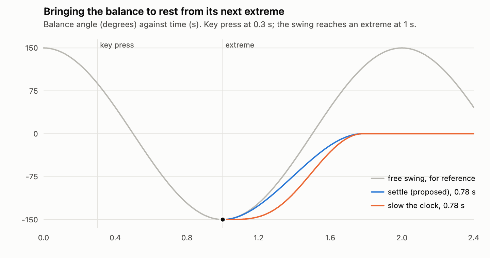
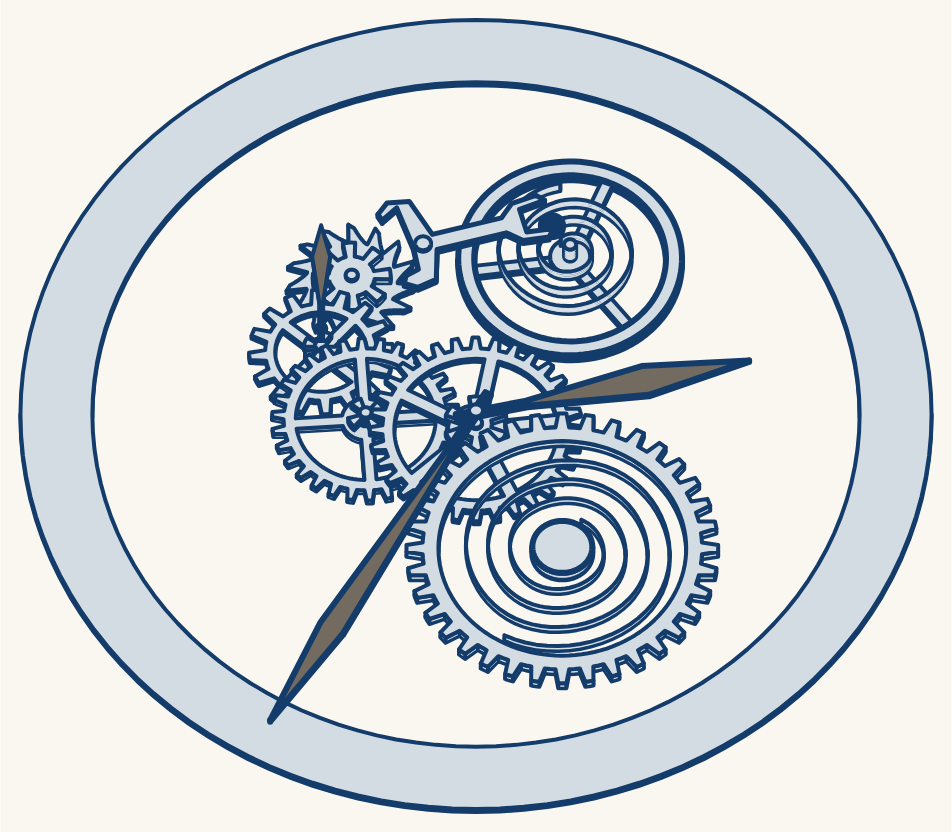
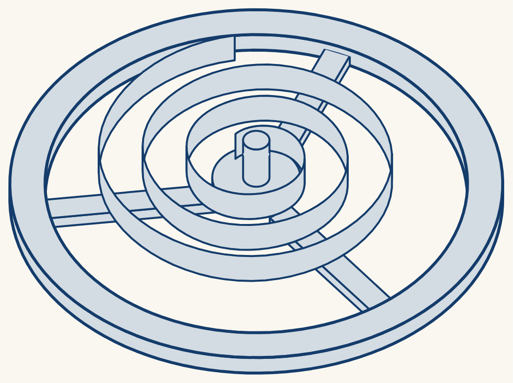
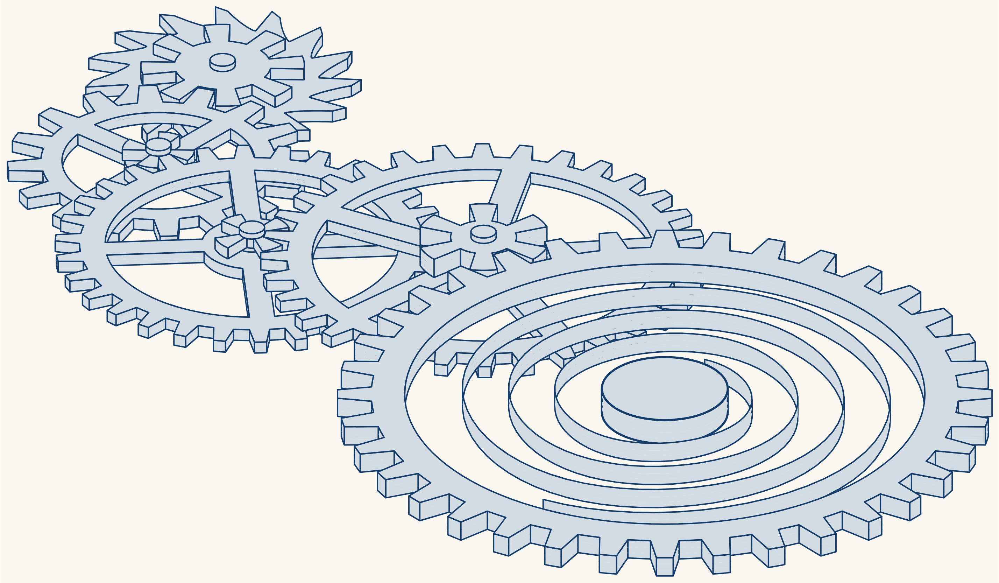

# Canvas-based animated illustrations: architecture plan

2026-09-27. **Status: plan for review.** The request is in
[instructions.md](instructions.md). This is a planning task: nothing outside
this directory changed. The tools that produced the numbers are in
[tools/](tools/), and their results are in [evidence/](evidence/). "How to
reproduce" at the end lists the commands.

## Summary

| Question | Recommendation | The deciding data |
| --- | --- | --- |
| Q1. Where does the canvas get the drawing? | **One Python model writes two files: the SVG (as now) and a JSON scene file.** The canvas reads the JSON. The SVG renderer uses the SVG. | SVG has no place for 3D, clocks, markers or views. A worker has no `DOMParser` (both browsers). Drawing code gains nothing: the canvas draws the watch in 0.1–0.2 ms of JS in Chrome. |
| Q2. 3D: who projects, and how is depth handled? | **Python splits the solids and fixes the drawing order ("slab order"). The renderers project each frame.** Both renderers use the same order. A tilt baked into SMIL uses $1 - \cos$ weights and keyframes with equal worst errors (section Q2). | One slab order draws the still watch with 0 px² of error at every tilt from 5° to 89°. Sorting by centre depth is wrong at every tilt (up to 924 px², 7.7% of the drawing). |
| — The claim "the order does not change from 0° to 90°" | **True for the real occlusion order, false for the centre-depth order.** | 2,938 of the 12,853 overlapping pairs of quads swap places in the centre-depth order between 5° and 85°. |
| — 3D while the mechanism moves | **Agree: design for 3D while still.** Animated 3D is possible on canvas without WebGL, but only if JS recomputes the order at each frame. | A kept order is wrong after 0.1 s (4 px²), and by 521 px² after 0.6 s. The recomputed order is exact in all 41 frames tested. |
| Q3. OffscreenCanvas? | **Build the renderer so that it can run in a worker, but run it on the main thread until a measurement shows the need.** | Main thread blocked 100 ms in every 400 ms: main-thread canvas, 9 gaps over 25 ms in 4 s; worker canvas, 0. Same pixels in Firefox; 59 of 540,960 differ in Chromium. |
| Q4. Canvg, SVG.js, DOMParser? | **None at run time.** A build-time Python importer for hand-drawn SVGs, if a talk needs one. | Canvg draws a whole SVG document with its own clock. It has no hooks for our clock, camera, line widths, fades or 3D. |
| Q5. Language? | **TypeScript, strict.** | Slidev builds TS already. Firefox spends its time inside the canvas calls, which WebAssembly would call too. |
| Q6. PixiJS, Paper.js, Konva? | **None.** Keep three.js in reserve for a slide that needs real 3D. | Each adds 7–228 KiB gzipped and a scene model of its own. None gives our clock, our 3D order and an SVG twin together. |
| Q7. Path2D with SVG `d`? | **Yes, for fixed shapes. Build changing shapes by calls.** | By calls: 0.3–0.5 µs per spring. From a string: 3.7–6.9 µs. |
| Feature 5: wait for a phase, then change the motion | **Possible with SVG too.** Put one clock with a time map in the shared controller; both renderers follow it. | A scheduled SMIL switch at the next extreme landed within 0.002° with no jump, in both browsers. Seeking the SMIL clock costs 0.004–0.023 ms. |

The rest of this file gives the options, the evidence and the ranking for
each question, then the architecture, the stages and the risks.

## 1. What exists

- **The generator.** `art/skeleton_watch.py` (1,194 lines) writes
  `public/cover/skeleton-watch.svg` (46 KB): 37 drawn paths, 18 circles, 1
  rectangle, 5 clip paths, 11 rotations (`animateTransform`) and 1 path morph
  (the hairspring, 25 frames). The house checks (`artcheck`, `barroom`,
  `motion`) read the SVG.
- **The Canvas 2D spike** (`tasks/2026-09-25-canvas-2d-watch/`). A player
  reads the SVG with `DOMParser` and draws it on a canvas (433 lines). A stage
  moves the camera, fades parts and runs the frame loop (166 lines). Results:
  - Firefox 156: 0 slow frames per zoom with canvas, against 12–14 with SVG.
  - Firefox 157: SVG improved to 1–7 slow frames per zoom (gaps up to
    83 ms). Canvas stayed at 0.
  - Chrome: smooth with both.
  - The canvas fades each shape, not each part. In mid-fade, edges that a
    part hides under itself show for a moment.
- **Decisions that carry over** (zoom task, `tasks/2026-09-25-zoom-to-hairspring/PLAN.md`):
  a persistent watch layer (`global-bottom.vue`, "option B"); a view per
  slide; a camera linear in scale with CSS `ease-in-out` over 1.8 s; the fade
  after the camera stops; line widths kept constant on the screen (divided by
  the scale); stills for the presenter's next pane and the overview.

The spike's drawing code and stage are the starting point. Its SVG reader
is not: this plan changes where the canvas gets its data (Q1). It also adds
what the new features need: clocks, markers, models and 3D.

## 2. The features

### 2.1 Simple 3D: is every part a few extrusions?

An **extrusion** here is a flat outline (with holes) swept along an axis
between two heights. A **ribbon** is an open curve swept the same way: a
spring. The table lists the parts that the talk could show, from the ETA
6497 that the drawing follows.

| Group | Part | Its 3D form | More than a few extrusions? |
| --- | --- | --- | --- |
| Going train | Barrel (drum with teeth) | floor disc, wall annulus, toothed rim: 3 extrusions | no |
| | Barrel cover | disc: 1 (cut away in a skeleton) | no |
| | Barrel arbor | 3–4 coaxial cylinders | no |
| | Mainspring | ribbon; its shape changes as it winds (a morph) | no |
| | Centre, third, fourth, escape wheels | wheel (toothed, with openings) + pinion + arbor: 3 each | no |
| | Centre wheel shaft | coaxial cylinders | no |
| | Driving wheel (if the caliber has one) | a wheel as above | no |
| Motion works | Cannon pinion | tube with leaves at one end: 2 | no |
| | Minute wheel and its pinion | 2 toothed discs on one arbor | no |
| | Hour wheel | toothed disc + pipe: 2 | no |
| | Hands | flat blades + pipes | no |
| Escapement | Pallet fork, guard pin, arbor | flat lever + 2 cylinders | no |
| | Pallet stones (2) | rectangular prisms in slots | no |
| | Balance wheel | rim annulus + arms: 2 | no |
| | Balance staff | 4–6 coaxial cylinders; 2 **conical** pivots | **cones**: use short cylinders, or a tapered extrusion |
| | Roller, impulse jewel, safety roller | discs + a D-shaped pin: 3 | no |
| | Hairspring (flat, as in the ETA 6497) | ribbon | no. **A Breguet overcoil would be**: its end rises out of the plane |
| | Collet, stud, regulator and curb pins | ring with slit, block, flat lever, 2 pins | no |
| Bearings | Hole jewels | annulus (the oil sink is a curved surface: ignore it) | no |
| | Shock setting (cap jewel, lyre spring, setting) | disc, flat spring outline, cylinders | no |
| Frame | Main plate | one extrusion per pocket depth: about 3–6 | no, only more of them |
| | Bridges, balance cock, pallet cock | 1–3 each | no |
| | Screws | slotted head (disc minus slot) + full disc: 2 | no |
| | Chapter ring, dial | annulus, disc | no |
| | **Case, crystal, lugs** | surfaces of revolution and sculpted forms | **yes**: keep them 2D, or drop them in 3D views |
| | Crown | knurled cylinder **along the stem axis (x)**; domed top | knurls no; the dome yes (approximate) |
| Keyless works | Winding stem | cylinders and a square section along x; a thread | no (draw the thread as rings) |
| | Winding pinion, sliding pinion | cylinders along x + **face teeth** (ratchet and contrate) | **many small prisms**, each along its own axis |
| | Crown wheel, ratchet wheel, setting wheel | toothed discs | no |
| | Click, click spring, setting lever, yoke, yoke spring, setting-lever jumper, corrector lever | flat outlines, a few pins | no |

**Result.** Every part is a few extrusions or a ribbon, except these:
- the case, crystal and lugs (curved surfaces);
- a Breguet overcoil (not in the ETA 6497);
- conical pivots and domed or curved cosmetic surfaces (approximate them);
- the face teeth of the winding and sliding pinions (many small prisms).

Parts along the stem (stem, crown, winding and sliding pinions) are
extrusions along x, not z. Seen from a camera tilted about the x axis, a
cylinder along x looks like the same rectangle at every tilt.

So the 3D model needs three kinds of solid: a **prism** (outline, two
heights, a placement), a **ribbon**, and later a **tapered prism** for cones.

### 2.2 Pan and zoom

The spikes settled this. A camera is `translate(x, y) scale(s)`, linear in
scale and eased. Line widths are divided by the scale in both renderers.
What changes:
- a view's camera becomes data that Python writes (the spike parsed it from
  the SVG's CSS);
- a camera gains a **tilt** for 3D views: $\theta$, about the slide's x axis.

### 2.3 Fading, and visibility per part or sub-assembly

- **Parts and assemblies.** A part (the hairspring, the escape wheel) is the
  unit that fades. An assembly is a named set of parts (the going train, the
  escapement). A view lists the parts or assemblies that stay.
- **SVG:** keep the browser's group opacity, one group per part.
- **Canvas:** the spike multiplied each shape's alpha. That shows hidden
  edges in mid-fade (spike C14). The exact method for a set of parts that
  fades together:
  1. draw the scene without the fading parts (and without the clip holes
     that they make);
  2. draw the full scene into a second canvas;
  3. copy the second canvas over the first with `globalAlpha` $= \alpha$.

  Where no fading part is, the two draws give the same pixels, and the copy
  changes nothing. Where a fading part lies over another part, the result is
  exactly "the set as one layer at opacity $\alpha$".
  - This also solves the clip-hole problem of the zoom task: a hole belongs
    to the part that makes it, so when that part fades, the part below
    appears.
  - The cost is two draws per frame, for the 0.8 s of a fade only.
  - It differs from the SVG only where two fading parts overlap: the SVG
    fades each part as its own layer. Mid-fade only; document it.
- **If two draws cost too much in Firefox** (the spike measured 6–8 ms of JS
  per draw there), fall back to the spike's per-shape alpha.

### 2.4 Switching to another model

A model is one drawing with its own clock: the watch, or the ruler over the
edge of a desk.
- **Canvas:** one canvas per model, stacked. A cross-fade is CSS `opacity` on
  the canvas elements, so the browser composites it and nothing is redrawn.
  A hidden model does not draw.
- **SVG:** one inline `<svg>` per model. Each has its own SMIL clock. The
  probe paused one while the other ran on (0 s against 0.3 s).
- **Clock policy per model:** a hidden model's clock can run on (the watch
  keeps time) or hold (the ruler waits at its start). The next section
  describes the clock.
- **The ruler's motion** (press the end down, release, oscillate and
  decay) is data like the watch's: Python computes the beam's bent shape and
  the keyframes of its decay; the slide's clicks play segments of the ruler's
  clock.

### 2.5 Wait for a phase, then change the motion

**The request:** wait for the hairspring's next extreme, then move it to the
centre with a speed that is a quadratic in time, and stop it there. Is this
possible with SVG?

**Yes. Probe results, Chromium 153 and Firefox 155**
([tools/smil_probe.html](tools/smil_probe.html),
[evidence/smil_probe.json](evidence/smil_probe.json)):

| What | Chromium | Firefox |
| --- | --- | --- |
| Clock API on `<svg>`: `getCurrentTime`, `setCurrentTime`, `pauseAnimations`, `unpauseAnimations` | yes | yes |
| On each animation: `getStartTime`, `getSimpleDuration`, `beginElementAt`, `endElementAt` | yes | yes |
| Animated angle read at once after a seek (`transform.animVal`), worst error against the keyframe arithmetic | 0.011° | 0.0001° |
| Cost of one seek and one read | 0.004 ms | 0.023 ms |
| Animated path readable (`getTotalLength()` follows the morph) | yes | yes |
| `repeatEvent` and `endEvent` fire | yes | yes |
| **Hand-over scheduled 0.45 s ahead** (`endElementAt` on the swing, `beginElementAt` on a settle animation): worst error against the planned curve | **0.002°** | **0.002°** |
| Largest step between frames during the hand-over (the free swing moves up to 7.9° per 60 Hz frame) | 7.7° at 60 Hz | 4.0° at 120 Hz |
| The scheduled switch after a seek back into it | kept (−75°, as planned) | kept (−75°) |
| Web Animations API: `iterationComposite: "accumulate"` (the stepping wheels need it) | **ignored** (−3° for −27°) | works |
| Web Animations API: animate the CSS `d` path | works | works |

So a controller can know where every SVG animation is without asking the
SVG. **All motion is a function of the mechanism's time $\tau$.** The
controller owns $\tau$ and knows each period, so it computes each phase.

**The design: one clock per model, with a time map.** The clock maps wall
time $t$ to mechanism time $\tau$, piece by piece: run (at a rate), hold, or
ease to a target. **Markers** name the useful phases, for example
"balance at an extreme: $\tau \equiv 0 \pmod{1\,\text{s}}$" and "balance at
the centre: $\tau \equiv 0.5 \pmod{1\,\text{s}}$". Python writes them, because
it knows the motion.
- **Canvas:** draw at $\tau(t)$.
- **SVG:** `pauseAnimations()` once, then `setCurrentTime(τ)` at each frame.
  At 0.004–0.023 ms per seek, this is free.
- The SMIL-only way also works (the probe did it), but it needs a settle
  animation for every moving element. The time map needs none, and every
  part follows the balance.

**The settle curve** ([tools/settle_curve.py](tools/settle_curve.py),
[evidence/settle.json](evidence/settle.json)). The swing is
$\alpha(t) = A\cos\omega t$ with $A = 150^\circ$, $\omega = 2\pi/T$,
$T = 2$ s. From an extreme $\alpha_e$ at time $t_e$:

$$\alpha(t) = \alpha_e\,\bigl(1 - s(u)\bigr),\qquad s(u) = 3u^2 - 2u^3,\qquad u = \frac{t - t_e}{D}.$$

The speed is proportional to $6u(1-u)$: the proposed quadratic, zero at both
ends. The swing's acceleration at the extreme is $-\omega^2\alpha_e$. The
settle's is $-6\alpha_e/D^2$. They are equal when

$$D = \frac{\sqrt6}{\omega} = \frac{\sqrt6}{2\pi}\,T \approx 0.78\ \text{s}.$$



| Hand-over | Jump in angle | Jump in speed | Jump in acceleration | Peak speed while settling |
| --- | --- | --- | --- | --- |
| **Settle, smoothstep in angle, $D = 0.78$ s (proposed)** | 0 | 0 | **0** | 289°/s |
| Slow the clock: smoothstep in $\tau$, 0.78 s | 0 | 0 | 1,480°/s² (a brief hang at the extreme) | 374°/s |
| Freeze at the key press (what to avoid) | 0 | 381°/s | 871°/s² | — |

The free swing peaks at 471°/s. **Recommendation:** use the smoothstep in
angle with $D = \sqrt6/\omega$, and drive the whole mechanism by it: set
$\tau(t)$ so that the balance angle follows the settle,
$\tau(t) = t_e + \frac{T}{2\pi}\arccos\bigl(1 - s(u)\bigr)$. The same
formula holds from either extreme. The fork, the escape wheel and the train
then stop where they belong for a balance at rest: the fork on its centre
line, with the impulse jewel in its notch.

**What the canvas adds here:** nothing that SVG cannot do for this feature.
The advantage of the canvas is elsewhere: parts that follow a variable other
than time (for example the hairspring as a function of the balance angle,
for a decaying swing), and 3D views that move.

## 3. The design questions

### Q1. Should the canvas read the SVG, or should Python write a second format?

| Option | For | Against |
| --- | --- | --- |
| **A. The canvas reads the SVG** (a strict subset, as in the spike) | One file. The art checks and the canvas read the same file. The spike works. | SVG has no place for 3D solids, clocks, markers, views or part links: they would become `data-*` strings or CSS (the spike parsed views from CSS). The reader must copy SVG and SMIL semantics (about 250 lines). No `DOMParser` in a worker (probe, both browsers). |
| **B. Python writes a JSON scene file too, from the same model** | Structured data: parts, clocks, markers, views, 3D pieces, as objects linked by id. `JSON.parse` works anywhere, workers too. A loader is about 50 lines plus types. Reusable for the train, the interferometer, the lander. | Two outputs. They cannot drift in content if both writers walk the same Python model; a pixel check (canvas against SVG) guards the rest, as in spike C1. A format to document and version. |
| C. Python writes JS drawing code | No parser. | Ties the art to one renderer's API: the SVG renderer and 3D projection cannot use it. Executable art is harder to check and diff. **The gain is nil:** the spike's interpreting player drew in 0.1–0.2 ms of JS in Chrome. |
| D. An existing format (Lottie JSON, glTF) | Existing players. | Lottie has no constant-width lines under zoom, no 3D order, no markers; glTF is for meshes, not line art. Our timing logic fits neither. |
| E. SVG with the extras in it (a JSON block in `<metadata>`, or `data-*` attributes) | One file. | Two syntaxes in one file, and still no `DOMParser` in a worker. |

**Ranking: B, E, A, C, D.** B is the only option that carries every
feature in section 2 without string parsing, and it works in a worker.
E keeps one file but has A's problems. A is fine for flat 2D art only.

**The format.** JSON, not binary: the watch is about 50–250 KB, which
`JSON.parse` reads in milliseconds. Its shape follows SVG, so SVG knowledge
carries over:
- nodes are groups and shapes;
- paints use SVG's names (`fill`, `fillRule`, `stroke`, `strokeWidth`…);
- path data is SVG's absolute `M L C A Q Z` grammar;
- animation channels use SMIL's `values`, `keyTimes`, `dur` and
  `accumulate`, but each names the clock it follows.

It adds what SVG lacks: parts and assemblies, clocks and markers, views
(camera and shown parts), clip owners, and 3D pieces. References are ids in
the file; the loader turns them into object links once. A `format` number
versions it. TypeScript types describe it, and a test checks the Python
output against them.

**What the canvas "implements", then.** It implements the SVG subset that
the file uses (your aim in instructions.md), but it reads it from JSON. A build-time
Python importer can turn a hand-drawn SVG into the same JSON if a talk needs
a hand-drawn drawing on canvas.

### Q2. 3D: who projects, how is depth handled, in SVG and in canvas?

**The camera.** A tilt $\theta$ about the x axis, from straight above
($0^\circ$) towards the watch's 6 o'clock side ($90^\circ$). A point
$(x, y, z)$, with $y$ down the slide and $z$ out of it, lands at

$$x' = x,\qquad y' = y\cos\theta - z\sin\theta,$$

at depth $d = y\sin\theta + z\cos\theta$ (larger is nearer). Each flat face is
an affine image of its 2D outline; an arc becomes an elliptical arc.

#### The claim: "the depth order does not change from 0° to 90°"

Take two points on the same pixel: the same $x$ and the same $y'$. Then
$\Delta y\cos\theta = \Delta z\sin\theta$, and

$$\Delta d = \Delta y\sin\theta + \Delta z\cos\theta = \frac{\Delta y}{\sin\theta}.$$

So for every $0 < \theta \le 90^\circ$, **of two points that share a pixel,
the one with the larger $y$ (and the larger $z$) is nearer, whatever
$\theta$ is.** Two consequences:
1. A point in a higher layer always hides a point in a lower layer.
2. Where two vertical walls of the same heights share a pixel, the wall with
   the larger $y$ at that $x$ is in front.

Neither depends on $\theta$. So **one drawing order is right for every tilt
in $(0^\circ, 90^\circ]$** (the "slab order" below). The claim is true of
the real occlusion order.

It is **false for the depth of centres.** A piece's centre depth is
$d_c = y_c\sin\theta + z_c\cos\theta$. Two pieces swap places at
$\tan\theta = -\Delta z_c/\Delta y_c$ whenever $\Delta y_c$ and $\Delta z_c$
differ in sign. Sorting by centre depth is also wrong at a single tilt,
because a large face or a long piece has its centre far from where it
overlaps other pieces.

**The test** ([tools/depth_order.py](tools/depth_order.py),
[evidence/depth_order.json](evidence/depth_order.json)). It extrudes the real
drawing: 35 solids from the frozen SVG, stacked in its paint order, plus a
balance staff that rises through the hairspring's inner coil. A z-buffer of
the same pieces is the reference. "Wrong area" is where an order shows a
surface more than 0.75 px behind the nearest one. All areas are in slide
px² at the cover's scale; the drawing covers 5,800–71,000 px², depending on
the tilt.

| Tilt | Centre depth, per quad (as proposed) | Per quad, sorted once at 45° | Centre depth, per x-monotone run | **Slab order, computed once** |
| --- | --- | --- | --- | --- |
| 5° | 21.5 | 183.5 | 21.8 | **0** |
| 30° | 118.0 | 195.0 | 119.0 | **0** |
| 45° | 196.5 | 196.5 | 241.2 | **0** |
| 60° | 408.5 | 349.0 | 444.8 | **0** |
| 75° | 449.5 | 422.0 | 451.0 | **0** |
| 85° | 771.5 | 740.0 | 924.0 | **0** |
| worst, 5°–89° | 771.5 (6.4%) | 740.0 (6.2%) | 924.0 (7.7%) | **0** |

- At exactly 90° every order has 3 px²: one pixel row where the hour and
  minute hands meet edge-on, a tie in the rasterizing. It is 0 at 89.99°.
- **Which pieces the centre sort gets wrong:** a large face against its own
  walls (the barrel's top face under the barrel's inner wall: 170 px² of the
  409 at 60°); long thin pieces against large faces (the hour hand under the
  centre wheel); pieces at different heights mixed in one list (the
  hairspring under the balance's face).
- **The order changes:** of 12,853 pairs of quads that overlap on the screen,
  2,938 swap places in the centre-depth order between 5° and 85°.



#### The hairspring's half-coils

The proposal: cut the ribbon wherever it reaches its leftmost or rightmost
extent, and sort the pieces by centre depth.

| Scene | Worst wrong area, 5°–89° |
| --- | --- |
| Hairspring alone, ribbon 8 or 20 high | **0** |
| Hairspring with the staff through it, ribbon 8 or 20 high | **0** |
| With the balance (rim, arms, hub) in the same sorted list, ribbon 8 high | 211.5 px² (up to 7.5% of the drawing) |
| The same, ribbon 20 high | 334.8 px² |
| Any of these, slab order | **0** |

**The cut is right; the sort is right for the spring alone.** The errors all
come from the balance's rim and arms, sorted into the same list: they are at
other heights. The slab order uses the same cuts and adds the layering.



#### The slab order

1. Cut every solid at every height where some solid starts or ends. Between
   two such heights is a **slab**.
2. Draw the slabs from the bottom up.
3. In a slab, draw the front-facing walls (outward normal towards $+y$),
   cut at their leftmost and rightmost points into x-monotone runs. Order
   them so that, wherever two runs overlap in $x$, the one with the larger
   $y$ comes later (a topological sort).
4. Then draw the top faces that end at the slab's top.

For the whole watch: 202 runs become 448 pieces in 29 slabs. The sort
compares 1,171 pairs, and found 0 crossings and 0 cycles. It needs the solids
not to intersect. In this first model, each wheel sits on top of the pinion
that it drives, so the teeth and the leaves do not mesh. The next section
puts the train at meshing heights.

**Where it breaks:** a tilt that crosses 0° or 90° (the rule flips); a
camera that tilts about two axes (an orbit); solids that intersect; and
parts that move (next section).

#### The train at meshing heights

In a movement, each wheel's teeth are at the same height as the pinion that
they drive. [tools/meshing.py](tools/meshing.py) sets these heights
(`depth_order.Meshing`):

- Each wheel sits on the wheel that it drives.
- Its pinion is at the height of its driver's teeth.
- Its hub is flush with the wheel.
- Its arbor's end rises a distance `cap` above the pinion.

The other parts keep the stacking rules. The side view at 89° shows the
first model's staircase in
[evidence/depth/watch-tilt-89.png](evidence/depth/watch-tilt-89.png), made
by [tools/side_view.py](tools/side_view.py).

| Model of the train | Heights | Slabs | Pieces | Pairs compared | Worst slab error, 5°–89° |
| --- | --- | --- | --- | --- | --- |
| Staircase (the first model) | 30 | 29 | 448 | 1,171 | 0 |
| Meshing; pinion flush with its driver's teeth; arbor ends 1.5 px (as drawn) | 22 | 21 | 537 | 2,289 | 0.5 px² |
| Meshing; pinion 1 px taller than its driver's teeth; arbor ends 1.5 px | 25 | 24 | 675 | 3,046 | 0.5 px² |
| Meshing; pinion flush; no arbor ends | 19 | 18 | 375 | 1,469 | 0.75 px² |
| **Meshing; pinion flush; arbor ends 3 px (one wheel thickness)** | 20 | 19 | **390** | 1,482 | 0.75 px² |

All variants have 0 crossings and 0 cycles. Sorting by centre depth gets
worse with meshing heights: up to 1,095 px², against 771.5 px² for the
staircase.

**Teeth and leaves overlap in plan, but only a little.** This is the
drawing's own geometry, so it is the same in every variant. The tool
measured it on a 0.1 px grid, at 240 times over 120 beats (between the
steps and in the middle of each step):

| Wheel → pinion | At the still pose | Worst |
| --- | --- | --- |
| fourth → escape | 0 | 0.73 px² |
| third → fourth | 0.05 px² | 0.70 px² |
| centre → third | 0.07 px² | 0.86 px² |
| barrel → centre | 0 | 0.44 px² |

All the slab errors are at these overlaps. At 70° and 75°, the whole error
is 2 pixels (at 0.5 px), where the third wheel's teeth pass into a leaf of
the fourth pinion. There, the solids intersect, so no painter's order is
exact. An error of 0.75 px² is smaller than one line width, so nobody can
see it. To remove it, make the leaves in the generator a little thinner.

**Do the equal heights save slabs? Yes. Keep every height on a grid.** A
new height cuts every solid that spans it, even solids far away in plan. So
the cost of a height is in pieces (draw calls), not in slabs:

- **A flush pinion adds no heights.** A pinion 1 px taller than its
  driver's teeth, as in a real movement, adds 3 heights and 138 pieces
  (+26%), and 33% more pairs to compare.
- **Arbor ends of 1.5 px add 2 heights and 147 pieces**, compared with ends
  of 3 px. With 3 px, the tops of the ends land on heights that other solids
  already have. The 3 px ends cost 1 height and 15 pieces more than no ends.
- **The pieces increased, but the slabs decreased (448 → 537 pieces, 29 → 21
  slabs).** The train now uses the same heights (0–19) as the balance, the
  hairspring and the staff. Each height of one group cuts the other group.
  For example, the barrel goes from 89 to 133 pieces, and the third wheel
  goes from 73 to 111 pieces.
- **A cut that is only local would remove most of this increase.** Cut a
  solid only at the heights of solids that overlap it on the screen: this is
  the trapezoidal decomposition, compared with the slab method. I did not
  test it.

Recommendation: flush pinions, and arbor ends of one wheel thickness (or no
ends). This gives 19 slabs and 390 pieces. If the art needs a pinion that is
taller than the teeth, make the extra height a multiple of the same grid.



#### Where to compute, and what each renderer does

| Option | For | Against |
| --- | --- | --- |
| **Python fixes the pieces and the order; JS projects each frame** | The geometry stays in Python, with the z-buffer check at build time. JS does only arithmetic: $y\cos\theta - z\sin\theta$ per point. Any camera path, set at run time. | The pose must be known at build time (true for the planned hairspring view: the mechanism is at rest). |
| Python also bakes the camera path into SMIL morphs | A standalone SVG file shows the tilt, with no script. Both browsers play it as computed. | A new render for each camera path, and large files: 0.27 MB per keyframe for the train alone. With the chosen keyframes, one tilt from 0° to 90° is about 1.6 MB, and a loop there and back is 3.1 MB (see "Baking the tilt into SMIL" below). |
| JS computes pieces and order at run time too | Any pose, even while the mechanism moves. | The slab order in TypeScript too (about 150 lines, not written); the check must then run in a browser. |

**Recommendation:** Python fixes the pieces and the order; JS projects.
- **Canvas:** each frame, set each face's transform (it is affine) or build
  its path, and build each wall run's path (two copies of the run, joined).
- **SVG:** one `<path>` per piece, in the slab order; JS sets each `d` each
  frame. Use SMIL morphs only if a standalone file must show the tilt, and
  then use the method in "Baking the tilt into SMIL" below
  ([tools/tilt_animation.py](tools/tilt_animation.py) makes one for the
  train; [evidence/tilt_animation.json](evidence/tilt_animation.json)).
- **The lines of a wall:** its top and bottom edges where they are the
  solid's own (not a slab cut), and a vertical line at each end and at each
  corner of the outline inside the run. Python marks a corner where two path
  commands meet at more than 5°, so points on an arc or a curve are never
  corners. It exports each wall's corner indices. The whole watch has 195
  such corners; in the meshing model's slab pieces they add 458 short lines
  to the 1,008 end lines, in the same stroke per piece.
- **Cost per frame** for a tilting view, headless
  ([tools/draw_cost.py](tools/draw_cost.py),
  [evidence/draw_cost.json](evidence/draw_cost.json)):

  | Scene | Chromium canvas | Chromium SVG | Firefox canvas | Firefox SVG |
  | --- | --- | --- | --- | --- |
  | Whole watch, 448 pieces: JS per frame | 0.7 ms | 3.9 ms | 12 ms | 5 ms |
  | Balance and hairspring, 23 pieces: JS per frame | 0.2 ms | 1.2 ms | 3 ms | 1 ms |
  | Frame gaps over 25 ms in 4 s (whole watch; balance) | 0; 0 | 0; 0 | 0; 1 | 0; 0 |

  Firefox rounds `performance.now()` to 1 ms. Headless browsers may draw
  without the GPU of a visible window, so these numbers are a first look.
  **Firefox's canvas is the tightest: 12 ms of the 16.7 ms of a 60 Hz
  frame.**

#### Faces by an affine transform: possible, not needed now

**The idea.** All points of a face have the same height $h$. So its
projection $y' = y\cos\theta - h\sin\theta$ is an affine map of the whole
face:
$$\begin{pmatrix}x'\\y'\end{pmatrix} = \begin{pmatrix}1 & 0\\0 & \cos\theta\end{pmatrix}\begin{pmatrix}x\\y\end{pmatrix} + \begin{pmatrix}0\\-h\sin\theta\end{pmatrix}.$$
The renderer can then set one transform per face at each frame and keep
the face's path fixed. An affine map sends a line to a line, a Bézier to
the Bézier of its mapped control points, and an arc to an elliptical arc.
Thus a face can keep the art's own `d`, with no flattening and no second
copy of its geometry in the JSON.

- **SVG:** give each face `transform="matrix(1 0 0 cosθ 0 −h·sinθ)"`, and
  set only that attribute at each frame. As an alternative, a CSS
  `transform` can read two custom properties, `--c` and `--s`, that JS sets
  once per frame on the root; each face holds its own $h$. (Not tested:
  whether Firefox accepts `calc()` inside `matrix()`.) The scale also
  squashes the stroke. `vector-effect="non-scaling-stroke"` prevents this,
  but such a stroke also ignores the camera's zoom. Thus JS must set the
  stroke width from the camera's scale.
- **Canvas:** build each face's `Path2D` once. At each frame, fill it under
  `setTransform(1, 0, 0, cosθ, 0, −h·sinθ)`. To stroke it, map the path
  with `new Path2D().addPath(path, matrix)`, and stroke that under the
  identity transform, so the line width is not squashed.
- **At exactly 90°** the matrix is singular ($\cos\theta = 0$). A browser
  may not draw an element whose transform has no inverse (not tested).
  Stop the tilt at 89.99°.
- **Walls cannot use one transform.** A wall's fill is one closed outline:
  its top polyline, then its bottom polyline in reverse. The two halves
  need two maps (the same $\cos\theta$, but $-top\cdot\sin\theta$ and
  $-bottom\cdot\sin\theta$). An SVG element has one transform, so SVG walls
  stay per point. Canvas has a trick, because each run is x-monotone. Make
  a "curtain": the top polyline, closed by a drop to a baseline far below
  the view. Add the curtain to one `Path2D` twice, with the top and the
  bottom maps, and fill with `evenodd`. Below the bottom copy, the two
  curtains cancel. The coincident vertical edges at each end of the run can
  leave faint seams where the edges are antialiased.

**Why not now.** The per-point projection is already fast enough. Headless,
Chromium drew every frame at 60 Hz (241 frames in 4 s, for both
renderers). Firefox drew 81 frames per second for canvas and 105 for SVG,
with no interval over 25 ms. The test drew the 980 × 552 slide at a device
pixel ratio of 2, which is 2.16 Mpx. The projector will almost certainly be
1080p, which is 2.07 Mpx, so the test rasterised more pixels than the
talk will. Faces are few (33 of 448 pieces), but each is large, so faces
are 31% of the points written at each frame
([tools/piece_points.py](tools/piece_points.py),
[evidence/piece_points.json](evidence/piece_points.json)):

| Whole watch | Faces | Walls |
| --- | --- | --- |
| Pieces | 33 | 415 |
| Points in plan | 4,527 | 6,160 |
| Points written per frame (fill and strokes) | 9,054 | 20,516 |

Thus face transforms save at most about 31% of the JS time: about 1.2 ms
in Chromium SVG and 1.5 ms in Firefox SVG. In canvas they save less,
because the time is spent in the canvas calls, and a transform does not
make rasterising cheaper. That gain does not change a frame that already
fits. It would cost a second code path (faces and walls), the stroke
handling and the 90° limit.

**When to do it.** Do it only if a real run drops frames: stage 6 (a
visible window, full screen on the talk laptop and the projector, with the
presenter view open) shows intervals over 25 ms during a tilt. First
measure where the frame time goes:
- **If it is the JS that writes `d` strings or builds paths** (for
  example, SVG in Firefox), faces by transform can save up to about 31%.
- **If it is rasterising** (Firefox canvas: 12 ms, spent inside the
  canvas calls), transforms do not help. Use the SVG renderer in that
  browser, draw fewer pieces, or present from Chromium.
- **The curtain trick for canvas walls** is the last step. Try it only if
  building the wall paths is a large share of a frame that is too slow.

#### Baking the tilt into SMIL: what it costs, and how coarse it can be

**The method (decided).** To bake a tilt from $a$ to $b$ into SMIL, with
$N$ interior keyframes (all angles in $[0°, 90°]$, either direction):

1. **Keyframes.** Use $\theta_0 = a, \theta_1, \dots, \theta_{N+1} = b$. Each
   keyframe holds the exact projection at its tilt.
2. **Weights: the generalisation of $1 - \cos$.** In the interval from
   $\theta_i$ to $\theta_{i+1}$, while the true tilt $\theta$ turns at its
   planned rate, SMIL mixes the two keyframes with weight
   $$u(\theta) = \frac{\cos\theta_i - \cos\theta}{\cos\theta_i - \cos\theta_{i+1}}.$$
   This keeps the plan's height exact, as if the caliber were flat. Only
   the walls come out too short. Write $u$ as one fitted `keySplines`
   Bézier per interval (`calcMode="spline"`), mirrored for the way back.
   From 0° to 90° in one step, $u = 1 - \cos\theta$.
3. **Keyframe angles: equal worst errors.** An interval's error is largest
   at its middle $m_i$. There it is $|Z|\,(1-\cos\delta_i)/\sin m_i$, with
   $\delta_i$ the half-width and $|Z|$ the largest height from the pivot
   (so put the pivot at mid-height). Choose the $\theta_i$ so that these
   errors are all equal. This makes the largest error as small as it can
   be: moving a keyframe makes one neighbour's error larger and the other's
   smaller. `keyframe_tilts(a, b, N)` in
   [tools/keyframe_angles.py](tools/keyframe_angles.py) finds them by
   bisection.
4. **Choose the smallest $N$ whose worst error is at most 0.68 px.** While
   the tilt moves, you cannot see an error of 0.68 px between keyframes:
   that is the train with $N = 2$, measured over the swing. For the same
   keyframes, the closed form gives 0.66 px. The difference is the fitted
   `keySplines` curve: in the interval from 47.96° to 90°, it misses the
   exact weight $u$ by up to 0.00024, which moves a point by up to about
   0.02 px. We do not know the true limit. It is more than 0.68 px and less
   than 1.31 px. $N = 1$ at its best angle (32.28°) gives 1.31 px, and that
   is clearly too much: see the side-by-side file and the stills below.
   (Before that, the upper bound was 1.8 px: one keyframe at 45°, where the
   walls in the still at 22.5° were visibly too thin.) So $N = 2$ is the
   only choice for the train over 0°–90°, whatever the exact limit is.
   `interior_needed(a, b, |Z|)` in
   [tools/keyframe_angles.py](tools/keyframe_angles.py) gives $N$.
   - **For the train ($|Z| = 9.25$ px), $N = 2$ is enough for any tilt of
     90° or less** (inside $[0°, 90°]$). Over the full 0°–90°, the worst
     error is 0.66 px, less than a line width. Any smaller range does at
     least as well: clip the 0°–90° keyframes to the range, and each clipped
     chord lies closer to the arc than the chord it came from. Measured:
     0°–45° 0.31 px, 45°–90° 0.09 px, 20°–70° 0.15 px, 10°–80° 0.32 px,
     5°–90° 0.50 px
     ([evidence/keyframe_angles.json](evidence/keyframe_angles.json)).
   - **A taller scene needs more keyframes.** The error is proportional to
     $|Z|$. An interval's error is about proportional to the square of its
     width. Thus $N + 1$ grows about as $\sqrt{|Z|}$. Over 0°–90°:
     $|Z| = 15$ px needs $N = 3$, 20 px needs 4, 30 px needs 5, and 50 px
     needs 7.
5. **A hold at a tilt that is not a keyframe:** split the interval there.
   The new keyframe is exactly what the mix shows at that moment, and de
   Casteljau's rule splits the `keySplines` curve exactly. Each split adds
   keyframes, and each keyframe costs 0.27 MB for the train. So hold
   between keyframes only to inspect the error (at the interval middles).
   A finished file does not do this.

The rest of this section is the evidence.

[tools/tilt_animation.py](tools/tilt_animation.py) writes the train alone
(440 pieces, 862 paths) as SMIL `d` morphs: 0° → 90° → 0°, at 22.5°/s,
with a 1 s hold at each end (a 10 s loop), as a finished file would be.
The sizes below are of these files. Each equal-error version is also
compared, side by side, with keyframes every 5°. The side-by-side file
also holds at the middle of each of its intervals, where its error is
largest: 16.14° and 61.14° for $N = 1$ (a 14 s loop), and 8.155°, 32.135°
and 68.98° for $N = 2$ (a 16 s loop). The tool pauses each version in both
browsers
([evidence/tilt_animation.json](evidence/tilt_animation.json)). At every
pause, both browsers draw each panel to within the line width of the
predicted height.

| Keyframes | File | Worst error, slide px |
| --- | --- | --- |
| every 5° | 11.3 MB | 0.14 |
| every 10° | 6.3 MB | 0.54 |
| every 22.5° | 3.5 MB | 2.7 |
| 0° and 90° only, steady | — | 29.6 |
| 0° and 90° only, speed profile $u = 1 - \cos\theta$ | — | 3.8 |
| 0°, 45° and 90°, speed profile $1 - \cos$ per interval | — | 1.8 |
| 0°, 32.28° and 90° (equal worst errors, $N = 1$), $1 - \cos$ per interval | 2.5 MB | 1.31 |
| **0°, 16.31°, 47.96° and 90° (equal worst errors, $N = 2$), $1 - \cos$ per interval** | **3.1 MB** | **0.68** |

- **The size is almost all keyframes.** Each keyframe of the train is
  0.27 MB of `d` values (the same in all five files). The rest of a file is
  0.5–0.7 MB: the first `d` of each path, the styles, `keyTimes` and
  `keySplines`. The equal-error loop has 9 keyframes per path: 0° twice
  (the start and the end of its hold), 16.31°, 47.96°, 90° twice, 47.96°,
  16.31° and 0°. A single tilt from 0° to 90° has 4 keyframes, and so is about
  1.6 MB (derived from the loop, not written). With $N = 1$, the loop has 7
  keyframes (2.5 MB), and a single tilt about 1.3 MB.

- **The error is a squash, not a wrong drawing.** A linear mix of two
  tilts' projections is a true view at tilt $\operatorname{atan2}(s, c)$,
  squashed vertically by $\sqrt{c^2+s^2}$, where $c$ and $s$ are the same
  mix of the two cosines and sines. So coarse keyframes never break the
  drawing order. Halfway between keyframes, the drawing is shrunk towards
  the pivot by the factor $\cos(\Delta\theta/2)$. The error is largest where the
  drawing is tallest on the screen (near 0°), and almost 0 near 90°.
- **Side by side, 10° looks the same as 5°.** At a constant rate, each
  version shows the right tilt at every moment; only the shapes differ.
- **SMIL can vary the speed inside one interval**: `calcMode="spline"`,
  one cubic-Bézier `keySplines` entry per interval. With keyframes at 0°
  and 90° only, one number $u$ sets both the plan's height ($1-u$) and the
  walls' height ($u$), so no curve gives a true rotation. A steady $u$
  moves too fast near 0°. $u = 1 - \cos\theta$ treats the caliber as flat
  ($z = 0$): the plan is exact, and the whole error is the heights' term
  $|Z|(\sin\theta + \cos\theta - 1)$. That is at most
  $9.25 \times 0.414 = 3.83$ px, at 45° (measured: 3.84). As a Bézier,
  `keySplines="0.3603 0 0.671 0.4827"` fits it to better than 0.0001. The
  walls still lag: at 45°, they look like 22.5°, which is clearly too thin
  to the eye.
- **Adding a keyframe at 45° fixes most of it.** For an interval from $a$ to
  $b$, the same idea gives
  $u = (\cos a - \cos\theta)/(\cos a - \cos b)$, one fitted curve per
  interval. The walls are thinnest in the middle of each interval. At 22.5°
  they are 48% of their true height (it looks like 11.25°; worst error 1.8
  px). At 67.5° they are 91% (0.8 px). See
  [evidence/depth/tilt-45-one-minus-cos-still-22.5.png](evidence/depth/tilt-45-one-minus-cos-still-22.5.png)
  and [-67.5.png](evidence/depth/tilt-45-one-minus-cos-still-67.5.png):
  the true rotation on the left, the mix on the right.
- **Where to put the keyframes**
  ([tools/keyframe_angles.py](tools/keyframe_angles.py),
  [evidence/keyframe_angles.json](evidence/keyframe_angles.json)). In the
  plane of $(\cos\theta, \sin\theta)$, the mix moves along the chord
  between two keyframes, with the cosine exact. For an interval with middle
  $m$ and half-width $\delta$, the gap between the arc and the chord is
  largest at $\theta = m$ (the tangent there is parallel to the chord). There
  it is $|Z|\,(1-\cos\delta)/\sin m$ (sampling agrees to 8 digits).
  Keyframes with equal worst errors, for $|Z| = 9.25$ px:

  | Interior keyframes | Angles | Worst error (evenly spaced) |
  | --- | --- | --- |
  | 0 | 0°, 90° | 3.83 px |
  | 1 | 0°, **32.3°**, 90° | 1.31 px (1.84) |
  | 2 | 0°, **16.3°, 48.0°**, 90° | 0.66 px (1.22) |
  | 3 | 0°, **9.8°, 29.2°, 57.0°**, 90° | 0.40 px (0.91) |
  | 4 | 0°, 6.6°, 19.6°, 38.7°, 62.9°, 90° | 0.26 px (0.73) |

  Two well-placed keyframes do as well as five evenly spaced ones (0.61
  px). The stills at the interval middles show it. For $N = 1$:
  [16.14°](evidence/depth/tilt-0-32.28-90-one-minus-cos-still-16.14.png)
  (walls 49%; they look like 8.07°) and
  [61.14°](evidence/depth/tilt-0-32.28-90-one-minus-cos-still-61.14.png)
  (84%; they look like 56.67°), each at 1.31 px. For $N = 2$:
  [8.155°](evidence/depth/tilt-0-16.31-47.96-90-one-minus-cos-still-8.155.png)
  (walls 50%),
  [32.135°](evidence/depth/tilt-0-16.31-47.96-90-one-minus-cos-still-32.135.png)
  (87%) and
  [68.98°](evidence/depth/tilt-0-16.31-47.96-90-one-minus-cos-still-68.98.png)
  (92%), at 0.66, 0.66 and 0.68 px (the last with the `keySplines` fit). For small intervals, $\delta \approx \sqrt{2E\sin m}$: the
  spacing grows as $\sqrt{\sin\theta}$. As a fraction of the walls' true
  height, the first interval's error is $1/(1+\cos\delta) \ge \tfrac12$,
  whatever its width: at its middle, the walls are always about half their
  height. But they are small there, so the error in pixels,
  $|Z|\tan(\delta/2)$, still shrinks.
- **The tilt can end at exactly 90°:** the order holds there, and the faces
  collapse to lines.

#### 3D while the mechanism moves

At a 45° tilt, with the mechanism running over one 2 s period, 41 frames:
- **the order of frame 0, kept** (its pieces follow the parts as they turn):
  4 px² wrong at 0.1 s, 97 px² at 0.25 s, 521 px² at 0.6 s. Up to 568 wall
  edges turn from front-facing to back-facing, or back;
- **the slab order made again at each frame:** 0 px² wrong in every frame. In
  Python it takes 8–9 ms per frame for 446–456 pieces (not measured in JS).

**What I think.** I agree: design for 3D while the mechanism is still. It
covers the story (stop the hairspring, then tilt), it keeps SVG and canvas
equal, and it keeps the order in Python, where the z-buffer checks it. But
animated 3D is not "a real-time 3D package" for this kind of geometry:
extrusions along one axis need only the slab order, redone each frame.
WebGL is not needed for that. It would be needed for perspective, lighting,
curved surfaces, or solids that intersect. If a slide needs a moving tilted
mechanism later: port the slab order to TypeScript, draw on canvas only, and
measure Firefox first.

### Q3. OffscreenCanvas?

**Probe** ([tools/worker_probe.py](tools/worker_probe.py),
[evidence/worker_probe.json](evidence/worker_probe.json)), Chromium 153 and
Firefox 155, device pixel ratio 2:

| What | Chromium | Firefox |
| --- | --- | --- |
| `transferControlToOffscreen`; in the worker: `OffscreenCanvas`, `Path2D` (also from a string), `requestAnimationFrame`, `FontFace` and `self.fonts`, `DOMMatrix` | yes | yes |
| `DOMParser` in the worker | **no** | **no** |
| Same `drawScene()` on the main thread and in the worker: pixels that differ by more than 2 levels | 59 of 540,960 | 0 |
| Main thread blocked 100 ms in every 400 ms, 4 s: main-thread canvas | 9 gaps over 25 ms, largest 83 ms | 9, largest 101 ms |
| The same: worker canvas | **0**, largest 16.8 ms | **0**, largest 17.5 ms |
| Worker's time origin minus the page's | 15.6 ms | 79 ms |
| `toDataURL()` on the canvas after the transfer | did not throw | did not throw |

| Option | For | Against |
| --- | --- | --- |
| **Main thread now, worker-ready design** | Simplest now; the spike's deck had 0 slow frames on the main thread. The worker stays one switch away. | A long main-thread task (Vue, a slide transition, garbage collection) can still delay a frame. |
| Worker from the start | Immune to main-thread work (probe: 0 against 9 gaps). | Messages for every change of view; convert times between origins; the canvas must be resized by message; debugging across threads. |
| Main thread only | Least code. | No way out if Slidev's work causes jank. |

**Recommendation: design the renderer to run in either place, and start on
the main thread.** That means:
- a drawing function that takes plain data and either kind of 2D context
  (the probe's `draw_scene.js` ran unchanged in both places);
- no DOM in the renderer, so no `DOMParser` (another reason for Q1-B);
- the renderer keeps its own clock from frame timestamps, and it converts
  with `performance.timeOrigin`, because the two origins differ
  (15.6–79 ms);
- control by messages: show a view, set a time map, resize.

Move it into a worker when a visible-window test shows main-thread
contention, for example with the presenter view open.

### Q4. If the file were SVG: Canvg, SVG.js, or DOMParser?

| Option | Facts ([evidence/libraries.json](evidence/libraries.json)) | Fit |
| --- | --- | --- |
| **DOMParser + a strict subset reader** (the spike) | built in; a few ms for 46 KB; main thread only | Right, if SVG were the file. It throws on anything it does not know. |
| Canvg 4.0.3 | 23.0 KiB gzipped; 2025-03 | Draws a whole SVG document, with its own SMIL clock. No hooks for our clock, camera, constant line widths, part fades or 3D. We would fight it. |
| SVG.js 3.2.8 | 29.4 KiB gzipped; 2026-08 | Builds and animates SVG DOM. It does not draw on a canvas. For our SVG renderer, plain DOM calls are enough. |

**Recommendation:** none at run time, because the canvas reads JSON (Q1).
For hand-drawn SVGs, a build-time Python importer (`xml.etree`, as the probe
tools use) would write the same JSON.

### Q5. Which language?

| Option | For | Against |
| --- | --- | --- |
| **TypeScript, strict** | Slidev and Vite compile it with no setup. Types for the scene file catch schema mistakes, as `mypy --strict` does for the Python. | A type-check step (`vue-tsc --noEmit` or `tsc --noEmit`). |
| JavaScript with JSDoc types | No build step; `tsc --checkJs` can still check it. | Noisier types; Slidev builds TS anyway. |
| Rust to WebAssembly | Fast for heavy geometry. | A second toolchain (cargo, wasm-bindgen). Each canvas call still goes through JS. Our JS costs 0.2–0.7 ms per frame in Chrome; Firefox's 12 ms is spent inside the canvas calls, which WASM would make too. |

**Ranking: TypeScript, JavaScript with JSDoc, Rust.** Revisit WASM only for
work that is heavy and inside our own code, such as a general hidden-line
algorithm or a physics simulation.

### Q6. PixiJS, Paper.js, Konva, or another library?

What we need: (R1) our own clock and time maps; (R2) constant screen line
widths under zoom; (R3) group opacity; (R4) clips and even-odd fills; (R5)
our 3D order; (R6) the same scene in SVG; (R7) small, offline, maintained.

The versions, dates and sizes are measured
([tools/library_facts.py](tools/library_facts.py)). The "Fit" notes come
from each library's documentation; I did not test the libraries.

| Library | Version, date | Minified / gzipped | Fit |
| --- | --- | --- | --- |
| Konva | 10.7.0, 2026-09 | 188 / 56 KiB | Canvas scene graph. `strokeScaleEnabled: false` gives R2. Group opacity only through a cached bitmap. No SVG output, no 3D. |
| Paper.js | 0.12.18, 2024-07 | 234 / 81 KiB | Canvas scene graph with boolean path operations and SVG import and export. Slow releases. |
| Two.js | 0.8.24, 2026-08 | 201 / 49 KiB | One scene graph drawn by SVG, canvas or WebGL: close to R6. Small community (20 k downloads a week). |
| PixiJS | 8.21.0, 2026-09 | 809 / 228 KiB | WebGL or WebGPU. Strokes become triangles: thin anti-aliased lines at a changing zoom are its weak point. Overkill for about 60 shapes. |
| Zdog | 1.1.3, 2022-01 | 29 / 7 KiB | Flat shapes in 3D, drawn to canvas or SVG, **sorted by centre depth**: the method that was wrong by up to 7.7% here. No release since 2022. |
| three.js | 0.186.1, 2026-09 | 790 / 188 KiB | Real 3D with a depth buffer; constant-width lines through `Line2`. Silhouette lines need extra work, and it is a separate world from the 2D art. |
| Fabric | 7.4.0, 2026-05 | 292 / 90 KiB | An editor's object model. |
| lottie-web; dotLottie | 5.13.0; 0.80.0 | 298 / 74 KiB; 161 KiB + 1.2 MB WASM | Players for a format that has no place for our timing, views or 3D order. |
| CanvasKit (Skia) | 0.42.0, 2026-08 | 118 KiB + 7.1 MB WASM | The fallback if Canvas 2D had failed in Firefox. It did not. |
| GSAP | 3.15.0, 2026-04 | 71 / 28 KiB | Timelines with labels, seeking and a tweenable time scale: it could do our time map. But the map is about 100 lines of our own, and its licence is free but not open source. |

**Recommendation: no library for the 2D renderer.** The spike's drawing code
is about 100 lines and costs 0.1–0.2 ms per frame in Chrome. No library meets
R1, R5 and R6 together, and each adds 7–228 KiB gzipped. Keep **three.js** in
reserve for a slide that needs real 3D (perspective, lighting, curved
solids), for example a lunar lander in a later talk. Put it in its own
component, not in the watch's renderer.

### Q7. Path2D with SVG `d` syntax?

**Yes, for shapes that do not change.** `new Path2D(d)` parses once, in the
browser's own parser, with SVG's grammar. The spike drew the whole watch
this way in both browsers, and the probe did it in a worker.

For shapes that change each frame (the hairspring's morph, 3D wall runs),
**build the path by calls**
([evidence/worker_probe.json](evidence/worker_probe.json)):

| Build the hairspring's path (M and 13 C) | Chromium | Firefox |
| --- | --- | --- |
| From a string made each time | 3.7 µs | 6.9 µs |
| By `moveTo` and `bezierCurveTo` calls | 0.3 µs | 0.5 µs |

Both are small. Two cautions:
- `Path2D(d)` stops without an error at the first bad token. The Python
  writer must emit a strict grammar, and the pixel check catches the rest.
- A `Path2D` answers no questions (no length, no bounds, no points). So the
  scene file carries numbers wherever JS needs geometry: morph frames and 3D
  pieces.

## 4. The architecture

```text
art/skeleton_watch.py   (per talk; builds one Scene with the shared Python package)
   │
   ├──► skeleton-watch.svg    house checks and stills; the SVG renderer's drawing
   └──► skeleton-watch.json   parts, clocks, markers, views, 3D pieces;
                              the canvas renderer's drawing

Slidev deck   (the TypeScript runtime, shared by all talks)
   global-bottom.vue ──► Stage: models, views, camera, fades, clocks with time maps
                            │   (reads skeleton-watch.json)
                            ├──► CanvasRenderer   Canvas 2D; main thread, worker-ready
                            └──► SvgRenderer      the inline SVG; its SMIL clock set to τ
                                                  at each frame
                                 (one of the two, chosen at page load)
   slide-bottom.vue  ──► stills for the presenter's next pane, the overview and export
```

**The renderer is chosen at page load** (as the earlier review proposed): the
canvas by default, the SVG as the fallback. Only one runs. The stage, clocks
and views are shared, so the two cannot drift in behaviour.

### The SVG renderer: the generated file, or SVG built from the JSON?

| Option | For | Against |
| --- | --- | --- |
| **The generated SVG, its SMIL clock set to $\tau$** | Any SVG feature (text, gradients, masks, filters) works in it as soon as the generator writes it: the insurance that instructions.md asks for. The browser's SMIL is a second, independent animation engine; the probe matched it to the keyframe arithmetic within 0.011°. The file shown is the file the house checks read. | Two engines must agree: a pixel check against the canvas at sampled times (spike C1). 3D pieces still come from the JSON, and JS sets their `d`. |
| SVG built from the JSON by JS, attributes set at each frame | One animation engine for both renderers; 3D pieces fit naturally. | Every SVG feature must pass through the JSON and the adapter first. The SVG shown is not the file the house checks read. |

**Recommendation: the generated SVG.** Its independence from our code is the
point of keeping a second renderer.

### The Python model (fixed data on objects)

| Class | Kind | Fields |
| --- | --- | --- |
| `Scene` | regular class | `name`, `size`, `root: Group`, `parts`, `assemblies`, `clocks`, `markers`, `views`, `solids` |
| `Part` | `@dataclass(eq=False)` | `name` (for export only). The unit that fades. |
| `Assembly` | `@dataclass(eq=False)` | `name`, `parts: frozenset[Part]` |
| `Group` | `@dataclass(eq=False)` | `transform`, `rotation: Channel \| None`, `clip: Clip \| None`, `part: Part \| None`, `children` |
| `Shape` | `@dataclass(eq=False)` | `outline: Path \| Morph`, `paint: Paint`, `part: Part \| None` |
| `Paint` | `@dataclass(frozen=True)` | `fill`, `fill_opacity`, `fill_rule`, `stroke`, `stroke_width`, `stroke_opacity`, `line_join`, `line_cap` |
| `Path` | `@dataclass(frozen=True)` | `segments`: absolute M, L, C, A, Q, Z. Writes `d` for both files. |
| `Channel`, `Morph` | `@dataclass(frozen=True)` | `clock: Clock`, `values` or `frames`, `key_times`, `duration`, `accumulate` |
| `Clock` | `@dataclass(eq=False)` | `name` |
| `Marker` | `@dataclass(frozen=True)` | `name`, `clock`, `period`, `offset` |
| `Clip` | `@dataclass(eq=False)` | `outline`, `owner: Part`: the part whose presence makes the hole |
| `View` | `@dataclass(frozen=True)` | `name`, `camera` (x, y, scale, tilt), `shown: frozenset[Part]` |
| `Solid` | `@dataclass(eq=False)` | `part`, `outline`, `bottom`, `top`, `ribbon`, `paint` |

Computed per run, in side tables, never stored on the objects: the pose at a
time, the 3D pieces and their slab order, the cameras' numbers.

### The JSON file (format 1), in outline

```json
{
  "format": 1,
  "size": [980, 552],
  "clocks": [{ "id": "mechanism" }],
  "markers": [
    { "id": "balance-extreme", "clock": "mechanism", "period": 1, "offset": 0 },
    { "id": "balance-centre", "clock": "mechanism", "period": 1, "offset": 0.5 }
  ],
  "parts": [{ "id": "escape-wheel" }, { "id": "hairspring" }],
  "paints": [{ "fill": "#D3DCE3", "fillRule": "evenodd" }],
  "root": {
    "transform": [1, 0, 0, 1, 798, 276],
    "children": [
      {
        "part": "escape-wheel",
        "clip": { "d": "M-400 -400H400V400H-400Z M…", "owner": "fourth-wheel" },
        "transform": [1, 0, 0, 1, -62.2, -100.9],
        "rotate": {
          "clock": "mechanism",
          "values": [0, 0, -12, -12, -24, -24],
          "keyTimes": [0, 0.2233, 0.2767, 0.7233, 0.7767, 1],
          "dur": 2,
          "accumulate": true
        },
        "children": [{ "d": "M20.9 9.6Q24 7 …Z", "paint": 0 }]
      }
    ]
  },
  "views": [
    { "id": "cover", "camera": { "x": 0, "y": 0, "scale": 1, "tilt": 0 } },
    { "id": "hairspring", "camera": { "x": -3067.8, "y": -450.3, "scale": 4.4643, "tilt": 0 }, "shown": ["hairspring"] }
  ],
  "solids": []
}
```

### The TypeScript runtime

| Class | Fixed data | Data each run changes |
| --- | --- | --- |
| `Scene` (loaded) | parts, groups, shapes with `Path2D`, channels, markers, views; ids resolved to objects | — |
| `Clock` | its markers | the time map: pieces of run, hold and ease |
| `Stage` | models, views, timing (`move` 1.8 s, `fade` 0.8 s) | current view, camera tween, fades |
| `CanvasRenderer` | a canvas, a scene | backing-store size |
| `SvgRenderer` | an inline SVG, a scene | — (it sets the SMIL clock, camera and opacities) |

### Other talks

| Talk | What it needs | How the design covers it |
| --- | --- | --- |
| Special relativity (a train) | motion along a track; a clock for each frame of reference; lengths that contract; light pulses | a model with more than one clock; translate and scale channels; markers for events (a pulse leaves, a pulse arrives) |
| Mach-Zehnder interferometer | beams with moving dashes; photons along the paths; detector counts | a dash-offset channel (canvas `lineDashOffset`, SVG `stroke-dashoffset`); photon positions as keyframes that Python samples; counts as HTML text |
| Lunar lander game | live input and physics | a model whose transforms come from code at each frame, not from keyframes; three.js if the lander must be real 3D (Q6) |
| Labels, in every talk | legible text in the house fonts, which follows the camera | HTML text placed with the stage's camera, so the house type and legibility rules apply unchanged. Text inside the scene only where the drawing must hide it. |

So the runtime needs two things from the start: more than one clock per
model, and channels whose values come from code. The rest (dashes, colour
channels) can wait until a talk needs it.

**Where the code lives.** The TypeScript runtime becomes a workspace package
beside the theme, for example `stem/packages/stage/`. The Python scene
builder becomes a package that the venv installs in editable mode (a line in
`requirements.txt`), so art scripts import it without `sys.path` changes.
The names are placeholders.

## 5. Stages

Each stage ends with its checks in **Chrome and Firefox**. The estimates are
planning guesses from the spikes' code sizes, not measurements.

| Stage | Work | Checks | Estimate |
| --- | --- | --- | --- |
| 1 | The Python model, and the generator rebuilt on it. First with the SVG **byte-identical**; then with parts and views added. The JSON writer. | the SVG byte-identical before step 2; `validate_skeleton_watch.py`; the JSON against the types | 1.5 days |
| 2 | TS loader and `CanvasRenderer` (the spike's drawing code); clips, camera, line widths | canvas against SVG, pixel check at 16 stills (spike C1) | 1 day |
| 3 | `Stage`: clocks with time maps and markers, views, camera, fades (two-draw), models; `SvgRenderer` seeking SMIL | the settle lands at the centre with no jump; the fade matches at its ends | 2 days |
| 4 | Slidev: the layer, views per slide, stills for the presenter's next pane and the overview, export; the renderer switch | forward and back, presenter view, `slidev export`, `offline_check.py` | 1.5 days |
| 5 | The hairspring's settle and tilt (3D: Python slab order, JS projection); the ruler model | z-buffer check of the slab order at build time; frame gaps in visible windows | 2 days |
| 6 | Measurements in visible windows, full screen, both browsers, presenter view open; docs | 0 gaps over 25 ms per zoom or tilt | 1 day |

Total: about 9 days. Stages 1–4 give the current talk the new architecture
with no new visible feature; stage 5 adds the features.

## 6. Risks and unknowns

- **Firefox's canvas cost for big 3D views:** 12 ms of JS per frame for the
  whole watch, headless. Not measured in a visible window. If it is too
  slow, tilt the hairspring view only (23 pieces, 3 ms).
- **The two-draw fade** doubles the canvas's work for 0.8 s. The spike
  measured 6–8 ms per draw in Firefox. Measure it; the fallback is the
  per-shape fade.
- **SMIL seeking at every frame in a visible Firefox window** is not
  measured. The probe measured the call (0.023 ms), not the paint.
- **3D and the 2D art's clip holes.** The 2D art hides a lower wheel inside
  the root circle of the wheel above it, so the spokes' openings show empty
  paper. In 3D, the openings show the wheel below. Is that clutter
  acceptable? I do not know; it is a question for your eyes.
- **Parts along the stem** (the keyless works) need the slab order extended
  from z-extrusions to x-extrusions. The argument holds (section Q2), but the
  prototype handles z only.
- **A pose known only at run time** (the train stopped at some beat, then
  tilted) needs the slab order in TypeScript.
- **Slidev internals:** the layer uses `injectionSlidevContext` from
  `@slidev/client/constants.ts`, which is not public API (carried over from
  the zoom task).
- **Not tested:** Windows, a projector, and your own browser profiles. The
  projector will almost certainly be 1080p (2.07 Mpx). The headless tests
  drew 2.16 Mpx (the slide at a device pixel ratio of 2).
- **Headless numbers** (draw cost, the worker test) show what blocks what.
  They do not show the smoothness of a visible window.

## 7. Evidence and how to reproduce

Run each tool from `tools/`, with `../../../../.venv/bin/python3 <tool>`.
Every tool passes `stem/tools/check_python.py` (ruff, `mypy --strict`,
pyright).

| Tool | What it measures | Writes | Time |
| --- | --- | --- | --- |
| `depth_order.py` (with `watch_svg.py`) | the painter's orders against a z-buffer: still, hairspring, running | `evidence/depth_order.json`, `evidence/depth/` | 45 s |
| `meshing.py` (with `depth_order.py`) | the train at meshing heights: slabs, pieces, intersecting solids, teeth-and-leaf overlaps, the slab order against a z-buffer | `evidence/meshing.json`, `evidence/depth/meshing-*` | 4 min |
| `tilt_animation.py` (with `depth_order.py`, `keyframe_angles.py`; run with `uv run python` in `watches/`, for scipy) | the train tilting 0°→90° and back as SMIL `d` morphs: keyframes every 5°, 10° and 22.5°, and at 0°/32.28°/90° and 0°/16.31°/47.96°/90° (equal worst errors, $N = 1$ and 2) with a $1 - \cos$ `keySplines` curve per interval; sizes of each alone (holding at 0° and 90° only); side by side, each equal-error version against every 5°, also holding at its interval middles; errors (also for 0°/45°/90° and one step), panels side by side in both browsers with the apparent tilt, squash and drawn height at each pause; stills at each interval's middle for the 45° and both equal-error versions | `evidence/tilt_animation.json`, `evidence/depth/tilt-*-one-minus-cos-still-*.svg/.png`; in `out/` (3–22 MB, not kept): `meshing-train-tilt-<panel>.svg`, `-5-vs-10.svg`, `-10-vs-22.5.svg`, `-5-vs-0-32.28-90-one-minus-cos.svg`, `-5-vs-0-16.31-47.96-90-one-minus-cos.svg`, `tilt-*-vs-*-*.png` | 2 min |
| `keyframe_angles.py` | where the $1 - \cos$ mix's error is largest in an interval; keyframe angles with equal worst errors for 0–5 interior keyframes; two interior keyframes over ranges inside 0°–90°; the interior keyframes needed for a worst error of 0.68 px as $|Z|$ grows; `keyframe_tilts(a, b, N)` and `interior_needed(a, b, |Z|)` for any range | `evidence/keyframe_angles.json` | 1 s |
| `side_view.py` (with `depth_order.py`) | the first model, tilted 89° | `evidence/depth/watch-tilt-89.svg` | 2 s |
| `svg_to_png.py ../evidence/depth/*.svg` | PNG copies of the pictures | `evidence/depth/*.png` | 5 s |
| `smil_probe.py` (with `smil_probe.html`) | the SMIL clock API, seeking, the scheduled hand-over, Web Animations | `evidence/smil_probe.json` | 15 s |
| `worker_probe.py` (with `worker_probe/`) | OffscreenCanvas: capabilities, pixels, a blocked main thread, Path2D cost | `evidence/worker_probe.json`, `out/worker-*.png` | 30 s |
| `draw_cost.py` (with `draw_cost/`) | JS time per frame for a tilting 3D view | `evidence/draw_cost.json`, `out/draw_cost_scenes.json` | 1 min |
| `piece_points.py` (with `draw_cost.py`) | faces and walls in draw_cost's scenes: pieces, points in plan, points written per frame | `evidence/piece_points.json` | 10 s |
| `settle_curve.py` | the hand-over jumps and the chart | `evidence/settle.json`, `evidence/settle.svg` | 1 s |
| `library_facts.py` | versions, dates and sizes of the candidate libraries (needs the network) | `evidence/libraries.json` | 30 s |

**Inputs.** `inputs/skeleton-watch.svg` is a frozen copy of
`public/cover/skeleton-watch.svg` at commit `157c2bd` (SHA-256
`10e19155…ecb1f`). The tools read only this copy, so they give the same
numbers after the art changes.

**Machine and browsers.** MacBook Pro (M3 Pro), macOS 26.6. Playwright's
Chromium 153.0.8010.12 and Firefox 155.0, headless. Headless Firefox ran at
120 Hz and Chromium at 60 Hz.
