# WebGL for the watch's 3D views: is it feasible?

**Status: closed on 2026-09-29. The decision: WebGL for the whole talk,
with no SVG of the watch (option F).** The implementation is
[`watches/tasks/2026-09-29-webgl-watch/`](../2026-09-29-webgl-watch/instructions.md).
First written 2026-09-28. Revised 2026-09-29:
the parts now sit at heights where they touch (the hands, the chapter ring
and the escapement moved), the whole cover is in 3D (case, lugs, strap,
crown, the ring's marks, the 2D clip paths), and every result was measured
again on that model. Revised again the same day: the centre-line test is
decided, and the renderer now has only it; a test deck was measured in
visible windows, the presenter view, the export and the overview (section
10); section 11 answers whether to drop the SVG. Revised a third time the
same day: the talk's first two slides, with the zoom, the fade of the rest
of the watch, the hairspring's stud, the tilt and the settle (section 10.1);
a bug in the size of the drawing was fixed, and section 10 was measured
again.

The request and the later messages are in [instructions.md](instructions.md).
This is a planning task. Nothing outside this directory changed. The spike
and the tools are in [tools/](tools/), and their results are in
[evidence/](evidence/). Section 14 gives the commands.

This task follows
[tasks/2026-09-27-canvas-2d-planning](../2026-09-27-canvas-2d-planning/PLAN.md)
("the 2D plan"). That plan draws 3D on Canvas 2D and SVG, in a painter's
order that Python computes (the "slab order"). It has three limits: the
mechanism must be still while the view is tilted, the camera turns about one
horizontal axis only, and parts that are not extruded along z (the keyless
works) need more work.

## Summary

| Question | Answer | The deciding data |
| --- | --- | --- |
| Is a WebGL render of the watch feasible? | **Yes.** A renderer of about 770 lines of JS, with its shaders, draws everything in the 2D cover in 3D, in the house style: flat fills, lines of the house widths and colours on every edge, silhouettes of curved walls, and the mechanism running while the view is tilted. | Against the exact reference, the proposed method's error above the error that every method shares is at most 2.3 CSS px². A frame costs 0.8 ms (Chromium) and 1 ms of JS (Firefox; 5 ms with the GPU). Chromium and Firefox agree to within 0.5 px². |
| Is the post's vertex-shader line useful? | **Yes, in its screen-space form, with a distance test in the fragment shader.** Each edge is an instanced quad that the vertex shader widens on the screen. The fragment shader makes it a capsule: round caps (so round joins) and antialiasing. The miter attribute is not needed. | 15,467 edge segments, one instanced draw per solid. The width is exact in device px at every zoom. |
| Do Bartosz's lines work for our widths? | **No, and not only because they are thin.** A constant depth bias gets up to half the line's width wrong. At 1 CSS px nobody sees it. At our 2–4 px, they do. | Worst excess over the shared error, 26 stills at the house widths: bias 0.25 px, 2,234 px²; 1 px, 695 px²; 4 px, 4,680 px². |
| What hides lines correctly at our widths? | **The centre-line test**: a line is drawn at its full width where its centre is visible, and not at all where its centre is hidden. | Worst excess 2.3 px² (7 of 26 stills have any). Slope-scaled offset, the best alternative: 28 px² (19 stills). |
| Does WebGL remove the 2D plan's limits? | **Mechanism moving while tilted: yes, measured. A part along x: yes, the crown, looked at.** Any camera: by construction, not tested. | The four moving poses at 45° have the same error as the still pose. The crown is a cylinder along x; it needs a 4 × 4 placement and nothing else. |
| Does it match the 2D drawing at 0°? | **Yes, except where the 3D model is deliberately different.** | 70–92 px² of solid error against the real SVG, all at the balance's centre: the balance now lies over the fork, and the 2D plan's added balance staff shows. |
| Does it work in Slidev, in visible windows? | **Yes.** Full screen on the laptop and as a 1080p projector, in Chromium and Firefox. | 0 frame gaps over 25 ms on the 10 watch slides in all four runs. Every frame at 120 Hz in Chromium (largest gap 9.4 ms); in Firefox the largest gap was 16.7 ms. JS 0.7–0.9 ms per frame (Chromium), 1 ms (Firefox). |
| The presenter view? | **Yes.** The current slide is live; the "next" pane shows a still of the next slide's watch; the audience view follows. | 2 WebGL contexts in the presenter view, 1 in the audience view, none lost. With the stills drawn at load (the default): 0 gaps over 25 ms in either browser in 10 slide changes; the largest, 25.0 ms, at a change. |
| The opening: zoom, fade the rest of the watch, tilt, settle? | **Yes** (section 10.1). The rest of the watch fades as one image; the hairspring's stud stays; the balance settles at its next extreme with no jump. | Fade: its ends are the plain pictures to 0 levels, its middle the mean to 0.5 level; 0 missed frames at 120 Hz in the 192 fade frames of each of four windows. Settle: no jump in angle, speed or acceleration where it starts. |
| The export and the overview? | **Yes.** Each page shows a still of its slide's watch, drawn by one shared renderer. | Export: 11 pages, 1 WebGL context, every still drawn 2.5 s after load, on SwiftShader (no GPU). Overview: 1 context, 10 of 10 stills. |
| Recommendation | **Commit to WebGL for the whole talk, and do not generate the SVG.** Before the SVG goes: port the house checks to the scene file and to WebGL stills, and keep a PDF export of the deck as the static fallback. | Sections 9 and 11. |

**Not tested:** a presenter setup with two windows on two screens (the test used one
window with two frames), the projector itself, a crossfade between two
models, a camera that is not a tilt about x, and curved surfaces.

## 1. The spike

[tools/webgl/renderer.js](tools/webgl/renderer.js) (WebGL2, plain JS, with
the centre-line test only, the exact swing, and the fade),
[tools/webgl/stage.js](tools/webgl/stage.js) (the camera, the fade and the
tilt one at a time, the balance's clock with its settle, and stills), and
[tools/webgl/index.html](tools/webgl/index.html) (a page with controls for the
view, the tilt, the time and the clips). The test deck is in [deck/](deck/)
(section 10).

- **The method comparison** (section 4: every hidden-line method, and the
  1 px lines) is frozen in [tools/method_comparison/](tools/method_comparison/),
  with the probe, the figures and the tables that it produced. The renderer
  was then cut down to the centre-line test.
  [tools/pixel_check.py](tools/pixel_check.py) checks that cut: the areas are
  the same as the comparison's centre-line column in all 31 stills, in both
  browsers ([evidence/pixel_check.json](evidence/pixel_check.json)). It is the
  check to run after a change to the renderer or the model.

- **The model** is [tools/cover_model.py](tools/cover_model.py). It starts
  from the 2D plan's extruded movement (its `depth_order.py` and
  `watch_svg.py`, copied here unchanged), moves the parts to heights where
  they touch (section 2), and adds the rest of the cover (section 3).
- **The export** ([tools/scene_export.py](tools/scene_export.py),
  `out/scene.json`, 193 KB) holds, for each solid: its outline in its own
  group's frame, its heights, its fill, a placement if it is not a z
  extrusion, its clip discs, and the line style of each outline. For each
  group: its parent, its static transform and its rotation keyframes. The
  hairspring's morph is a set of flattened frames, and also a spiral (section
  10.1). The browser extrudes the solids and animates the groups: 46 solids
  and decals (with the stud), about 11,300 wall triangles and 16,300 line
  segments with the spiral.
- **The camera** is the 2D plan's: a tilt $\theta$ about a horizontal axis
  through a pivot, then the slide's zoom. Orthographic. Three views: the
  cover, the zoom task's hairspring view (scale 4.46), and a view of the
  crown (scale 2; the cover crops the crown off the slide's right edge).

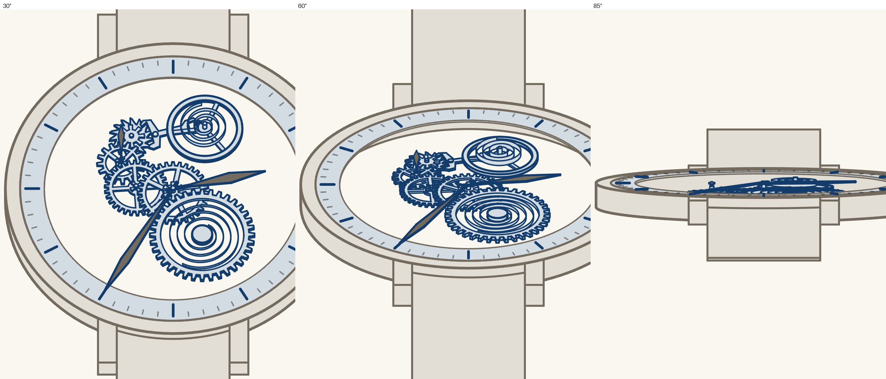

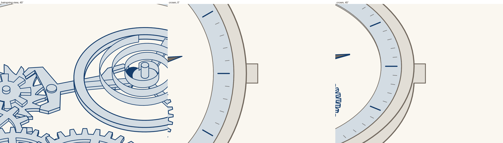

## 2. Heights: where the parts touch

The 2D plan's model stacked each part on everything drawn before it that it
could touch. So the parts drawn last in the SVG ended on top: the hands
floated 1–10 px above their arbors, the pallet fork was 18 px above the
escape wheel, and the balance was under its own hairspring and impulse
jewel. `cover_model.movement()` replaces those heights with rules. The
train keeps the 2D plan's meshing heights.

| Part | Rule | Height, px |
| --- | --- | --- |
| Pallet fork | at the escape wheel's teeth, one step up (below) | 1–4; arbor cap 4–5.5 |
| Impulse jewel | at the escape wheel's teeth, in the fork's notch | 0–3 |
| Balance, hairspring, staff | raised together, so the balance sits on the fork | balance 4–11, hairspring 11–19, staff 11–23 |
| Seconds hand | as low as it can go and still clear every part that it sweeps over in a turn (a disc of its reach); its arbor rises to meet it | 15–17.5; fourth arbor 9–15 |
| Hour hand | the same, and above the seconds hand | 23–24.5; centre arbor 17–23 |
| Minute hand | on the hour hand, and above anything more that its longer reach sweeps over | 24.5–26 |
| Centre pivot | on the minute hand | 26–27 |
| Chapter ring | its top at the bottom of the minute hand, the only hand that reaches over it | 21.5–24.5 |

- **The fork is one step (1 px) above the teeth.** The 2D drawing draws each
  locked tooth under a pallet: they overlap by 12.8–24.9 px² in plan, at every
  one of 81 times over 2 s
  ([tools/intersections.py](tools/intersections.py)). At one height, the two
  top faces would fight in the depth buffer. One step up keeps the 2D paint
  order at 0°, and the pallets still reach into the teeth. **The real fix is
  in the art:** pallets that touch the teeth, not overlap them.
- **The balance staff sets the hands' height.** It is the 2D plan's addition
  (the drawing has none), 4 px above the hairspring, and the hour hand sweeps
  over it. Make it 1 px above the spring, and the hour and minute hands and
  the chapter ring drop 3 px.
- **Physical, not 2D.** The balance wheel is above the fork, as in a real
  movement. The 2D drawing paints the fork over the balance. This is the
  main difference from the 2D drawing at 0° (section 6).
- The remaining overlaps in 3D are small or intended
  ([evidence/intersections.json](evidence/intersections.json)): hubs inside
  their wheels (the same volume, 50 px²), teeth in pinion leaves (the 2D
  plan's 0.07–0.31 px²), balance arms into the rim (up to 0.34 px²), and
  the lugs and strap touching the case's edge (up to 0.26 px²).

## 3. The whole cover

Everything in the 2D cover is in the 3D model:

| 2D element | 3D form | Height, px |
| --- | --- | --- |
| Case band (0.18 fill, 228–250 px) | the ring extruded; deep enough to hold the crown | −11.5 to 24.5 |
| Lugs (four strips, 0.18 fill) | their 2D outlines extruded, as long as in 2D (to 300 px from the centre) | the case's height |
| Strap (two strips, 0.18 fill) | 4 px thick, at the case's mid-height; runs straight on to 1,100 px so that its end leaves the slide up to about 75° | 4.5–8.5 |
| Crown (a rectangle, rx 4) | a cylinder along x, radius 17, at the case's mid-height | centre 6.5 |
| Chapter ring (fill only) | the ring extruded | 21.5–24.5 |
| Ring, bezel and case edges (three stroke-only circles) | the lines of the ring's and the case's outlines | — |
| Hour marks, minute ticks (open strokes) | decals: lines on the ring's top face | 24.5 |
| Clip paths (four discs) | discs in plan: a clipped solid is not drawn inside its disc, at any height | — |

- **Line styles come from the 2D strokes.** A wheel's body is a fill with no
  stroke; the outline is a separate stroke-only copy, 2.5 px outside and
  2 px for the spoke openings. The model matches each stroke-only line to the
  outline that it draws (to 0.05 px) and gives that outline the stroke's
  colour, width and opacity. A stroke that draws no outline is a decal on the
  highest face under it. So the 3D lines have the 2D hierarchy: 2, 2.5, 3
  and 4 px, in `#143C6B`, `#736A60`, and `#2A2520` at 0.5 opacity.
- **The 0.18-opacity fills are opaque in 3D**, in the colour they show over
  the paper (`#E2DED6`). In the 2D drawing each lies over bare paper, so
  this is the same at 0°. In a tilted view, the case then hides what is
  behind it, as a real case does.
- **The clips are optional** (the page's "2D clip paths" box). With them, a
  lower wheel is cut by a vertical cylinder around the arbor above. At 0°
  that is the 2D drawing. Tilted, the difference is small:

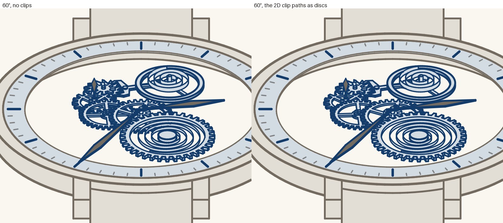

- **Line order.** Lines do not test each other's depth. They are drawn from
  the lowest solid up, so a nearer line covers a farther one where they
  cross. That matters only where lines of two colours cross.

**Choices for you to check**, all constants in `cover_model.py`: the step
of the fork, the staff's height, the lugs' height (the full case) and
length (as in 2D), the strap's thickness, height and straight run, and the
crown's height.

## 4. Lines

### 4.1 The post's technique, in screen space

The pasted passage from mattdesl's post pushes each point along its 2D normal
by half the thickness, **before** the projection. In 3D that makes the width
change with the depth and the view. The post's "screen-space projected lines"
section fixes this: project first, then widen on the screen. The spike does
that:

1. Each edge is one instance of a 4-vertex quad. Its attributes are the two
   3D end points, and the line's colour and width.
2. The vertex shader projects both ends to device px. It moves each corner
   across the edge by the half-width, and along it by the half-width (for the
   caps), plus 1 px for the antialiasing.
3. The fragment shader finds the point of the segment nearest to its pixel,
   and the distance $d$ to it. Coverage is
   $\operatorname{clamp}(w/2 + \tfrac12 - d,\ 0,\ 1)$.

So each segment is a **capsule**. Two capsules that meet make a round join,
with no data about the neighbours. The post's `miter` attribute is for miter
joins, which need each point's neighbours. The house SVG uses
`stroke-linejoin="round"` on 23 of its 36 stroked shapes, and SVG's default,
the miter, on 13. A capsule rounds those corners: for a 3 px line at a 90°
corner, the miter reaches $(\sqrt2 - 1) \times 1.5 \approx 0.6$ px further.
If that matters, add the miter attribute for those shapes.

### 4.2 Which parts of a line are hidden

A line lies on an edge between two surfaces. Half of its width covers one of
them.

**Bartosz's method (a constant bias).** His watch
([watch.js](https://ciechanow.ski/js/watch.js), 8,655 lines) gives every
shader a `_line_shader` twin. Each line is a quad that the vertex shader
widens on the screen by `line_arg.x = 2 / viewport_h` in clip space: 1
device px on each side, 2 in total (about 1 CSS px on a Retina screen). It
moves the quad towards the camera by a constant, `line_offset = -0.0007` in
clip z, and depth-tests it against the faces. The line's colour is the
face's colour times 0.5. The context has `antialias: true` (MSAA). The
meshes come from binary files, and the springs are computed in the vertex
shader.

**Why a constant bias fails for thick lines.** Take a top face at height $h$.
A point on it at $y$ is on the screen at $y' = y\cos\theta - h\sin\theta$, at
depth $y\sin\theta + h\cos\theta$. Along the face,

$$\frac{\partial\,\text{depth}}{\partial y'} = \tan\theta .$$

A line has its edge's depth across its whole width. At a concave edge (a
pinion standing on a wheel), the half of the line that covers the wheel's
face is up to $\tfrac{w}{2}\tan\theta$ behind that face. To keep the line
whole, the bias must be at least that. For a 3 px line at the cover's scale:

| Tilt | 30° | 45° | 60° | 75° | 85° |
| --- | --- | --- | --- | --- | --- |
| Bias needed, slide px | 0.9 | 1.5 | 2.6 | 5.6 | 17 |

A bias larger than the thickness of an occluder lets a hidden line show
through it. The hands are 1.5 px thick, a wheel 3 px. **No constant bias is
right for 3 px lines above about 45°.** For 1 CSS px lines, the part that a
bias gets wrong is at most 0.5 px.

**Slope-scaled offset.** The standard fix: a second depth pass of the faces
with `glPolygonOffset(factor = w/2 + 1)`, which moves each face away by its
own depth slope times the half-width. Test the lines against that pass. It is
much better than a constant bias, but it still fails where a steep face is in
front of a line.

**The centre-line test (proposed).** Draw the faces into a depth texture.
For each fragment of a line, take the point of the line's centre line that is
nearest to the fragment. Compare that point's depth with the faces' depth
there, and draw the fragment only if the centre is visible. Use the farthest
of the 2 × 2 texels nearest to the point, with a tolerance of 0.25 slide px
of depth. So a line is drawn at its full width where its centre is visible,
and not at all where its centre is hidden.

This is the painter's rule of the SVG art. There, a nearer shape's fill and
stroke cover a farther shape's stroke. Where an occluder's edge crosses a
line, the occluder's own outline covers the cut end of the line. The rule is
exact when the occluder's line is at least as wide as the hidden line.

A 3 × 3 neighbourhood was tried first. It lets a line show up to 1 device px
behind an occluder's rim: a sliver 0.5 CSS px wide at low tilts. The 2 × 2
neighbourhood halves that.

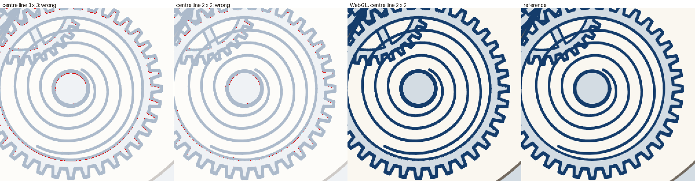

### 4.3 Results

**The reference** for these stills is the 2D plan's slab order, drawn as SVG
by Chromium, with each outline's own line style and the decals. That plan
showed with a z-buffer that the slab order is exact where solids do not
intersect. `scene_export.py` makes the order again for each time. These
stills leave out what the slab order cannot draw: the crown (an x
extrusion) and the clips.

**The stills.** Two views (the cover, the hairspring view), 9 tilts (0°, 5°,
15°, 30°, 45°, 60°, 75°, 85°, 89°) at a still pose, each with the house
widths and with 1 px lines, and 4 moving poses at 45° (0.1, 0.25, 0.6 and
1.3 s). At a device pixel ratio of 2 (1960 × 1104 device px, about the 1080p
projector).

**The measures.**
- A pixel is **wrong** if a colour channel differs from the reference by more
  than 96 of 255 levels.
- The **solid** error counts only the wrong pixels that survive a 3 × 3
  erosion. A missing or extra line of 2–4 CSS px survives it. Scattered
  specks, where two antialiasers put an edge half a pixel apart, do not. It
  cannot see a 1 px line (2 device px wide): for 1 px lines, use the wrong
  area only.
- The **floor** of a still is the smallest solid error of any method. An
  error that every method makes is in the model or the reference, not in a
  hidden-line method. The **excess** is a method's solid error above the
  floor.
- Areas are in CSS px² (4 device px each). The drawing covers 8,000–87,000
  px², depending on the view and the tilt.

**The floor is the reference's own error at concave edges.** Where a face
meets a wall that rises from it (the strap and the lugs against the case,
the hairspring against its staff), the slab order draws the wall after the
face, and the wall covers the upper half of the face's line. WebGL draws the
line at its full width, because its centre is visible. At high tilts these
edges are long: the floor is 19.5–41.8 px² for the cover at 75°–89°, and
115–132 px² for the hairspring view at 85°–89°. The figure shows the cover
at 75°: the proposed method's only errors are at the strap's edge, where the
slope method also has them, plus its own.

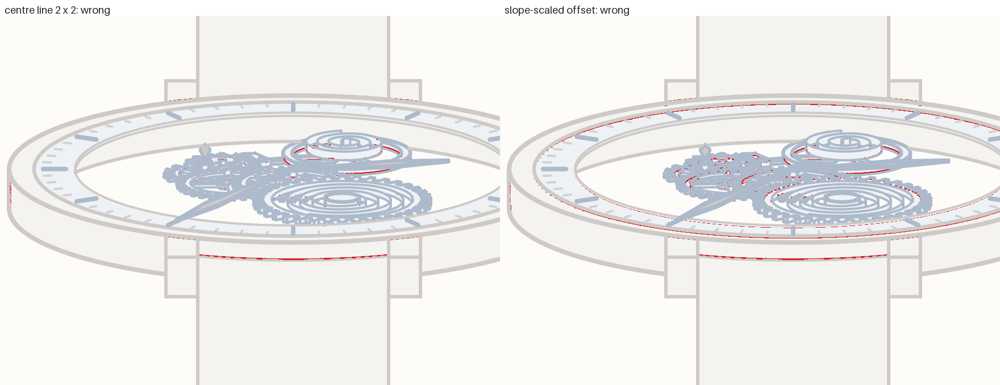

Over the 26 stills with the house widths (Chromium; Firefox is the same to
within 0.5 px², [evidence/webgl_probe.json](evidence/webgl_probe.json);
tables by [tools/method_comparison/summarize.py](tools/method_comparison/summarize.py)):

| Method | Stills with no solid error | Worst solid | Median solid | **Worst excess** | Stills with excess | Worst wrong | Median wrong |
| --- | --- | --- | --- | --- | --- | --- | --- |
| **Centre line, 2 × 2 texels** | 7 | 131.8 | 1.65 | **2.3** | 7 | 1,665 | 532 |
| Centre line, 3 × 3 texels | 7 | 131.8 | 1.8 | 2.3 | 11 | 1,760 | 631 |
| Slope-scaled offset | 5 | 140.5 | 5.85 | 28.2 | 19 | 1,741 | 648 |
| Constant bias, 1 px | 1 | 810.2 | 18.2 | 695.2 | 25 | 8,199 | 897 |
| Constant bias, 0.25 px | 9 | 2,365.8 | 135.3 | 2,234 | 14 | 10,706 | 2,618 |
| Constant bias, 4 px | 0 | 4,680 | 191.9 | 4,680 | 26 | 11,546 | 2,183 |

With 1 px lines (18 stills), the wrong area, median and worst: centre line
2 × 2, 151 and 689; slope-scaled, 126 and 556; bias 1 px, 259 and 1,634;
bias 0.25 px, 892 and 2,938. With thin lines every method but the 4 px bias
is acceptable, as Bartosz's watch shows.

Per still, solid error (wrong area in brackets), house widths, Chromium:

| Cover | Drawn | Floor | Centre 2 × 2 | Slope | Bias 0.25 | Bias 1 | Bias 4 |
| --- | --- | --- | --- | --- | --- | --- | --- |
| 0° | 32,968 | 0 | 0 (447) | 0 (301) | 0 (301) | 16 (340) | 161 (958) |
| 5° | 34,716 | 0 | 0 (370) | 0 (62) | 0 (118) | 0.2 (129) | 164 (888) |
| 15° | 36,708 | 0 | 0 (422) | 0 (285) | 82 (1,599) | 52 (518) | 184 (2,324) |
| 30° | 38,095 | 0 | 0 (478) | 6.5 (488) | 195 (4,736) | 30 (1,015) | 212 (3,366) |
| 45° | 36,132 | 2.5 | 2.5 (583) | 10.8 (657) | 305 (6,004) | 18 (1,888) | 31 (1,795) |
| 60° | 32,628 | 2 | 2 (506) | 3.5 (782) | 476 (6,116) | 70 (3,175) | 7 (794) |
| 75° | 25,342 | 19.5 | 19.5 (330) | 20.8 (1,007) | 632 (4,557) | 343 (3,388) | 24.5 (1,137) |
| 85° | 15,231 | 36.5 | 36.5 (225) | 36.8 (446) | 362 (2,264) | 304 (2,055) | 87 (1,540) |
| 89° | 8,012 | 41.8 | 41.8 (514) | 41.8 (550) | 189 (819) | 189 (814) | 189 (811) |
| 45°, running, 4 times | 36,150–36,252 | 1.8–2.5 | 1.8–2.5 | 10.2–16 | 303–307 | 18.2 | 29.5–31.8 |

| Hairspring view | Drawn | Floor | Centre 2 × 2 | Slope | Bias 0.25 | Bias 1 | Bias 4 |
| --- | --- | --- | --- | --- | --- | --- | --- |
| 0° | 36,272 | 0 | 0 (177) | 0 (125) | 0 (125) | 90.5 (318) | 838 (2,042) |
| 5° | 41,935 | 0 | 0 (1,001) | 0 (908) | 0 (403) | 0.5 (121) | 784 (5,115) |
| 15° | 45,802 | 0 | 0 (1,665) | 28.2 (1,741) | 0 (2,542) | 0 (760) | 3,124 (9,663) |
| 30° | 46,788 | 0 | 0.8 (1,124) | 1.2 (1,190) | 0 (2,693) | 1 (980) | 4,680 (11,546) |
| 45° | 56,768 | 0 | 1.5 (547) | 2.8 (616) | 0 (2,251) | 14.2 (757) | 1,593 (4,391) |
| 60° | 71,457 | 2.2 | 4.5 (349) | 5.2 (594) | 2.2 (4,466) | 7.2 (669) | 1,925 (4,992) |
| 75° | 87,047 | 9 | 9 (236) | 21.2 (707) | 581 (9,207) | 11 (1,578) | 856 (2,690) |
| 85° | 59,265 | 131.8 | 131.8 (1,004) | 140.5 (1,172) | 2,366 (10,706) | 717 (8,199) | 168 (1,513) |
| 89° | 36,550 | 115 | 115 (970) | 115 (974) | 873 (4,548) | 810 (4,321) | 195 (3,622) |
| 45°, running, 4 times | 56,477–57,411 | 0–0.2 | 0.8–1.2 | 1.2–2 | 0–0.2 | 3.5–9.2 | 1,589–1,624 |

- **The moving poses are as good as the still ones.** The depth buffer does
  not care whether the parts moved, so nothing is recomputed per frame.
- **At 0° and 5°, the bias methods have fewer specks** (the wrong area in
  brackets). The centre-line test still lets some lines show up to 1 device
  px behind a rim. None of it survives the erosion.
- **The small bias looks good at low tilts in the hairspring view** (0 solid
  error to 45°), because that view is zoomed 4.46 times: a line's half-width
  is 4.46 times smaller in slide px, so the bias it needs is too. It fails
  from 75°.

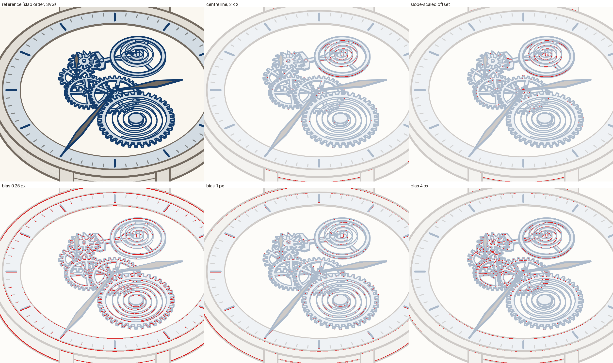

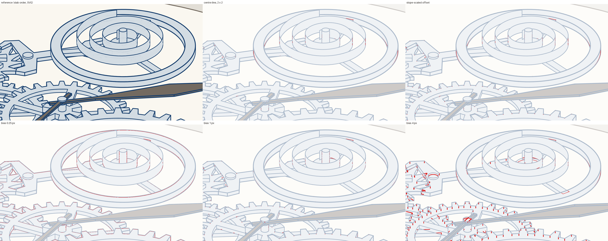

### 4.4 Silhouettes of curved walls

The art's lines are the outlines of shapes. In 3D, a wall also needs a line
where it turns away from the camera: the silhouette of a cylinder, a tooth's
flank, a coil of the hairspring, or the crown. The spike makes an edge from
bottom to top at every point of every outline:
- at a corner (two path commands meet at more than 5°) or at the end of an
  open outline, it is always drawn;
- at any other point, it carries the normals $n_-$ and $n_+$ of the outline's
  two edges there. The vertex shader turns them by the solid's model matrix
  and draws the edge only if $\operatorname{sign}(n_- \cdot v) \ne
  \operatorname{sign}(n_+ \cdot v)$, with $v$ towards the camera. Otherwise it
  puts the quad outside the clip volume.

The test uses the 3D normal and the camera's direction, so it holds for any
camera and any placement: the crown, extruded along x, gets its silhouettes
from the same shader. The same idea works for a mesh of a curved surface (a
crown's dome, a rounded case): an edge between two triangles is a
silhouette where one faces the camera and the other does not. That is not
tested.

### 4.5 The post's "Other approaches"

| Approach | What it is | For us |
| --- | --- | --- |
| Stencil geometry | Fill any polygon by counting its triangle fan in the stencil buffer, then cover it | **Used, for the faces** (section 5). Not for lines: no antialiasing. |
| Loop–Blinn curve rendering | Exact quadratic and cubic curves in the fragment shader | Not needed: arcs are flattened in steps of 3°, below a pixel at these sizes. |
| Rasterized strokes | Stamp a brush texture along the path | No: the house style has no texture. |
| Single-pass wireframe | Draw triangle edges from inside the triangle, with barycentric coordinates | No: it draws only the inner half of a line, and every triangle edge unless each is marked. |
| Geometry shaders | Make the line's quads on the GPU | Not in WebGL2. The instanced quad does the same job. |
| Analytic distance fields | Coverage from the distance to the shape | **Used, per segment**: the capsule's antialiasing and round ends. |
| (Not in the post) Edge detection after rendering | Find lines where the depth, normal or part changes, in a full-screen pass | Silhouettes of any surface for free, and no hidden-line test. But widths come from a pixel kernel, so the stroke ladder and SVG's antialiasing are hard to match. Not tested. See section 7. |

### 4.6 Would three.js do this for us?

No. Its `LineSegments2` / `LineMaterial` (three 0.186.1) uses the same
screen-space expansion, with round caps made by `discard`. It hides lines
with the depth buffer, as Bartosz does (section 4.2). It antialiases only
with `alphaToCoverage` and MSAA. It has no silhouette edges: its
`EdgesGeometry` gives fixed crease edges. We would still write the two
shaders that matter, and add 188 KiB gzipped (2D plan, Q6).

## 5. Faces: stencil-then-cover

A face is an outline with holes, filled by the even-odd rule, as in SVG. The
spike does not triangulate it:
1. With colour and depth writes off and the depth test off, draw a triangle
   fan of each ring, and flip stencil bit 0 for each triangle. A pixel inside
   the face is covered an odd number of times.
2. Draw the face's bounding rectangle, at the face's height, where bit 0 is
   set, with the depth test on. Clear the bit as it passes.

That is exact even-odd filling, at the face's own depth, with no
triangulation library. The fills are not antialiased (`antialias: false`).
Almost every edge of a fill lies under a line. The exceptions are the two
fills with no stroke in the 2D art, the impulse jewel and the seconds hand's
cap: their edges are aliased. If that shows, draw the colour pass with MSAA
and keep a single-sample depth pass for the centre-line test.

## 6. Parity with the 2D drawing at 0°

The whole cover, with the clips, at 0°, against the real SVG
(`inputs/skeleton-watch.svg`, paused at the same time by
`setCurrentTime`), at 5 times:

| Time | 0.1 s | 0.25 s | 0.37 s | 0.6 s | 1.3 s |
| --- | --- | --- | --- | --- | --- |
| Solid error, centre line 2 × 2, px² | 69.8 | 78.5 | 91.5 | 83.0 | 78.5 |

All of it is at the balance's centre: the balance's arms and hub now lie
over the end of the fork (section 2), and the balance staff (an addition of
the 2D plan) shows. Every method has the same error (69.5–108 px²). The rest
of the cover, including the ring's marks, the case, the lugs, the strap and
the clipped wheels, matches.

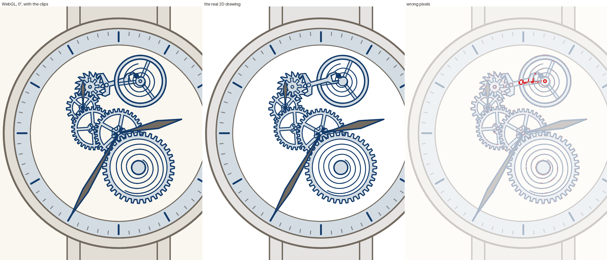

If the talk wants the 2D paint order at 0° instead, put the balance under
the fork (it overlaps nothing else in plan) and drop the staff. That trades
the physical order for parity.

## 7. What could change the decision for the centre-line test

The data above settles it for this model and these views. These would make
me measure again:

1. **Many curved surfaces.** If the talk needs a rounded case, a domed crown,
   curved lugs or a strap that bends, the silhouette edges (section 4.4) grow
   with the mesh, and each needs its two normals. Edge detection after
   rendering (section 4.5) gets silhouettes of any surface for free and needs
   no hidden-line test at all. It is the one alternative that could replace
   the whole line pipeline. It is not tested.
2. **Your eye at the projector, at low tilts.** At 0°–15° the centre-line
   test has more specks than the slope method (for example 370 against 62 px²
   of wrong area, cover at 5°), and none of them is solid. If you can see
   them and not the slope method's errors at high tilts, use the slope
   method below about 20° and the centre-line test above it. Both ran in one
   shader in the comparison (`tools/method_comparison/webgl/renderer.js`);
   the renderer now has only the centre-line test.
3. **Fills that need MSAA** (section 5). WebGL2 cannot sample a multisampled
   depth buffer, so the centre-line test needs its own single-sample depth
   pass. The slope method works with MSAA as it is. The extra pass costs
   about one more draw of the faces.
4. **A perspective camera.** The centre-line test interpolates depth along
   the segment on the screen, which is exact only for an orthographic
   camera. Perspective needs the interpolation in $1/w$. A small change, not
   a reason to switch.
5. **Lines of different widths crossing.** Where a 2 px line hides a 4 px
   line, the test hides all of the thick line; the SVG shows up to 1 px of
   it. Where lines of two colours cross, the order is the drawing order by
   height, not depth (section 3). Neither is measured on its own.

None of these makes a constant bias usable at our widths.

## 8. Where the geometry of the parts lives

`renderer.js` knows nothing about watches. It extrudes the outlines in
`scene.json` and animates the groups. The geometry is in three places:

- **Teeth, radii, spokes and arbor positions** are in the talk's generator,
  [art/skeleton_watch.py](../../art/skeleton_watch.py). The centre wheel is
  `CENTRE = Wheel("centre", teeth=32, pitch_radius=50, spokes=5, leaves=6,
  driven=THIRD)` (line 203). The arbors follow from `LAYOUT` (line 247):
  `Placement` puts each arbor at its mesh distance from the arbor before it,
  at the layout's angle (line 673). The generator writes
  `public/cover/skeleton-watch.svg`.
- **The spike reads that SVG**, frozen in `inputs/`. So the geometry reaches
  the spike as outlines already placed: a wheel's teeth are points of a path,
  and its arbor is its group's `translate`.
- **The heights are not in the SVG at all.** They come from `depth_order.py`
  (the thickness of each kind of shape, by the SVG's top-level group) and
  `cover_model.py` (the rules of section 2). That is why the spike needs the
  SVG's group order and matches strokes to outlines: it recovers 3D from 2D.

In the architecture of the 2D plan (its Q1-B), this is a spike's shortcut.
There, `skeleton_watch.py` builds one Python model and writes both the SVG
and the scene file. The heights, the line styles and the 3D forms of the case,
the strap and the crown then belong in the generator, next to the tooth
counts, and the stroke matching and the group indices go away.

## 9. Options and ranking

| Option | For | Against |
| --- | --- | --- |
| **F. WebGL draws every view, and there is no SVG.** The generator writes only the scene file. A PDF export of the deck is the static fallback. | One renderer and one output. The generator's 3D model is the only source: no stroke matching, no SVG group order (section 8). The tests of section 10 cover what the SVG gave for free: the presenter view, the export, the overview. The fallback covers every slide, the 3D ones too. | The house checks read SVG files: they must be ported first (section 11). An SVG can be viewed and diffed without the renderer. |
| C. WebGL draws every view; the generator also writes the 2D SVG, for the house checks and as a fallback for the 2D views | The house checks run as they are. An independent fallback for the 2D views. | Two outputs to keep equal (the parity check of section 6). The fallback covers only the 2D views: 3 of the 10 watch slides in the test deck. |
| B. The 2D plan, plus WebGL for 3D views only | 2D views keep the plan exactly. | Three renderers (SVG, Canvas 2D, WebGL) and the slab order: the most code. A view that goes from 2D to 3D must hand over between renderers without a visible jump. |
| A. The 2D plan only | Designed and measured. No GPU dependency. | No motion while tilted; one tilt axis; the crown and the keyless works need the slab order extended. Firefox: 12 ms per frame. |
| E. As F, with three.js | Cameras, matrices and loaders exist. | 188 KiB gzipped. Its lines are the constant-bias kind (section 4.2), with no silhouettes, so we still write both shaders. |

**Ranking: F, C, B, A, E.**
- F is first now that the deck tests (section 10) passed: the SVG's remaining
  jobs are the house checks and a fallback, and both have a WebGL answer
  (section 11).
- C was first before the deck tests. It is still the choice if porting the
  house checks is not worth a day.
- B risks nothing in the 2D views, but it costs the most code.
- A does the planned still tilt well, but nothing more.
- E adds a large dependency for the parts that are easy.

## 10. The deck: visible windows, the presenter view, the export, the overview

[deck/](deck/) is a Slidev deck of 11 slides, run by the talk's own Slidev
53 (`pnpm exec slidev`): 10 slides with the watch (the cover, the hairspring
view and the crown view, at tilts from 0° to 85°) and one plain slide.
[tools/deck_check.py](tools/deck_check.py) starts it, measures it, and stops
it ([evidence/deck_check-*.json](evidence/)).

- **The live layer** ([deck/global-bottom.vue](deck/global-bottom.vue)): one
  WebGL canvas under every slide, for the whole talk. Each slide names its
  view in its frontmatter (`watch: hairspring`, `watchTilt: 45`). The camera
  eases to it over 1.8 s; the mechanism runs throughout.
- **The stills** ([deck/slide-bottom.vue](deck/slide-bottom.vue)): where a
  slide is not the live one (print and export, the overview, the presenter's
  "next" pane), a PNG of its view, drawn by **one hidden renderer shared by
  the page**. So a page has at most two WebGL contexts, whatever its number
  of slides. One context per slide would pass the browsers' limit: Slidev
  mounts the global layer once per printed page.
- **What Slidev does that the spike had to handle:**
  - a printed page gets the render context `"slide"` and a fixed nav with no
    `isPrintMode`; the page's own `useNav()` knows print mode;
  - the still is positioned, so it paints over the slide's text unless the
    slide's layout is positioned too (the talk's cover does the same);
  - `slidev export` waits for `[data-waitfor]` selectors: each still says
    when its image is there;
  - the dev server does not serve `/print`; `slidev export` starts its own
    server in "export" mode ([tools/export_server.mjs](tools/export_server.mjs)
    does the same).

The tables below were measured again on 2026-09-29, after the size bug of
section 10.1 was fixed: before, the drawing had 1960 × 1104 px on the laptop
and 980 × 552 px in the 1080p window, stretched to the screen. At the true
size the JS per frame is about 0.2 ms more in Chromium and the same in
Firefox. In the windows no frame gap grew; in the presenter view, Chromium's
"lazy" run had one gap of 33 ms where it had none over 25 ms before.

**Visible windows.** The deck, stepped through by the arrow key, 3 s per
slide. "Laptop" is a window as large as the screen at its own pixel ratio,
like full-screen Slidev (the canvas task's method); "projector" is an
emulated 1920 × 1080 window at ratio 1. The screen runs at 120 Hz, so a frame
is 8.3 ms:

| Browser, window | Window | Gaps over 25 ms, watch slides | Largest gap, watch slides | JS per frame, median (95th percentile) |
| --- | --- | --- | --- | --- |
| Chromium 153, laptop | 1728 × 997, ratio 2 | 0 | 9.4 ms | 0.8–0.9 ms (≤ 1.1) |
| Chromium 153, projector | 1920 × 1080, ratio 1 | 0 | 9.4 ms | 0.7–0.8 ms (≤ 1.2) |
| Firefox 155, laptop | 1728 × 1000, ratio 2 | 0 | 16.7 ms | 1 ms (2) |
| Firefox 155, projector | 1920 × 1080, ratio 1 | 0 | 9.4 ms | 1 ms (2) |

Chromium drew every frame at 120 Hz. Firefox dropped one 120 Hz frame, on 1
of 10 slides in one window; at 60 Hz that is none. The first run, with the
small drawing, had one larger gap on the change to the plain slide, as the
layer stops (67 ms in Chromium, 33 ms in Firefox); this run had none over
9.4 ms there.

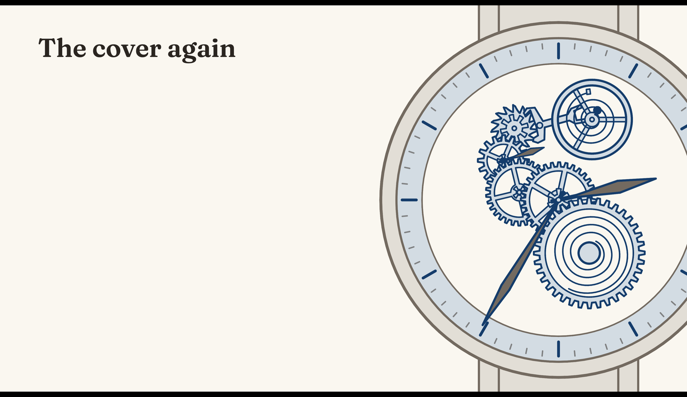

**The presenter view.** One visible window, full screen, with two frames side
by side, as the canvas task's C18: the presenter view on the left, the
audience view on the right. The arrow key goes to the presenter, and Slidev
moves both. The presenter view draws the stills for its "next" pane either
all at once while it is idle after loading ("eager", the default) or at each
slide change ("lazy"):

| Browser, stills | Gaps over 25 ms, watch slides | Largest gap | WebGL contexts, presenter / audience | Contexts lost |
| --- | --- | --- | --- | --- |
| Chromium, eager | 0 | 9.4 ms | 2 / 1 | 0 |
| Chromium, lazy | 1 | 33.4 ms | 2 / 1 | 0 |
| Firefox, eager | 0 | 25.0 ms | 2 / 1 | 0 |
| Firefox, lazy | 2 | 34.0 ms | 2 / 1 | 0 |

- Every gap over 12.5 ms but one came 10–40 ms after the key press: the
  slide change itself, in both frames at once (same-origin frames share one
  main thread). With two windows on two screens that may be less; it is not
  tested.
- One run each at the true size. The runs with the small drawing, and one
  more lazy run before them, agree: eager stills are better in both
  browsers, and they are the default.
- The canvas task measured Canvas 2D the same way: in Firefox, 0–3 missed
  frames per change with "erase", no gap over 25 ms. WebGL is about the same.

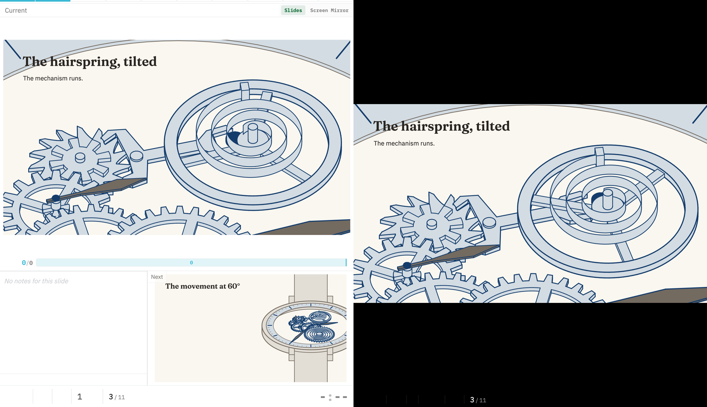

**The export.** On 2026-09-29 the talk got `playwright-chromium` 1.63.0, the
package that `slidev export` needs. Then
`pnpm exec slidev export tasks/2026-09-28-webgl-planning/deck/slides.md` made
11 pages in 4.0 s (PDF 1.8 MB), with the still drawn on each watch page and the
house fonts. Before that, `deck_check.py export` ran the export's own steps (Slidev
53's `export-*.mjs`) with this venv's Playwright Chromium: the export-mode
server, a 980 px viewport as tall as all the slides at scale 2,
`/print?print=true`, `networkidle`, the `[data-waitfor]` waits, then
`page.pdf()` and a screenshot of each page. Headless and without GPU flags,
so WebGL ran on SwiftShader, as a default export does.

| Pages | WebGL contexts | Every still drawn | In all | PDF |
| --- | --- | --- | --- | --- |
| 11 | 1 (the stills) | 2.5 s after load | 4.1 s | 1.8 MB |

Each of the 10 watch pages has the watch's line colour (14,838 to 189,952
px); the plain page has none.

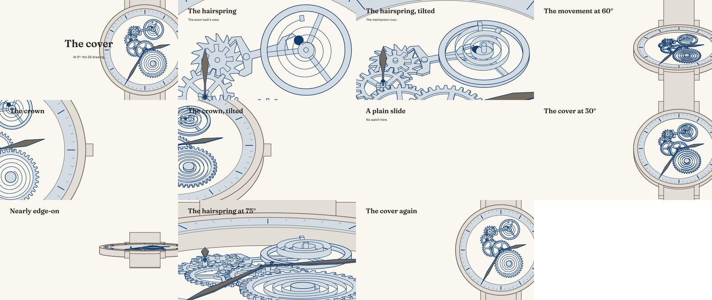

**The overview** (`/overview`): 1 WebGL context, 10 of 10 stills drawn.

### 10.1 The opening: zoom, fade, tilt, settle

The talk's first two slides, as requested on 2026-09-29
([deck/slides-opening.md](deck/slides-opening.md)):
1. The cover, with the title.
2. A key press goes to slide 2. The title fades as the camera zooms to the
   hairspring. Then the rest of the watch fades until only the hairspring and
   its stud are left. Then the camera tilts 20° while the spring swings, to
   show that it is a ribbon.
3. A key press (a click on slide 2) settles the balance: it waits for the
   next extreme, where it is still, and then moves to rest.

A slide asks for all of this in its frontmatter ([deck/watch-state.ts](deck/watch-state.ts)):

```yaml
watch: hairspring
watchOnly: hairspring and stud   # the rest of the watch fades
watchTilt: 20
watchSettle: 1                   # the click at which the balance settles
clicks: 1
```

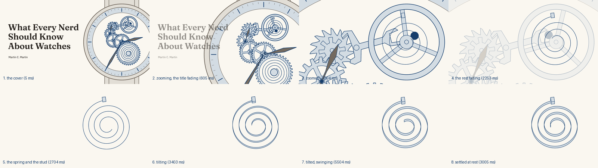

**The stage** ([tools/webgl/stage.js](tools/webgl/stage.js)) runs one
channel at a time, eased: towards a subject, the camera moves (1.8 s), then
the rest fades (0.8 s), then the camera tilts (1.5 s); away from it, the
reverse. A new state starts from what is on the screen now, so a key press
during a transition does not jump (section 13.1, item 4).

**The stud** (added to [tools/cover_model.py](tools/cover_model.py)): the 2D
drawing has none; the spring's outer end is only a point. It is a block of
7 × 5 px around that end, 1 px higher and lower than the ribbon. It is in the
cover too, where it is visible at 0°. The parity check and the slab-order
references leave it out ("inDrawing": false), so `pixel_check.py` still shows
0 changes. The balance staff belongs to the balance, so it fades: the spring's
inner end is then free.

**The exact swing.** SVG plays 25 samples of the swing and 25 frames of the
spring, linearly. So the balance turns at 61°/s at an extreme, not 0 (section
13.1, item 1). The scene file now also gives the swing's amplitude and period,
flags the groups that turn with the balance, and gives the spring as an
Archimedean spiral. The renderer takes the balance's angle and draws both
exactly. The export checks the spiral against all 25 frames of the drawing:
the points where the drawing's 13 Bézier segments join are within 0.063 px of
it, and between the joins the Béziers bulge by up to 0.91 px. So the spiral is
the more accurate of the two.

**The fade** ([tools/fade_check.py](tools/fade_check.py),
[evidence/fade_check.json](evidence/fade_check.json)). The renderer draws the
frame twice, with the rest of the watch and without it, and mixes the two
pictures (section 13.1, item 2). At the laptop's full-screen size,
3456 × 1947 px:

| Check | Chromium | Firefox |
| --- | --- | --- |
| Start of the fade against no fade | 0 levels | 0 levels |
| Largest step into and out of the fade (rest 0.002 and 0.998) | 0 levels | 0 levels |
| Middle of the fade against the mean of its ends | 0.5 level | 0.5 level |
| Frame time with `gl.finish()`, median: no fade / middle of a fade | 0.5–0.8 / 0.5–0.7 ms | 3 / 3–4 ms |

Firefox's timer has a resolution of 1 ms. Chromium had one outlier per view
in a fade (39 and 57 ms in 60 frames); the live runs below show no such gap.

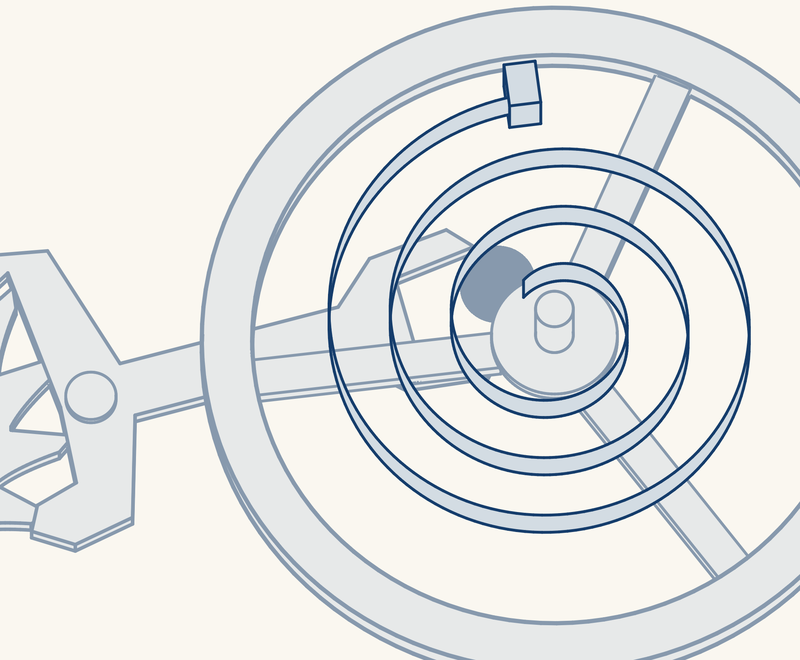

**The settle: which curve.** The 2026-09-27 plan measured three ways to stop
the balance (its section 2.5). From an extreme $q_e$ at $t_e$:

| Rank | Curve | Jump in angle / speed / acceleration at the start | Peak speed |
| --- | --- | --- | --- |
| 1 | **Smoothstep in angle**: $q = q_e\,(1 - s(u))$, $s(u) = 3u^2 - 2u^3$, $u = (t - t_e)/D$, $D = \sqrt6/\omega = 0.78$ s | 0 / 0 / **0** | 289°/s |
| 2 | Slow the mechanism's clock, smoothstep in time | 0 / 0 / 1,480°/s² (a brief hang at the extreme) | 374°/s |
| 3 | Freeze at the key press | 0 / 381°/s / 871°/s² | — |

The first ranks first: it is the only one with no jump at the start, and
its speed is the requested quadratic, zero at both ends. At the stop, its
acceleration drops from 1,480°/s² to 0: any curve that stops in finite time
has a jump in some derivative, and a curve of degree 7 would move it to the
third derivative. The spike uses the first.

The rest of the mechanism follows the balance through the 2026-09-27 plan's
time map, $\tau = t_e + \arccos(q/q_e)/\omega$. So the train stops when the
balance stops, and the mechanism time never runs backwards. To resume,
the balance goes on to the opposite extreme, by a cubic that starts at its
current angle and speed and ends still at that extreme in $D$. From rest, that
is the settle mirrored, and it meets the free swing with no jump in any of the
three.

[tools/settle_check.mjs](tools/settle_check.mjs)
([evidence/settle_check.json](evidence/settle_check.json)) samples the stage's
balance every 0.1 ms. A jump at one instant falls across two steps, so about
half of it shows:

| Case | Wait until it moves | Jump in speed, per step | Jump in acceleration, per step |
| --- | --- | --- | --- |
| The free swing (the control) | — | 0.15°/s | 0 |
| Settle, requested at 7 phases of the swing | to the next extreme: 0–1.0 s | 0.15°/s | 0 at the extreme; 786°/s² at the stop (1,480 at one instant) |
| Resume from rest | none | 0.15°/s | 740°/s² at the start (the stop mirrored); 0 where it joins the free swing |
| Resume during a settle | none | 0.18°/s | 364°/s² |

The balance reaches rest 0.78 s after the extreme. The mechanism time never
went back (largest step back: 0 s).

**In visible windows** (`deck_check.py opening`,
[evidence/deck_check-opening.json](evidence/deck_check-opening.json)). The
sequence above, then a key press back (resume), then back to the cover: the
tilt, the fade and the zoom run in reverse. Each frame is counted in the phase
that the stage was in. A gap over 12.5 ms misses a frame at 120 Hz:

| Window | Zoom, 432 frames | Fade, 192 frames (two pictures each) | Tilt, 360 frames | Settle, rest, resume, 432 frames | JS per frame, median by phase |
| --- | --- | --- | --- | --- | --- |
| Chromium, laptop (3456 × 1947 px) | 0 missed | 0 | 0 | 0 | 0.4–0.9 ms |
| Chromium, projector (1917 × 1080 px) | 0 | 0 | 0 | 0 | 0.4–0.8 ms |
| Firefox, laptop | 1 (17.1 ms, at the key press) | 1 (16.6 ms) | 0 | 1 (25.2 ms, 0.2 s after the resume key) | 1 ms or less (its timer's resolution) |
| Firefox, projector | 0 | 0 | 0 | 0 | 1 ms or less |

- No gap over 25 ms in any window, apart from Firefox's 25.2 ms above and one
  of 25.0 ms while the check took its screenshot. In each Chromium window the
  one larger gap (42–50 ms) is at the page's load, before the first key.
- One earlier Firefox laptop run had one stall of 144 ms, 0.2 s after the
  tilt ended. Four other Firefox laptop runs had none over 18.2 ms. One
  earlier Firefox window did not start the stage in 60 s; the next run did.
- In the "projector" window, Chromium sometimes showed the whole page small in
  its upper-left corner for a moment, when the URL changed after a Playwright
  screenshot. The page's own sizes did not change. It needs Playwright's
  emulation of a page larger than the window and a screenshot (seen by eye,
  2026-09-29). The talk has neither.

**A size bug, found here and fixed.** The stage sized its drawing from the
canvas's `clientWidth`, which leaves out the CSS transform by which Slidev
scales the slide. So it drew 1960 × 1104 px on the laptop's 3456 × 1947 px
slide, and 980 × 552 px on the 1080p one, and the browser stretched the
picture. It now uses the canvas's bounding box. The tables in this section are
measured again with the fix.

## 11. WebGL for the whole talk, with no SVG: what it takes

My view: **yes, commit to it**, on three conditions. The deck tests answered
the questions that kept the SVG in option C: the presenter view, the export
and the overview work, and the frames are smooth in both browsers.

What the SVG does today, and what replaces it:

| The SVG's job | With no SVG | Work |
| --- | --- | --- |
| The live art on the cover slide (``) | The live layer | part of the stage work |
| `artcheck.py`: palette, stroke ladder, structure (from SVG attributes) | A check of the scene file: its colours, widths and opacities are data there | small: a few dozen lines |
| `barroom.py` and `motion.py`: legibility and motion at the back row (they render the SVG and measure pixels) | The same measures on stills from the renderer, at 0° and at each tilted view | moderate: they need a way to take PNGs, or a page to render |
| `tools/validate.py` runs those three on every SVG in the talk's `public/` | Without the port, the watch would drop out of the checks **silently** | wire the new checks in |
| `validate_skeleton_watch.py` regenerates and checks the SVG | It regenerates and checks the scene file | small |
| A fallback if the live art fails | A PDF export of the deck, made before each talk (section 10: 4 s); it covers every slide, the 3D ones too | exists: `pnpm export` in the talk (2026-09-29) |
| An independent second picture to compare with (the parity check, section 6) | The Python slab-order reference (`pixel_check.py`), which does not use WebGL either | exists |
| A file that anyone can open and diff | `tools/webgl/index.html` views the scene; a diff of the scene file is less readable | none |

**The conditions:**
1. **Port the checks before the SVG goes**, so that the watch is never
   unchecked.
2. **Keep a static fallback**: export the deck to PDF before each talk.
3. **Keep the slab-order pixel check** as the renderer's test.

The other talks' art (the timekeeper cards) stays SVG and is not affected.

## 12. If we go ahead: stages

For option F. The estimates are planning guesses, not measurements.

| Stage | Work | Checks | Estimate |
| --- | --- | --- | --- |
| 1 | The design file from the Python search; the talk's TypeScript generator for the 3D model (heights, line styles, the frame's 3D forms, views; section 13.3); no SVG | the geometry, written by the generator in Node, against the types; the slab-order pixel check | 3 days |
| 2 | The renderer and the stage in TypeScript, from the spike; context loss | `pixel_check.py` | 1.5 days |
| 3 | The stage from the spike (section 10.1: channels one at a time, the fade, the balance's settle and resume with the time map), plus models and the change between them | `settle_check.mjs`, `fade_check.py` | 1 day |
| 4 | Slidev: the layer and the stills from the spike deck; the export (`pnpm export`) | `deck_check.py` | 1 day |
| 5 | The house checks for the watch: the scene file's palette and ladder; `barroom` and `motion` on stills; `validate.py` | the checks fail on a planted error | 1 day |
| 6 | The 3D slides: the hairspring tilt, the train running while tilted; the keyless works if the talk shows them | your eye | 1 day |
| 7 | The projector and a two-screen presenter setup; docs | 0 gaps over 25 ms | 0.5 day |

About 9 days. The spike already has most of stages 2, 3 and 4. Stage 1 includes the port of the drawing code from Python.

**The language: TypeScript** (decided 2026-09-29), for the renderer, the
stage and each talk's geometry generator. The spike's JavaScript stays as it
is, because it is the evidence for this plan.

| Rank | Choice | For | Against |
| --- | --- | --- | --- |
| 1 | **TypeScript**, with `strict`, `noUncheckedIndexedAccess` and `erasableSyntaxOnly`, checked by `tsc --noEmit` | Types for the data between Python and JS (the design file, the geometry that the generator gives the renderer, the stage's states) and for the house rules on code design, as `mypy --strict` gives the Python. WebGL2 is typed in TypeScript's standard types. | Arrays of numbers need more annotations (`Float32Array` against `number[]`, indexing in strict mode). A new check in `validate.py`, which is a house tool. |
| 2 | JavaScript with JSDoc types, checked by `tsc` with `checkJs` | The same checks, and no port | Types in comments are harder to read and write |
| 3 | Plain JavaScript, as in the spike | Nothing to add | No check of the data between the parts |

- **No build step.** Vite removes the types when Slidev serves the deck. The
  talk's Node (v26.10.0) ran a `.ts` file directly (2026-09-29), so the
  generator runs in Node for tests and for the Python checks with no
  compile. Node's direct run does not support `enum`, `namespace` or class
  parameter properties; `erasableSyntaxOnly` makes `tsc` reject them.
- **It would have caught a bug of this task.** After `target(width, height)`
  became `target(index, width, height)`, one old call stayed. It cost a
  failed check run and a search for WebGL error 1281 (section 10.1).
  `tsc` reports a missing argument at once.
- **JSON still needs a check at load:** types do not check data that
  arrives at run time.
- **Add `typescript` to the talk's `devDependencies`.** TypeScript 6.0.3 is
  in the talk's lockfile today only because a Slidev package depends on it.
- **The shaders stay GLSL in strings,** with no types, in all three choices.

**Still to try before stage 1:** your eye on the 3D model's choices (section
3) and on the low-tilt specks (section 7), in the page or the deck.

## 13. Risks and unknowns

- **The projector and two screens** are not tested. The laptop tests had
  a large margin (JS 0.5–2 ms per frame of 8.3 ms).
- **Firefox and slide changes:** one or two frames at 120 Hz per change in
  the presenter setup (section 10).
- **Firefox at the laptop's full size:** about three missed 120 Hz frames in
  20 s of the opening, and once a single stall of 144 ms (section 10.1).
  At 60 Hz, most of these are not missed frames.
- **The model's choices** (section 3) are mine, and some are guesses about
  what reads well: for example the lugs as full-height blocks.
- **The escapement's 2D geometry** puts the pallets inside the teeth. The
  1 px step hides it at 0°. Tilted, a pallet visibly enters a tooth.
- **Line joins** are round everywhere (section 4.1).
- **WebGL2 availability** is not a risk for this talk: it runs on the
  speaker's own laptop, both browsers had WebGL2 in every run, and the
  export ran on SwiftShader with no GPU. A context loss is handled: the
  renderer builds its buffers again when the context comes back.

### 13.1 Findings kept from the first Canvas 2D plan

[`../2026-09-26-canvas-2d-refactor/`](../2026-09-26-canvas-2d-refactor/PLAN.md)
(reviewed 2026-09-29) planned an SVG reader and a Canvas 2D adapter. The WebGL
route replaces most of it:
- The depth buffer replaces its depth-order analysis.
- Screen-space lines replace its rule for line widths under zoom.
- With no SVG, its questions about the SVG reader and the data format are gone.
- The 2026-09-27 plan already carries its settle and its ruler.

These findings still apply:

1. **The balance and the hairspring move in straight segments.** The scene
   file has 25 samples over 2 s for each, and the renderer interpolates
   linearly between them, as SMIL does. Near an extreme the balance turns at
   $61.33^\circ$/s, not 0 (09-26 section 6), so the settle (stage 3) starts
   at a corner. Without SVG, the stage can calculate
   $q(t)=150^\circ\cos(2\pi t/T)$ and the spring's shape from $q$ at each
   frame. The 25 frames were a limit of SVG. For the rest pose, use the
   generator's rest frame, not the mean of the two extreme frames. **Done in
   the spike** (section 10.1): the scene gives the spring as a spiral.
2. **A fade must fade each part as one image** (SVG's group opacity). If each
   face or line gets its own alpha, overlaps add up. Two opaque shapes at
   alpha 0.5 give 0.75 (the probe measured 192 of 255, against 128), and the
   part's hidden lines show through. The fade with two textures (stage 3) does
   this correctly. Check it at alpha 0.5, not only at its ends. **Done in
   the spike** (section 10.1, `fade_check.py`).
3. **Clip discs.** The SVG's clips hide each lower wheel inside the root
   circle of the wheel above it, even behind its spoke openings; the depth
   buffer alone shows the lower wheels through the openings. **Decided on
   2026-09-29 (the user): keep the discs**, as a feature of the model, so
   that the watch looks as the approved 2D art at every tilt
   ([figure](evidence/figures/clips-on-off.png): the cover at 0° and 30°,
   with the discs and without them). A disc hides only the part that it is
   declared on. If a slide fades an upper part and keeps the part under it,
   that part stays hidden inside the disc: that slide needs the disc
   removed. The opening fades all the parts that have discs, so it does
   not.
4. **Navigation during a transition.** Start each new transition from what is
   on the screen now, and cancel the old one: give pending work a generation
   number. A direct link and the export show a declared view and time at once.
   **Done in the spike** for the camera, the fade, the tilt and the balance
   (section 10.1); the change of model still needs it.
5. **Tests that section 10 did not run** (09-26 stage 5):
   - rapid navigation;
   - a hidden tab;
   - a window resize, and fullscreen;
   - a change of device pixel ratio, when the window moves from the laptop
     (2) to the projector (1);
   - `prefers-reduced-motion`;
   - Windows, if the talk must run there.

   The stage reads the canvas's size on the screen and the pixel ratio at
   each frame, so it should follow these changes. It is not tested. The size
   bug of section 10.1 was of this kind: test the drawing's size, not only
   the frame times.
6. **In the PDF export, the watch is a bitmap.** Each still is a PNG at the
   export's scale (2 by default: 1960 px wide). That is sufficient for a
   projector. But it is not vector, so a zoomed-in PDF shows pixels.
7. **Parts that are not extrusions** (09-26 section 3, checked against the
   Sellita SW210-1 technical document):

   | Parts | Their geometry |
   | --- | --- |
   | The winding pinion, the crown wheel | Face or contrate teeth |
   | The sliding pinion | Clutch teeth |
   | The stem and the crown | Revolved profiles, and square sections |
   | Tapered pivots, jewels | Revolved profiles |
   | Bent springs, overcoils | Swept curves |

   WebGL can draw any triangles. But the model needs a revolved profile and a
   swept strip, in addition to the extrusion. The keyless works need these
   two.
8. **Workers,** if a worker becomes necessary:
   - A canvas that already has a context cannot be transferred
     (`InvalidStateError`).
   - A worker has no `DOMParser`.
   - `performance.now()` in a worker counts from a different origin.

   There is no need now: the JS takes about 1 ms per frame (sections 10 and
   10.1).
9. **Reuse in other talks.** The first request (09-26 `instructions.md`) asks
   for the same renderer in other talks: a train for special relativity, a
   Mach–Zehnder interferometer, an Apollo lunar module. Keep watch names out
   of the renderer and the stage. Only the scene file names the parts.

### 13.2 Beyond extrusions: any surface

Other talks need shapes that are not extrusions: a train car with a rounded
roof, windows and people in it (special relativity), or the Apollo lunar
module. The renderer can take triangle meshes for these, and make an
extrusion one way to make a mesh. The depth buffer and the centre-line test
(section 4) are already general. These parts of the renderer are tied to
extrusions:

| Part of the renderer | Today (extrusions only) | For any surface |
| --- | --- | --- |
| Faces | A 2D outline with holes, filled by stencil-then-cover at its bottom and top z; one quad per edge for the walls | Triangles. An extrusion's caps are cut into triangles once (for example by `earcut`). |
| Which edges get a line | The top and bottom outline edges; vertical edges at corners; smooth vertical edges only on a silhouette | Two lists from the caller: feature lines (always drawn) and silhouette edges (each with the normals of its two faces) |
| Hidden lines | The centre-line test against the faces' depth | No change |
| Which line covers another where they cross | Sorted by the solid's top z: the 2D art's paint order | Sorted by depth from the camera at each frame: one sort of the parts |
| Decals | Lines on a solid's top face | 3D polylines on any surface, moved a small distance out along the normal |
| Clips | 2D discs in plan, to match the 2D drawing's clip paths | Removed (see below) |

**Three kinds of line.**
1. *Feature lines*, always drawn: creases (two faces that meet at a sharp
   angle, for example more than 30°), open boundaries (a window's frame, a
   cut edge), and borders between colours. They are fixed for each mesh, so
   they are made once.
2. *Silhouettes* of curved surfaces: an edge has a line when one of its two
   faces points towards the camera and the other away from it. Today's
   vertex-shader test does this; it needs two 3D face normals in place of
   two 2D outline normals. On a faceted surface the silhouette jumps from
   one edge to the next as the view turns: for a cylinder of screen radius
   $R$ with $N$ facets, by up to about $R\pi^2/2N^2$. For $R = 200$ px, 64
   facets give 0.24 px, and 128 give 0.06 px. So fine meshes are enough.
   Smooth contours (the line where the smooth surface's normal is at right
   angles to the view, found in each triangle by a vertex shader) move with
   no jumps; they are necessary only for a coarse mesh that turns slowly on
   the screen.
3. *Intersection lines*, where one part goes into another, come from no
   mesh edge. Make them when the scene is built, for parts that do not move
   against each other, or model the parts so that they do not go into each
   other. The watch has the same gap today (section 7, `intersections.py`).

The silhouette test turns normals by the model matrix. A non-uniform scale,
such as a Lorentz contraction along x, needs the inverse transpose of that
matrix.

**Clips.** The disc clips exist only to match the 2D drawing. The depth
buffer hides parts correctly without them, so a general renderer does not
need them. For a car with people in it, model the cut-away: leave out the
near wall, or cut real window holes, whose edges become feature lines. A
clipping plane that moves on a slide needs a fill on the cut face and a line
along the cut; add it only if a slide needs it.

**Not known yet:** how a thick line on a curved silhouette is hidden at
grazing angles (the watch's round walls pass the pixel check; a sphere is
not tested), and whether smooth contours are necessary. A spike would answer
both: a car with a rounded roof and a sphere, turning, against a reference
that casts rays (the slab order works for extrusions only).

### 13.3 Where the geometry is made: in JS at load, or in Python ahead of time

The proposal (2026-09-29): the offline Python search still finds the design
(the arbors' positions, the numbers of teeth: `search_skeleton_watch_layout.py`),
and writes it as a small data file. Each talk has its own JavaScript, which
turns that design (a `Wheel`, for example) into the detailed geometry that
the renderer takes. The renderer stays shared between talks.

**What Bartosz does** ([watch.js](https://ciechanow.ski/js/watch.js), read
on 2026-09-29): both. Most of the watch (plates, bridges, wheels' bodies,
screws) comes from two binary files made offline, `watch_vertices.dat` and
`watch_indices.dat`, with ranges of triangles and of lines for each part.
The gear teeth are made in JS at load (`tooth_points()`, `gen_gear_teeth()`,
from the radius, the tooth count and the width). The springs are made and
moved in JS at run time (`gen_spring()`, `update_mainspring_buffer()`, and a
vertex shader for the balance spring).

**Data.** The spike already makes the lowest level in JS: at load, the
renderer turns each outline into walls, caps and line instances. With the
scene file of 195 KB (49 KB gzipped):

| Step, at load | Chromium | Firefox |
| --- | --- | --- |
| Fetch the scene file (local server) | 0.9 ms | 2 ms |
| Parse it | 0.4 ms | 1 ms |
| Build walls, caps, lines and GPU buffers, and compile the shaders | 8.5–12.5 ms | 18–21 ms |

Making the outlines too (the teeth, spokes and hands from the design) adds
arithmetic on about 20,000 points: a few milliseconds more, to be measured.
Slidev's own load takes much longer.

| | JS at load, one generator for each talk | Python ahead of time (the spike today) |
| --- | --- | --- |
| Shapes that change with state (the spring, the mainspring, a bending ruler, a Lorentz contraction, running people) | Made by the same code as the still shapes | Must be made in JS anyway. The spike already has the spring's spiral twice: in `scene_export.py` (to check it) and in `renderer.js` (to draw it). |
| From an edit to the picture | Vite reloads on save | Run the export again (3 s), then reload |
| Level of detail | Can depend on the view: the facets from the screen radius at the zoom used (section 13.2) | One level for the largest zoom |
| The model's source | The design and its generator. Today the 3D model is read back from the 2D SVG (`cover_model.py`), which goes when the SVG goes (section 11). | The same, or a Python generator |
| The house checks (`artcheck`, `barroom`, `motion`), which are Python | Need the geometry from JS: run the same module in Node to write it as JSON, or check stills | Read the geometry directly |
| Tools for the geometry code | TypeScript and a test runner (Node's built-in `node --test` needs no new package) | ruff, mypy and pyright, as today |
| Heavy geometry: booleans (window holes), intersection lines, meshes from a modeller | Few libraries (`manifold-3d` has a WASM build) | trimesh, manifold, Blender |
| Work to do | Port the drawing part of `skeleton_watch.py` (1,195 lines with the SVG writer) to JS. `cover_model.py` and `scene_export.py` (about 1,100 lines) mostly go. | Change `cover_model.py` to make meshes (section 13.2) |
| Output that must not change | Floating point can differ in the last bit between V8 and SpiderMonkey, so compare with a tolerance, or make test files in Node only | Byte-identical, as the house rule asks |

**Ranking.**
1. **JS at load, one generator for each talk, from a small design file that
   the Python search writes.** The generator has no DOM and no Slidev in it,
   so it runs in the browser and in Node. In Node it writes the geometry for
   tests and for the Python checks. A precomputed mesh stays a possible input
   for shapes that need offline tools, as in Bartosz's watch. This ranks
   first because the moving shapes must be JS in any case: then each shape
   has one copy, and the spring's formula is not written twice.
2. **Python ahead of time, as in the spike.** Better for the checks and for
   heavy geometry, but each moving shape needs a second copy in JS, and each
   edit needs an export step.
3. **Everything in JS, the search too.** No: the search is slow and offline
   by nature, and its result changes rarely.

This changes stage 1 of section 12: the model becomes a JS generator and a
design file written by Python, not a scene file written by Python.

## 14. How to reproduce

From `tools/`, with the watches talk's venv:

```bash
uv run --project ../../.. python scene_export.py     # 3 s: ../out/scene.json, ../out/reference/
uv run --project ../../.. python pixel_check.py      # 15 s: ../evidence/pixel_check.json
uv run --project ../../.. python intersections.py    # 3 s: ../evidence/intersections.json
uv run --project ../../.. python fade_check.py       # 6 s: ../evidence/fade_check.json, ../out/fade/
node settle_check.mjs                                # 2 s: ../evidence/settle_check.json
uv run --project ../../.. python deck_check.py all   # 15 min, visible windows: ../evidence/deck_check-*.json
uv run --project ../../.. python deck_figures.py     # 5 s: ../evidence/figures/deck-*.png, fade-middle.png
# the method comparison of section 4, as it was run:
uv run --project ../../.. python method_comparison/webgl_probe.py   # 2 min
uv run --project ../../.. python method_comparison/figures.py
uv run --project ../../.. python method_comparison/summarize.py
```

`deck_check.py` opens browser windows on the screen for its "windows",
"presenter" and "opening" parts; do not use the machine while they run.

To look at the spike, serve the task directory and open the page, or run the
deck:

```bash
python3 -m http.server 8000     # in the task directory, after scene_export.py
# then open http://localhost:8000/tools/webgl/index.html
pnpm exec slidev tasks/2026-09-28-webgl-planning/deck/slides.md           # in watches/
pnpm exec slidev tasks/2026-09-28-webgl-planning/deck/slides-opening.md   # the opening
```

| Tool | What it does |
| --- | --- |
| `watch_svg.py`, `depth_order.py` | Copies of the 2D plan's tools, unchanged: read the SVG, build the solids, the slab order |
| `cover_model.py` | The 3D model of the whole cover: heights, the frame, line styles, decals, clips, the stud |
| `scene_export.py` | The scene for WebGL (with the swing, the spiral and the subjects), the stills, and the slab-order reference SVGs |
| `webgl/renderer.js`, `webgl/stage.js`, `webgl/index.html` | The renderer, the stage and stills, and a page to look at them |
| `pixel_check.py` | The renderer against the slab order and the real 2D drawing |
| `fade_check.py` | The fade's pictures at its ends and middle, and its cost on the GPU |
| `settle_check.mjs` | The balance's settle and resume, sampled: waits and jumps |
| `intersections.py` | Pairs of solids that share heights and overlap in plan |
| `deck_check.py`, `export_server.mjs` | The deck in visible windows, the presenter view, the export, the overview, and the opening |
| `deck_figures.py` | Small copies of the deck's screenshots and the fade for this file |
| `method_comparison/` | The frozen method comparison: its renderer and page, `webgl_probe.py`, `figures.py`, `summarize.py` |
| `../deck/` | The test decks, `slides.md` and `slides-opening.md`; `global-bottom.vue`, `slide-bottom.vue`, `watch-state.ts` (a slide's frontmatter as a stage state); and a `vite.config.ts` that lets a deck in a task directory load the theme's fonts |

**Inputs.** `inputs/skeleton-watch.svg` is the 2D plan's frozen copy (commit
`157c2bd`, SHA-256 `10e19155…ecb1f`). Bartosz's `watch.js` is not copied (it
is his code). The quotes above are from the version served on 2026-09-28.

**Machine and browsers.** MacBook Pro (M3 Pro), macOS 26.6, a 120 Hz
screen of 1728 × 1117 CSS px at ratio 2. Playwright's Chromium 153.0.8010.12
and Firefox 155.0. The stills (sections 4–6): headless, Chromium with the
flags `--use-angle=metal --enable-gpu --ignore-gpu-blocklist`, at a device
pixel ratio of 2; headless Firefox ran at 120 Hz and Chromium at 60 Hz. The
deck (section 10): visible windows, with the GPU; the export headless, with
SwiftShader. Slidev 53.0.0, the talk's.
