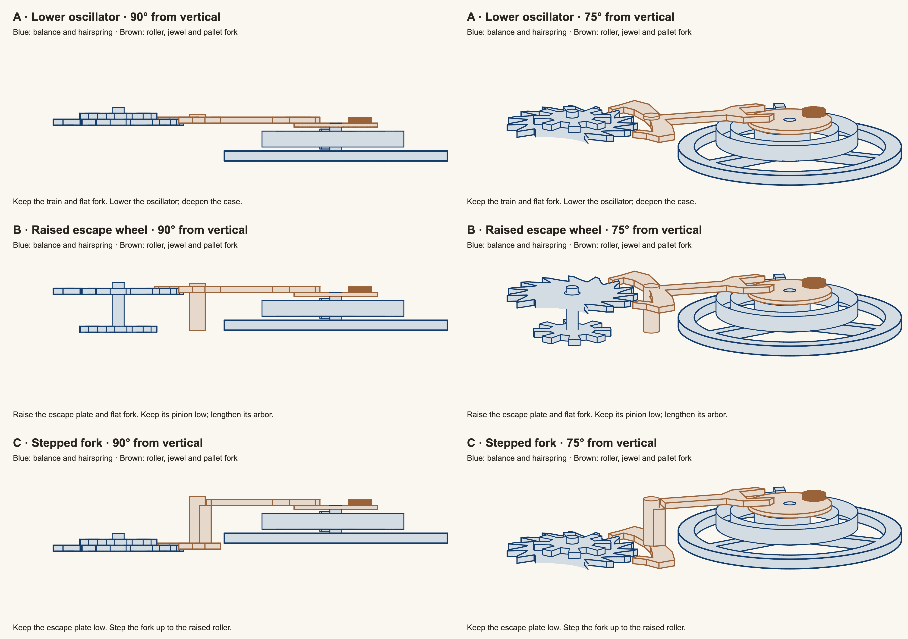

# Escapement above the hairspring

These proposals reverse the escapement and oscillator height order.
The balance wheel remains below the hairspring in every proposal.
The comparison is frozen. The live deck now uses A; see [Adoption](#adoption-2026-10-01).

Read [PLAN.md](PLAN.md) for scope, sources, options, and the method.
The new result is a comparison of three height arrangements, drawn with the actual WebGL renderer.

## Interactive viewer

Added on 2026-10-01 at the user's request.

Open [viewer.html](viewer.html) directly in a browser. It contains its script and needs no server or network requests.
Select any proposal or the current model. Camera settings stay the same when you switch models.

- Scroll or use the zoom slider to zoom. Scrolling keeps the point under the cursor fixed.
- Drag the model, or hold WASD, to pan. Click the canvas first if a form control has keyboard focus.
- Use the tilt slider to rotate around the x axis from $-180^\circ$ to $180^\circ$.
- Use the preset buttons for $0^\circ$, $75^\circ$, or $90^\circ$ from vertical.
- Use Tick and Tock to inspect the two stopped states, or Play to run the mechanism.
- Select Whole watch to include the other parts. Reset view fits the selected view.
- Use Highlight escapement to show the roller, jewel, and fork in brown.
- Press R or select Reset view to clear the pan and restore the default tilt and zoom.

For source development, run this command from `watches/`:

```bash
pnpm exec vite tasks/2026-10-01-raised-escapement/prototype --host 127.0.0.1 --port 3041 --strictPort
```

Then open <http://127.0.0.1:3041/viewer.html>.

To rebuild the standalone file and check it:

```bash
uv run tasks/2026-10-01-raised-escapement/package_viewer.py
uv run tasks/2026-10-01-raised-escapement/check_viewer.py
pnpm exec tsc --project tasks/2026-10-01-raised-escapement/tsconfig.json
```

[viewer-checks.json](evidence/viewer-checks.json) records Chromium and Firefox control checks.
These cover WASD, dragging, wheel zoom, reset, all models and preset angles,
both stopped states, playback, highlighting, the whole watch, and resizing.
Both browsers reported no page errors. The source also passes the strict TypeScript check.

## Images

The left column is $90^\circ$ from vertical. The right column is $75^\circ$.
All panels use the same scale and camera pivot. Brown identifies the roller, jewel, and pallet fork.
The other watch parts are omitted from these panels to expose the connections.



Individual panels:

| Proposal              | Side                                    | Almost side                             | Other stopped state                    | Whole mechanism                              |
| --------------------- | --------------------------------------- | --------------------------------------- | -------------------------------------- | -------------------------------------------- |
| A: lower oscillator   | [90 degrees](evidence/a-lowered-90.png) | [75 degrees](evidence/a-lowered-75.png) | [Tock](evidence/a-lowered-75-tock.png) | [75 degrees](evidence/a-lowered-full-75.png) |
| B: raise escape wheel | [90 degrees](evidence/b-raised-90.png)  | [75 degrees](evidence/b-raised-75.png)  | [Tock](evidence/b-raised-75-tock.png)  | [75 degrees](evidence/b-raised-full-75.png)  |
| C: step fork          | [90 degrees](evidence/c-stepped-90.png) | [75 degrees](evidence/c-stepped-75.png) | [Tock](evidence/c-stepped-75-tock.png) | [75 degrees](evidence/c-stepped-full-75.png) |
| Current model         | [90 degrees](evidence/current-90.png)   | [75 degrees](evidence/current-75.png)   | [Tock](evidence/current-75-tock.png)   | [75 degrees](evidence/current-full-75.png)   |

## Shared oscillator geometry

The current model has a jewel, but no visible roller table that attaches it to the staff.
Each proposal adds that table. Its radius is 21 model units, with a thickness of 2 units.
The jewel centre is 15 units from the staff. Its radius is 6 units, so the table supports its footprint.

From bottom to top, the proposed stack is:

1. Balance wheel: retain the existing 5-unit body and its continuous rim, arms, and hub.
2. Leave a 2-unit gap above the balance.
3. Hairspring and collet: retain the 8-unit ribbon height and existing spring curve.
4. Leave a 2-unit gap above the spring.
5. Roller table: 2 units thick, attached to the balance staff.
6. Jewel: rises 3 units from the table into the upper fork plane.

Extend the staff from the balance hub through the collet to the roller table.
The table, jewel, collet, and balance use the same rotating group.
The spring's inner end still meets the collet. Its outer end still meets the fixed stud.
The spring solver, plan shape, length constraint, and balance-wheel openings are unchanged.

The roller is 1 unit above the stud's top. The fork is 4 units above the spring's top.
These height gaps hold throughout the swing because those parts have fixed height ranges.
The roller can cover inner coils in a view from above. This is actual occlusion, not a transparent render.

## Heights and effects

All values are model units, not millimetres. Positive $z$ is towards the watch face.
Each interval gives the bottom and top of a mesh.

| Part              | Current  | A: lower oscillator | B: raise escape wheel | C: step fork |
| ----------------- | -------- | ------------------- | --------------------- | ------------ |
| Balance wheel     | $[4,9]$  | $[-18,-13]$         | $[4,9]$               | $[4,9]$      |
| Spring and collet | $[9,17]$ | $[-11,-3]$          | $[11,19]$             | $[11,19]$    |
| Roller table      | absent   | $[-1,1]$            | $[21,23]$             | $[21,23]$    |
| Jewel             | $[0,3]$  | $[1,4]$             | $[23,26]$             | $[23,26]$    |
| Fork mouth        | $[1,4]$  | $[1,4]$             | $[23,26]$             | $[23,26]$    |
| Pallet arms       | $[1,4]$  | $[1,4]$             | $[23,26]$             | $[1,4]$      |
| Escape plate      | $[0,3]$  | $[0,3]$             | $[22,25]$             | $[0,3]$      |
| Escape pinion     | $[3,6]$  | $[3,6]$             | $[3,6]$               | $[3,6]$      |
| Chapter ring top  | $22.5$   | $20$                | $32$                  | $30$         |
| Case bottom       | $-13.5$  | $-20$               | $-4$                  | $-6$         |

**A:** lower the balance by 22 units and the spring by 20 units.
The train and flat fork keep their existing heights.
The prototype deepens the case to give 2 units below the balance.
Its case depth is 40 units, compared with the current 36 units.

**B:** raise the escape plate and fork by 22 units.
Keep the escape pinion at its existing meshing height.
A longer escape arbor connects the low pinion to the high plate.
Lengthen the fork arbor as well. Recompute hand and chapter-ring heights above the raised parts.
The chapter ring rises by 9.5 units. The case keeps its 36-unit depth and moves with the ring.

**C:** raise only the fork mouth and lever by 22 units.
Keep the original pallet arms at escape-wheel height.
Split the fork at 6 units along its lever, beside the pivot.
A vertical connection joins the lower arms to the upper lever.
The separate pieces share the fork's rotating group, so they move as one rigid assembly.
The chapter ring rises by 7.5 units.

## Checks and limits

[geometry-checks.json](evidence/geometry-checks.json) records the checked oscillator intervals.
The checks confirm the two gaps, staff and jewel attachment, stud clearance, case clearance, and train meshing heights.

[heights.json](evidence/heights.json) records the rendered meshes and browser errors.
The browser rendered 49 samples across one full period for each proposal and the baseline: 196 sampled frames.
It reported no page errors or WebGL errors.
The images include both stopped escapement states, at times 0 and 1 second.
The original pallet outlines and timing remain unchanged. The fork and escape plate overlap by 2 units in height at their contacts.

These checks establish the illustrated height order and retained meshing geometry.
They are not a complete collision search or a manufacturing design.
The model does not include bearings, bridges, or a roller safety mechanism.
The images do not establish those parts' clearances or a back-row legibility score.
A selected implementation must update subjects, camera pivots, and stills, then run the talk's canonical validator.

## Ranking

1. **B: raised escape wheel.** Best match to the request for upper parts with the balance kept in place.
   Its flat fork reads clearly. The cost is two longer arbors and a higher hand stack.
2. **A: lowered oscillator.** Best if preserving the train is the priority.
   It changes fewer train connections, but moves the balance by 22 units and requires a deeper case.
3. **C: stepped fork.** Best if both the train and balance positions must remain fixed.
   Its tall connection is more complex, and its lower pallet arms remain below the spring.
   Thus it meets the requested upper fork mouth, but not an upper plane for the whole pallet assembly.

## Reproduce

From `watches/`, run:

```bash
pnpm exec node tasks/2026-10-01-raised-escapement/check_proposals.ts
uv run tasks/2026-10-01-raised-escapement/render_proposals.py
```

The prototype holds its own model, design, and renderer copies.
The build uses the installed talk dependencies; `inputs/` preserves their lockfiles.
`render_proposals.py` creates `site/`, the built proposal page. Serve it through a local HTTP server.

## Adoption, 2026-10-01

The user selected A after the interactive comparison.
The live model now lowers the balance and hairspring and adds the upper roller.
Slide 2 fades the roller with the mechanism. It keeps the original zoom and screen target.
The camera pivot follows the spring's new height.
The proposal images and viewer preserve the comparison made before adoption.

The canonical talk validator passed all 21 checks, including the build and offline walk.
The updated cover cleared the back-row gates: hold 4.11, p90 7.86, Fmax 0.132, and motion peak 10.01.
Its motion area above 3:1 is 3744.5 CSS pixel squares.
The source measurements are in `evidence/live-barroom.json` and `evidence/live-motion.json`.

To check the actual cover-to-slide-2 transition in both browsers:

```bash
pnpm build --out tasks/2026-10-01-raised-escapement/live-deck
uv run tasks/2026-10-01-raised-escapement/check_live_slide.py
```

The transition check records screenshots and `evidence/live-slide-checks.json`.
It checks the fade subject, the spring's lowered height, and its target at $(705,276)$.

## Closed, 2026-10-01

The user approved the implemented model and requested shipment.
The implementation, documentation, comparison viewer, and validation evidence are complete.
Generated build directories are ignored. The standalone `viewer.html`, source snapshots, and cited evidence are kept.

2026-10-23: the talk no longer depends on Python's Playwright, which this
task's tools import. The talk's last version was playwright 1.63.0; the version
on the task's date is in that day's `uv.lock`. To run the tools again, add it
to the talk for that session (`uv add playwright==1.63.0`), and install the
browsers they use (`uv run python -m playwright install chromium`).
